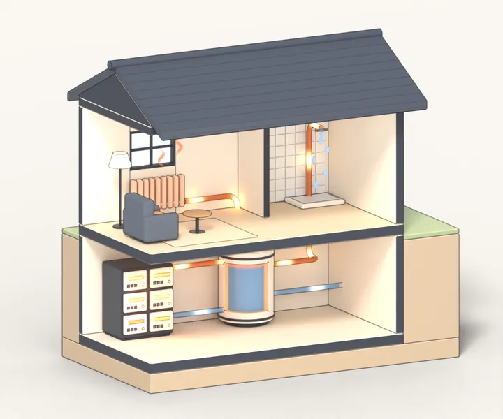
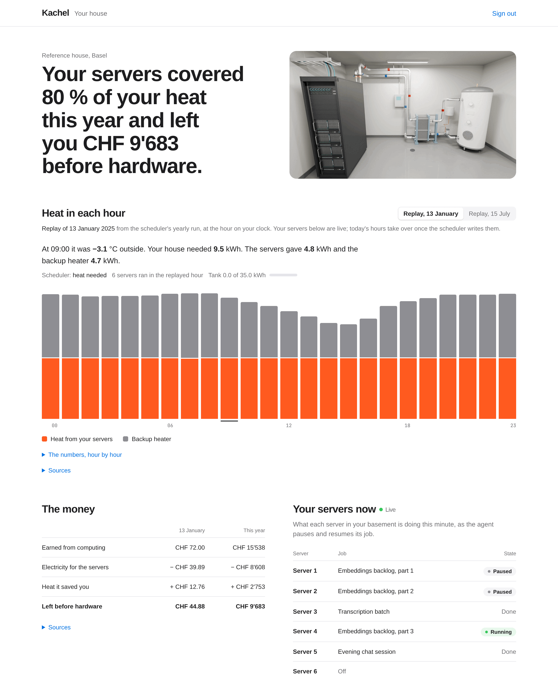

# Kachel

Your AI heats your home.

<p align="center">
  
  
  
  
  
  
  
  
  
  
  
  
</p>

<p align="center"></p>

Small servers in a home's basement run AI jobs, and their heat goes into space heating and hot water.
A job runs only when its heat is useful.
The AI that runs each house runs in it too, not in a cloud: the scheduler, the agent, and a local model (qwen3:4b through Ollama) that answers the household's questions, so their data stays in the house.

<p align="center"></p>

More renders, the videos and the charts are in [docs/media](docs/media/README.md). How the parts fit together is in [docs/architecture.md](docs/architecture.md).
Every value the model assumes, with its unit and source, is in [docs/assumptions.md](docs/assumptions.md).

## Run it

You need Node 22.12 or newer with pnpm 11, [uv](https://docs.astral.sh/uv/) for Python 3.12, Docker, and Linux or macOS.

```sh
git clone https://github.com/CPD9/kachel.git && cd kachel
make bootstrap                    # JavaScript and Python dependencies
pnpm exec supabase start          # the local Supabase stack, in Docker
pnpm exec supabase status -o env  # the keys for the three .env files
make dev                          # all five apps
make check                        # every check CI runs
```

Before `make dev`, copy `.env.example` to `.env` in `apps/host`, `apps/console` and `services/agent`, and fill in the keys from `pnpm exec supabase status -o env`. Only the agent takes the service role key.
`make dev` serves the host app on http://localhost:5173, the console on http://localhost:5174, the 3D heat map on http://localhost:5175, the pitch intro on http://localhost:5176 and the operator view on http://localhost:5177; the map needs internet.
The pitch intro (`apps/pitch`, by Duc) plays a scripted voice prompt, then opens the map at Byfangweg 18 with its card (`?egid=442141&card=1`; `?at=fhnw` targets FHNW Campus Dreispitz, EGID 243058419); with `VITE_MAPBOX_TOKEN` in `apps/pitch/.env` a Mapbox globe flies there first, `a` dives into the house and its questions, and `m` opens the map.
Row level security shows each person only their own rows, so sign in to the host app as the seeded demo host, `host@kachel.test`, and to the console as the demo buyer, `buyer@kachel.test`, both with the password `kachel-demo` (local stack only).

<p align="center"></p>

<p align="center"></p>

<p align="center"></p>

<p align="center"></p>

<p align="center"></p>

<p align="center"><em>The operator console (DigitalHeat), no sign-in needed for the model pages: Today, Billing → Settlement and the device.</em></p>

With the host app and the console running, `pnpm screenshots` retakes their two images with headless Chromium.

To pause and resume a real job from the heat signal, as on stage, follow [the demo checklist](docs/demo-checklist.md). Everything else, the model commands included, is in [Run it yourself](docs/wiki/Run-it-yourself.md). What we hand in for the hackathon is in [docs/submission.md](docs/submission.md). The map, the pitch and the operator view go online as described in [docs/deploy.md](docs/deploy.md).

## Repo map

| Path                 | What it is                                                      |
| -------------------- | --------------------------------------------------------------- |
| `apps/host`          | React app for hosts: their house, their heat, their servers     |
| `apps/console`       | React app for compute buyers: jobs and their state              |
| `apps/map`           | 3D map of Basel and Switzerland: buildings, heat, day and night |
| `apps/operator`      | The operator console: today, buildings, jobs, quotes, billing   |
| `packages/ui`        | Shared components and design tokens                             |
| `packages/db`        | Typed Supabase client and the generated database types          |
| `packages/config`    | Shared ESLint and TypeScript settings                           |
| `services/agent`     | Python agent on the server box: pauses and resumes the real job |
| `services/scheduler` | Python scheduler: hourly decisions, yearly balance, live demo   |
| `supabase`           | Local Supabase config, schema migrations and synthetic seed     |
| `scripts`            | Repository checks                                               |

## Team

- Peter Dike ([@CPD9](https://github.com/CPD9))
- Duc ([@bila9630](https://github.com/bila9630))
- Loyola ([@Loyola-sk](https://github.com/Loyola-sk))
- Nicolas ([@Ni93c42l](https://github.com/Ni93c42l))

## Licence

MIT. Copyright (c) 2026 the Kachel team.
