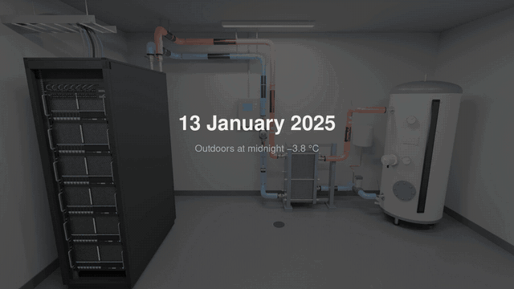

# Kachel

Your AI heats your home.

<p align="center"></p>

Small servers in a home's basement run AI jobs, and their heat goes into space heating and hot water.
A job runs only when its heat is useful.

<p align="center"></p>

More renders, the videos and the charts are in [docs/media](docs/media/README.md).
Every value the model assumes, with its unit and source, is in [docs/assumptions.md](docs/assumptions.md).

## Run it

```sh
make bootstrap
make dev
make check
```

`make dev` starts the local Supabase stack (Docker) and serves the host app on http://localhost:5173 and the console on http://localhost:5174.
Copy each `.env.example` to `.env` and fill in the keys from `pnpm exec supabase status -o env`.
Row level security shows each person only their own rows, so sign in to the host app as the seeded demo host, `host@kachel.test` with the password `kachel-demo` (local stack only).

## Repo map

| Path                 | What it is                                                      |
| -------------------- | --------------------------------------------------------------- |
| `apps/host`          | React app for hosts: their house, their heat, their servers     |
| `apps/console`       | React app for compute buyers: jobs and their state              |
| `packages/ui`        | Shared components and design tokens                             |
| `packages/db`        | Typed Supabase client and the generated database types          |
| `packages/config`    | Shared ESLint and TypeScript settings                           |
| `services/agent`     | Python agent on the server box: pauses and resumes the real job |
| `services/scheduler` | Python scheduler: hourly decisions, yearly balance, live demo   |
| `supabase`           | Local Supabase config, schema migrations and synthetic seed     |
| `scripts`            | Repository checks                                               |

## Team

- Peter Dike ([@CPD9](https://github.com/CPD9))
- Duc ([@bila9630](https://github.com/bila9630))
- Loyola ([@Loyola-sk](https://github.com/Loyola-sk))
- Nikolas ([@Ni93c42l](https://github.com/Ni93c42l))

## Licence

MIT. Copyright (c) 2026 the Kachel team.
