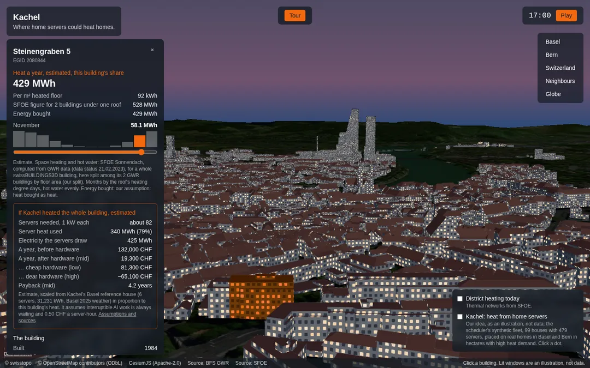
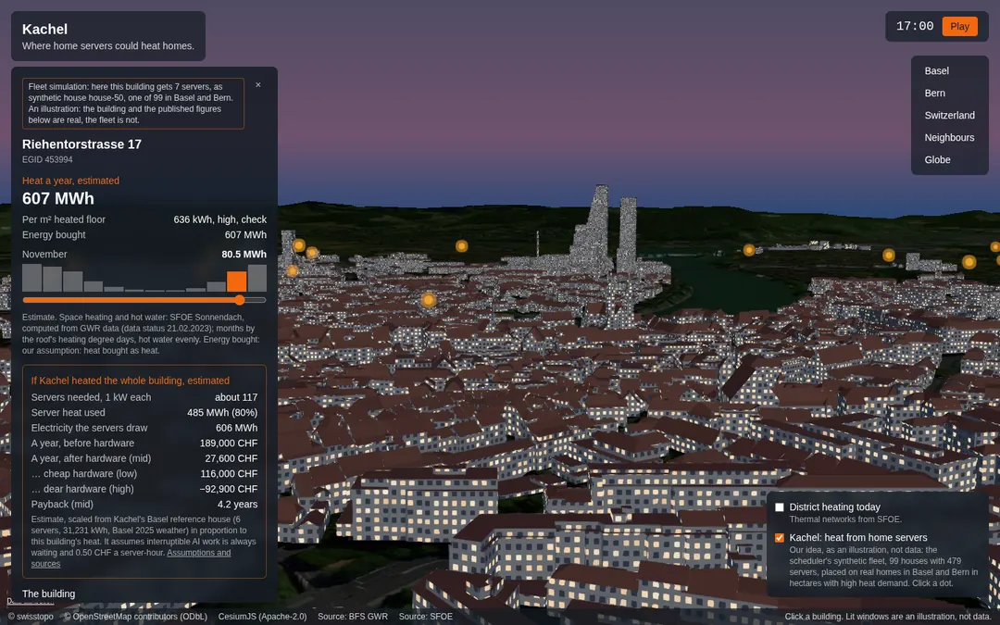
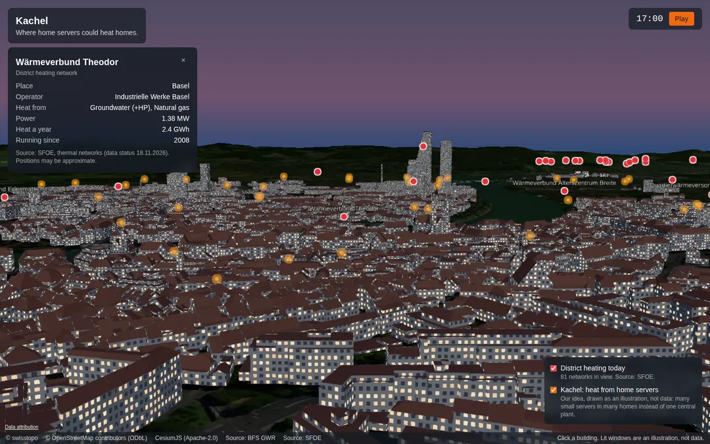
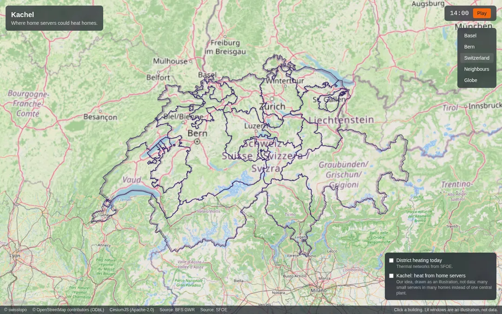
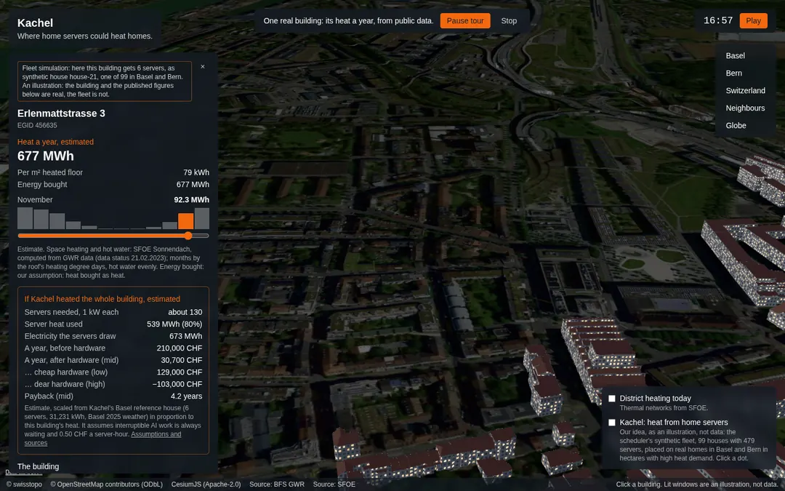

# Kachel heat map

An interactive 3D map: Basel at dusk, the day passing with the real sun, every building
streamed from swisstopo.

<p align="center"></p>
<p align="center"><sub>Buildings, terrain and aerial photos © swisstopo. Lit windows are an illustration.</sub></p>

```sh
pnpm --filter @kachel/map dev     # http://localhost:5175
```

`?at=2026-11-21T16:15:00Z` opens the map paused at that moment (for screenshots and the demo).
Without it, the clock starts 20 minutes before today's sunset in Basel and a day passes in about
five minutes.

Click a building for its estimated heat and energy use, from the federal building register
(GWR) and SFOE's published estimates, month by month, and what Kachel home servers could cover
there, scaled from the scheduler's Basel reference house. Requests go out only on click and are
cached.

<p align="center"></p>

SFOE's Sonnendach gives heat demand per swissBUILDINGS3D 2.0 building, which in dense blocks covers
several GWR buildings (SFOE's data model, field `GWR_EGID`). The card finds the GWR buildings under
the same roof outline (two more requests) and shows the clicked building's share by floor area,
labelled as our split, with SFOE's figure for the group beside it. Checked on nine Basel buildings on
21 Nov 2026: seven land at 53 to 140 kWh/m² (Bleichestrasse 27 went from 1,216 to 90).

Switch on **District heating today** for SFOE's thermal networks in view (click one for its
operator, heat source and size), and **Kachel: heat from home servers** for our idea beside them:
the scheduler's synthetic fleet (`services/scheduler/out/fleet_basel_bern_sites.csv`), each house
placed on a real residential building in a hectare with high heat demand by
`scripts/place-fleet.mjs` (EGID and position only, no addresses). The buildings are real; the
houses and their servers are not, and the layer and card say so.

<p align="center"></p>

<p align="center"></p>

The buttons top right fly from Basel to Bern, to all of Switzerland with its cantons, to the
neighbouring countries and to the globe.

<p align="center"></p>

## Tour for the stage

Press **Tour** (top centre), or open http://localhost:5175/?tour=1 to start it on load. In about
40 seconds it shows Basel at dusk, one real building's card, district heating with Kachel's fleet
beside it, and all of Switzerland, with a caption for each stop. **Pause tour** holds the picture
(the clock stops too); **Stop** ends it. Each stop waits for tiles at most 8 seconds, so a slow
connection shortens the wait instead of stalling the tour. A stop shows its caption only once its
tiles are in (or the cap has passed); `?tourcap=20000` lets each stop wait longer on a slow machine.

<p align="center"></p>

## How it works

- [CesiumJS](https://cesium.com/platform/cesiumjs/) 1.147 (Apache-2.0) draws the globe, the
  terrain and the buildings, and lights them with the sun at the clock's time.
- No Cesium ion and no keys. Every layer is an open service, listed in `src/sources.ts`.
- The buildings carry no windows. `src/scene/windows.ts` draws a storey-and-bay pattern on the
  walls and lights a share of it after sunset. That is an illustration, and the map says so.
- Nothing from swisstopo is copied into this repo: tiles are streamed from swisstopo's own servers
  while the map is open.

## Data sources and terms

| Layer                              | Service                                                                                                     | Terms                                                                                                                                                                    |
| ---------------------------------- | ----------------------------------------------------------------------------------------------------------- | ------------------------------------------------------------------------------------------------------------------------------------------------------------------------ |
| Buildings (swissBUILDINGS3D)       | `https://3d.geo.admin.ch/ch.swisstopo.swissbuildings3d.3d/v1/tileset.json`                                  | [3D Tiles docs](https://docs.geo.admin.ch/visualize-data/3d-tiles.html); free with credit "© swisstopo", fair use                                                        |
| Terrain                            | `https://3d.geo.admin.ch/ch.swisstopo.terrain.3d/v1/` (quantized mesh)                                      | [Terrain docs](https://docs.geo.admin.ch/visualize-data/terrain-service.html); same terms                                                                                |
| Aerial photos (SWISSIMAGE)         | `https://wmts.geo.admin.ch/1.0.0/ch.swisstopo.swissimage/…`                                                 | [FSDI terms of use](https://www.geo.admin.ch/en/general-terms-of-use-fsdi): free, "© swisstopo"; about 20,000 users a day counts as fair use                             |
| Building register (GWR)            | `api3.geo.admin.ch` find on `ch.bfs.gebaeude_wohnungs_register` by EGID                                     | BFS; level A data are public and free to use; "Source: BFS GWR"                                                                                                          |
| Heat demand, solar (Sonnendach)    | `api3.geo.admin.ch` identify on `ch.bfe.solarenergie-eignung-daecher`                                       | SFOE, data status 21.02.2023; "Source: SFOE"                                                                                                                             |
| Heat demand per hectare            | `api3.geo.admin.ch` identify on `ch.bfe.fernwaerme-nachfrage_wohn_dienstleistungsgebaeude`                  | SFOE, 2014 building and 2013 company statistics; "Source: SFOE"                                                                                                          |
| Thermal networks                   | `api3.geo.admin.ch` identify on `ch.bfe.thermische-netze` for the area in view                              | SFOE, data status 18.11.2026; "Source: SFOE"                                                                                                                             |
| Canton borders (swissBOUNDARIES3D) | `api3.geo.admin.ch` identify on `ch.swisstopo.swissboundaries3d-kanton-flaeche.fill`, once, when zoomed out | swisstopo, data status 01.01.2026; "© swisstopo"                                                                                                                         |
| Solar already mapped               | Overpass API (`overpass-api.de`), one query within 40 m of the clicked building, at most 6 s                | © OpenStreetMap contributors, [ODbL](https://www.openstreetmap.org/copyright); [Overpass usage policy](https://dev.overpass-api.de/overpass-doc/en/preface/commons.html) |
| Map outside Switzerland            | `https://tile.openstreetmap.org/`                                                                           | [OSM tile usage policy](https://operations.osmfoundation.org/policies/tiles/); "© OpenStreetMap contributors", data [ODbL](https://www.openstreetmap.org/copyright)      |

The credits sit in the footer at all times. For a public deployment with real traffic, swap
`tile.openstreetmap.org` for a tile provider that allows it; the policy does not cover heavy use.
