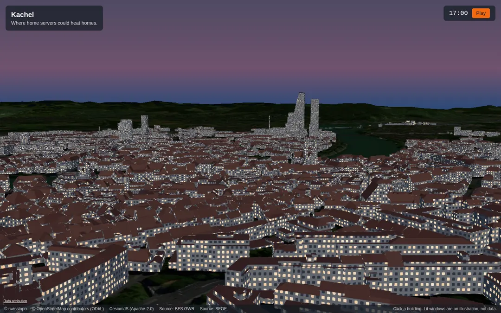

# Kachel heat map

An interactive 3D map: Basel at dusk, the day passing with the real sun, every building
streamed from swisstopo.

<p align="center"></p>
<p align="center"><sub>Buildings, terrain and aerial photos © swisstopo. Lit windows are an illustration.</sub></p>

```sh
pnpm --filter @kachel/map dev     # http://localhost:5175
```

`?at=2026-11-21T16:15:00Z` opens the map paused at that moment (for screenshots and the demo).
Without it, the clock starts 20 minutes before today's sunset in Basel and a day passes in about
five minutes.

## How it works

- [CesiumJS](https://cesium.com/platform/cesiumjs/) 1.147 (Apache-2.0) draws the globe, the
  terrain and the buildings, and lights them with the sun at the clock's time.
- No Cesium ion and no keys. Every layer is an open service, listed in `src/sources.ts`.
- The buildings carry no windows. `src/scene/windows.ts` draws a storey-and-bay pattern on the
  walls and lights a share of it after sunset. That is an illustration, and the map says so.
- Nothing from swisstopo is copied into this repo: tiles are streamed from swisstopo's own servers
  while the map is open.

## Data sources and terms

| Layer                        | Service                                                                    | Terms                                                                                                                                                               |
| ---------------------------- | -------------------------------------------------------------------------- | ------------------------------------------------------------------------------------------------------------------------------------------------------------------- |
| Buildings (swissBUILDINGS3D) | `https://3d.geo.admin.ch/ch.swisstopo.swissbuildings3d.3d/v1/tileset.json` | [3D Tiles docs](https://docs.geo.admin.ch/visualize-data/3d-tiles.html); free with credit "© swisstopo", fair use                                                   |
| Terrain                      | `https://3d.geo.admin.ch/ch.swisstopo.terrain.3d/v1/` (quantized mesh)     | [Terrain docs](https://docs.geo.admin.ch/visualize-data/terrain-service.html); same terms                                                                           |
| Aerial photos (SWISSIMAGE)   | `https://wmts.geo.admin.ch/1.0.0/ch.swisstopo.swissimage/…`                | [FSDI terms of use](https://www.geo.admin.ch/en/general-terms-of-use-fsdi): free, "© swisstopo"; about 20,000 users a day counts as fair use                        |
| Map outside Switzerland      | `https://tile.openstreetmap.org/`                                          | [OSM tile usage policy](https://operations.osmfoundation.org/policies/tiles/); "© OpenStreetMap contributors", data [ODbL](https://www.openstreetmap.org/copyright) |

The credits sit in the footer at all times. For a public deployment with real traffic, swap
`tile.openstreetmap.org` for a tile provider that allows it; the policy does not cover heavy use.
