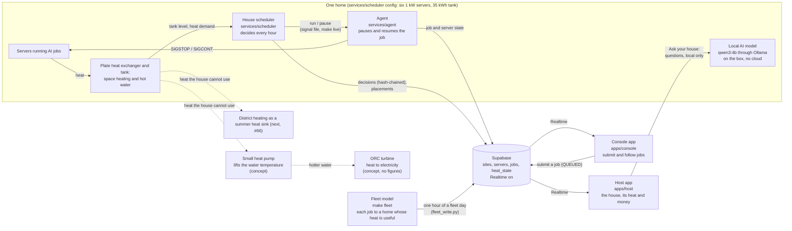

# How it works

Each home has servers and a hot-water tank in the basement. A server runs AI jobs only when
the house can use the heat. Boxes marked "next" are not built yet; boxes marked "concept" are
ideas with no figures.

The AI that runs the house runs in the house. The scheduler decides on the box, the agent
pauses and resumes jobs on the box, and the host app's chat asks a local model (qwen3:4b
through Ollama) on the same computer. The chat refuses any model that is not on the machine
(`isLocalUrl` in `apps/host/src/chat/model.ts`), so a household's questions and data stay in
the house, not in a cloud.

What each box is in the repo:

| Box                          | Where                                                               | State                                                                                                                                                                                      |
| ---------------------------- | ------------------------------------------------------------------- | ------------------------------------------------------------------------------------------------------------------------------------------------------------------------------------------ |
| House scheduler              | `services/scheduler/heatsched/scheduler.py`                         | Built. Moves a deadline job off site when it has no heat sink                                                                                                                              |
| Fleet model                  | `services/scheduler/heatsched/fleet.py`                             | Built as a model on synthetic houses (#86, #95); `fleet_write.py` fills Supabase (#100)                                                                                                    |
| Solar and battery            | `services/scheduler/heatsched/solar.py`                             | Built. Roof PV and a battery in the yearly balance (#91)                                                                                                                                   |
| Agent                        | `services/agent`                                                    | Built. Follows a run/pause signal file and writes to Supabase                                                                                                                              |
| Supabase and Realtime        | `supabase/migrations`, `packages/db/src/live.ts`                    | Built. Realtime on `servers`, `jobs` and `heat_state`; row level security on all                                                                                                           |
| Host app                     | `apps/host`                                                         | Built. Shows the house, each server and its job live                                                                                                                                       |
| Console app                  | `apps/console`                                                      | Built. Submits jobs (#85) and lists them with their state                                                                                                                                  |
| Scheduler writes the signal  | `services/scheduler/live.py`, `services/agent`                      | Built (#191). `make live` runs `decide()` each tick and writes the agent's signal                                                                                                          |
| Live routing                 | `services/scheduler/heatsched/live.py`                              | Built (#191). A queued console job gets a server through the fleet's `place_hour`                                                                                                          |
| Decision log                 | `heatsched/ledger.py`, `decisions` table                            | Built (#191). SHA-256 chained, append-only; `make verify-live` replays it                                                                                                                  |
| District heating             | issue #66                                                           | Next. A summer heat sink for heat the houses cannot use                                                                                                                                    |
| Local AI model               | `apps/host/src/chat`, Ollama                                        | Built. qwen3:4b on the same computer answers "Ask your house" (#26); the app talks to no other model                                                                                       |
| ORC turbine with a heat pump | [`apps/operator` The device](../apps/operator/src/pages/Device.tsx) | Concept, no figures (#159). Server water is too cool to drive an ORC turbine well, so a small heat pump would first lift its temperature; the turbine then turns the heat into electricity |
