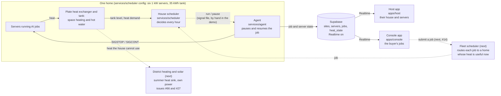

# How it works

Each home has servers and a hot-water tank in the basement. A server runs AI jobs only when
the house can use the heat. Boxes marked "next" are not built yet.

What each box is in the repo:

| Box                         | Where                                            | State                                                         |
| --------------------------- | ------------------------------------------------ | ------------------------------------------------------------- |
| House scheduler             | `services/scheduler/heatsched/scheduler.py`      | Built. Moves a deadline job off site when it has no heat sink |
| Agent                       | `services/agent`                                 | Built. Follows a run/pause signal file and writes to Supabase |
| Supabase and Realtime       | `supabase/migrations`, `packages/db/src/live.ts` | Built. Realtime on `servers`, `jobs` and `heat_state`         |
| Host app                    | `apps/host`                                      | Built. Shows each server and its job live                     |
| Console app                 | `apps/console`                                   | Built. Lists jobs and their state; submit form is next (#14)  |
| Fleet scheduler             | none yet                                         | Next. Today each home decides alone                           |
| District heating and solar  | issues #66 and #27                               | Next. The outlook for summer heat and cheaper power           |
| Scheduler writes the signal | `services/scheduler`, `services/agent`           | Next. On stage the signal file is written by hand             |
