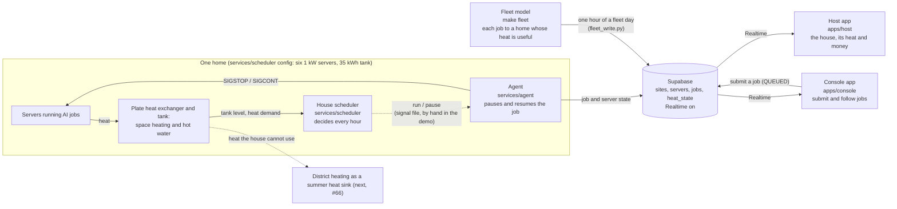

# How it works

Each home has servers and a hot-water tank in the basement. A server runs AI jobs only when
the house can use the heat. Boxes marked "next" are not built yet.

What each box is in the repo:

| Box                         | Where                                            | State                                                                                   |
| --------------------------- | ------------------------------------------------ | --------------------------------------------------------------------------------------- |
| House scheduler             | `services/scheduler/heatsched/scheduler.py`      | Built. Moves a deadline job off site when it has no heat sink                           |
| Fleet model                 | `services/scheduler/heatsched/fleet.py`          | Built as a model on synthetic houses (#86, #95); `fleet_write.py` fills Supabase (#100) |
| Solar and battery           | `services/scheduler/heatsched/solar.py`          | Built. Roof PV and a battery in the yearly balance (#91)                                |
| Agent                       | `services/agent`                                 | Built. Follows a run/pause signal file and writes to Supabase                           |
| Supabase and Realtime       | `supabase/migrations`, `packages/db/src/live.ts` | Built. Realtime on `servers`, `jobs` and `heat_state`; row level security on all        |
| Host app                    | `apps/host`                                      | Built. Shows the house, each server and its job live                                    |
| Console app                 | `apps/console`                                   | Built. Submits jobs (#85) and lists them with their state                               |
| Scheduler writes the signal | `services/scheduler`, `services/agent`           | Next. On stage the signal file is written by hand                                       |
| Live routing                | none yet                                         | Next. A submitted job waits as QUEUED; nothing places it live yet                       |
| District heating            | issue #66                                        | Next. A summer heat sink for heat the houses cannot use                                 |
