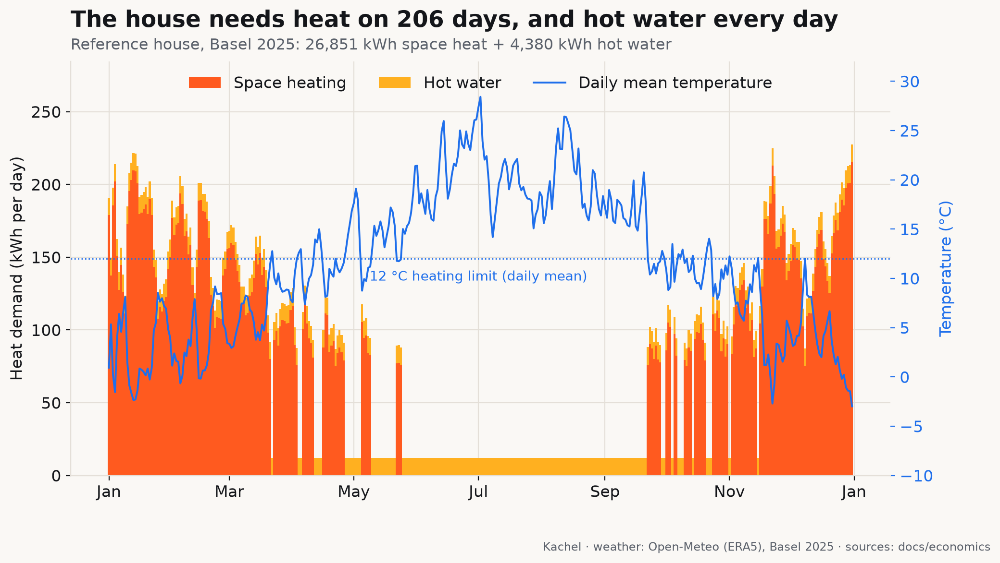
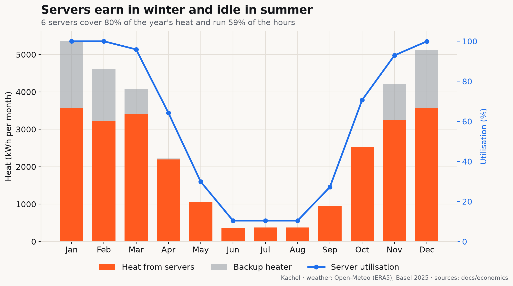
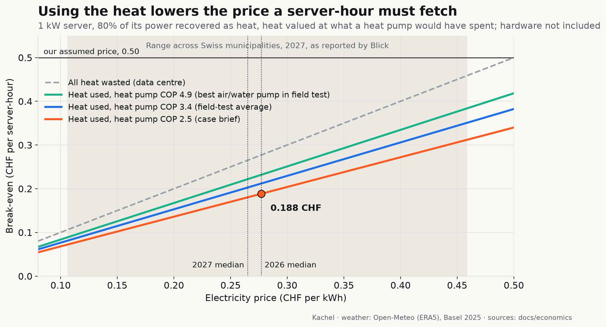
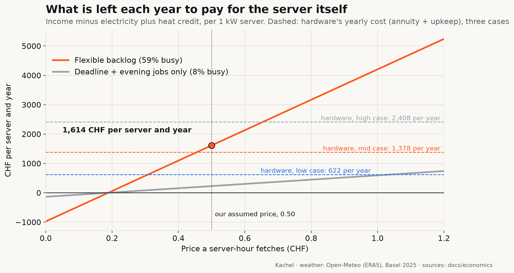
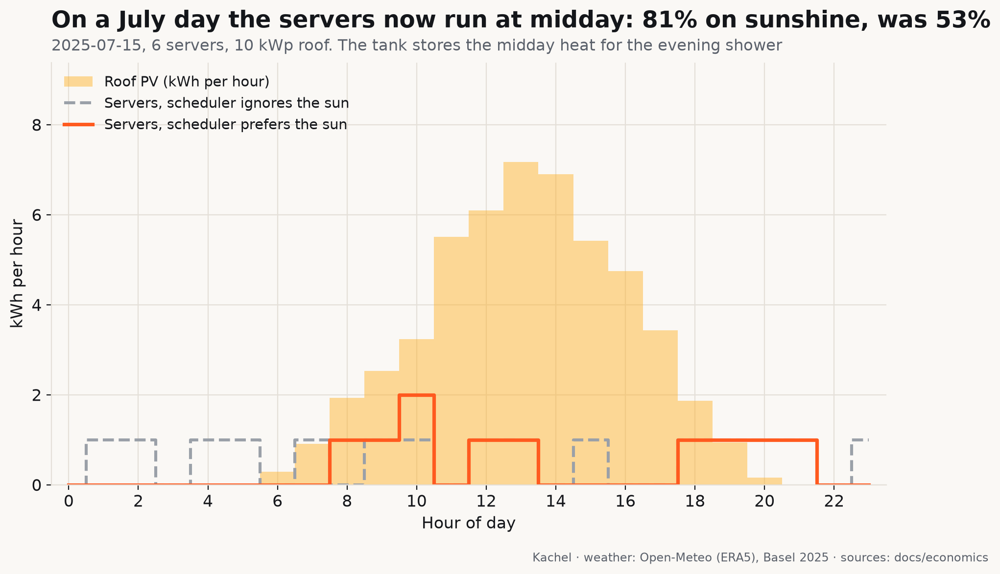
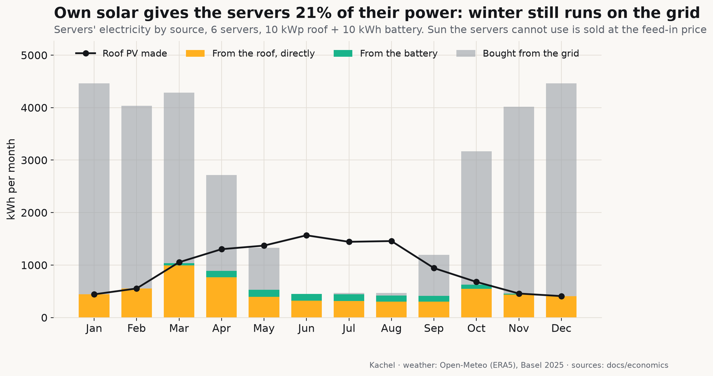
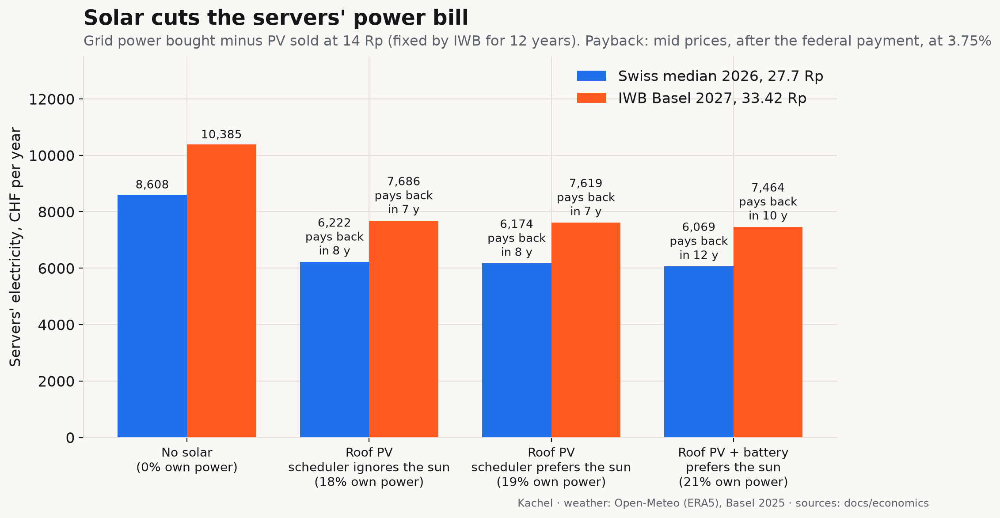
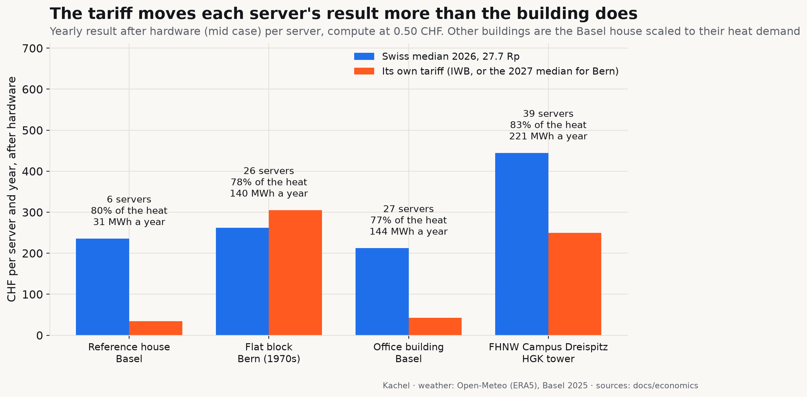

# The numbers behind Kachel

One reference house in Basel with six 1 kW servers in the basement. The servers run AI jobs
only when the house can use their heat. This page shows what that means for heat, money and
risk. It lists where every input comes from and which questions are still open.

The charts use real Basel weather for 2025, as does `services/scheduler/out/kpis.json`.

Rebuild everything on this page with:

```
cd services/scheduler
python economics.py
```

The tables behind each chart are in [`data/`](data/), ready for a spreadsheet.

## Key figures, one house, one year

| Figure                                     | Value      | Comes from |
| ------------------------------------------ | ---------- | ---------- |
| Heat demand (space heat + hot water)       | 31,231 kWh | [1], [2]   |
| Share covered by server heat               | 79.6%      | model      |
| Server utilisation                         | 59.1%      | model      |
| Server-hours sold                          | 31,075     | model      |
| Electricity bought for the servers         | 8,608 CHF  | [3]        |
| Heat credit (what a heat pump would spend) | 2,753 CHF  | [1], [4]   |
| Computing income at 0.50 CHF/server-hour   | 15,538 CHF | assumption |
| Left before hardware                       | 9,683 CHF  | model      |
| Break-even price per server-hour           | 0.188 CHF  | model      |
| Hardware per year, mid case                | 8,268 CHF  | [9]–[18]   |
| Left after hardware, mid case              | 1,415 CHF  | model      |
| Payback, mid case                          | 4.2 years  | model      |
| Break-even price including hardware, mid   | 0.454 CHF  | model      |
| Server power from own roof PV (10 kWp)     | 18.6%      | [25]–[28]  |
| Electricity for the servers with roof PV   | 6,174 CHF  | [3], [31]  |
| Payback of the roof PV, mid                | 8.2 years  | [29], [30] |

The hardware figures are for the mid case. The low and high cases are in chart 7 and in
[`data/hardware.csv`](data/hardware.csv).

## Charts

### 1. When the house needs heat



Space heating follows the brief's formula: on days with a mean below 12 °C, each hour needs
10 × (20 − outdoor °C) ÷ 25.6 kWh. This is the 20/12 heating-degree rule used in Swiss
practice [2]. Hot water is a flat 12 kWh a day [1].

### 2. Month by month



Servers run almost all of December to February and about 10% of the summer hours. The
business is seasonal unless summer work can find another heat sink.

### 3. How many servers per house


Each extra server covers less new heat and runs fewer hours. The model stops at the sixth,
the last one that still runs at least 40% of the year. That 40% cut-off is our rule, not a
market figure.

### 4. Break-even price



A server-hour costs 1 kWh of electricity. If 80% of it replaces heat a heat pump would have
made, the house saves 0.8 ÷ COP kWh. Break-even is then price × (1 − 0.8 ÷ COP). With the
2026 median price [3] and the brief's COP of 2.5 that is 0.188 CHF. A better heat pump makes
server heat worth less, so break-even rises. Field-test COPs are 3.4 on average and 4.9 at
best [4].

### 5. Room for hardware



This is the yearly amount each server has left to pay for itself, its upkeep and the
installation. The dashed lines are what the hardware costs each year in the three cases
below: the price spread over its life at the discount rate (an annuity), plus upkeep. At
0.50 CHF a server-hour the low and mid cases are covered; the high case is not.

### 6. What moves the result


Each input is moved alone, with everything else as in `config.json` and the mid hardware
case. Two things dominate: the price a server-hour fetches, and whether there is always
flexible work waiting. Without that backlog, utilisation falls from 59% to 8%. Next come the
electricity price, the server price and how long a server lasts.

Heat recovery barely matters here, and more of it lowers the result a little. The scheduler
only runs when the heat is needed, so more heat per hour means fewer hours sold. That holds
only while computing pays better than heating.

### 7. Paying back the hardware


Three hardware cases, each for six servers in one house. Prices are without VAT; dollar and
pound prices use the ECB rates of 20 Nov 2026 (1 USD = 0.839 CHF, 1 GBP = 1.10 CHF).

| Input, per server unless per house  | Low                  | Mid                 | High           | Comes from            |
| ----------------------------------- | -------------------- | ------------------- | -------------- | --------------------- |
| Server, about 1 kW                  | 2,518 CHF            | 5,034 CHF           | 6,714 CHF      | [9], [10]             |
| What it is                          | refurbished GPU host | new GPU workstation | dear GPU host  | [9], [10]             |
| Water loop to the tank              | 496 CHF              | 633 CHF             | 771 CHF        | [11], our guess       |
| Fitter, hours per house × rate      | 6 h × 103 CHF        | 10 h × 120 CHF      | 16 h × 148 CHF | our guess, [12]       |
| Electrician, hours per house × rate | 2 h × 151 CHF        | 3 h × 151 CHF       | 4 h × 151 CHF  | our guess, [13]       |
| Upkeep per house and year           | 190 CHF              | 315 CHF             | 630 CHF        | our guess, [12]       |
| Lifetime                            | 6 years              | 5 years             | 4 years        | [14], [15]            |
| Discount rate                       | 3.28%                | 3.75%               | 6%             | [16], [17], our guess |

| Result, per house                         | Low        | Mid        | High        |
| ----------------------------------------- | ---------- | ---------- | ----------- |
| Paid up front                             | 19,004 CHF | 35,655 CHF | 47,882 CHF  |
| Hardware per year (annuity + upkeep)      | 3,731 CHF  | 8,268 CHF  | 14,448 CHF  |
| Left per year after hardware              | 5,952 CHF  | 1,415 CHF  | −4,765 CHF  |
| Payback, discounted                       | 2.1 years  | 4.2 years  | 6.6 years   |
| Net present value over the lifetime       | 31,948 CHF | 6,344 CHF  | −16,512 CHF |
| Break-even per server-hour, with hardware | 0.308 CHF  | 0.454 CHF  | 0.653 CHF   |

With hardware, break-even rises from 0.188 CHF to between 0.31 and 0.65 CHF a server-hour.
At our assumed 0.50 CHF the mid case only just pays, and the high case needs 6.6 years on a
4-year life. Whether a 1 kW unit really costs this little, and whether it lasts, is now as
important as the compute price.

### 8. Solar: the scheduler waits for the sun



The house gets a 10 kWp roof facing south at 30° (our guess), and the scheduler learns one
more rule.
When the tank can carry the house until the sun is up, the backlog waits and fills the tank
at midday instead of at night. It never waits if that would leave the house short this hour, or
if a cold hour is coming that needs a full tank. On 15 July the share of server power that
comes straight from the roof rises from 53% to 81%.

PV per hour comes from the 2025 radiation already in the weather file: sun position [26],
direct and diffuse split [27], tilted roof [28], and a performance ratio of 0.79, which is
PVGIS's total loss for Basel [25]. That gives 1,167 kWh per kWp in 2025; PVGIS gives 1,160
for 2005 to 2023.

### 9. Solar: month by month



The servers draw most of their power from November to March, when the roof makes least. Own
PV and a 10 kWh battery cover 21% of their power over the year. In summer the roof makes
more than three times what the servers can use; the rest is sold to IWB at 14 Rp per kWh [31].

### 10. Solar: the bill and the payback



The bill is grid power bought minus PV sold. Payback is for the PV and battery alone, against
the same house without them, discounted at 3.75% [17]. IWB's 2027 tariff of 33.42 Rp [3] is
the sensitivity case: dearer power makes own PV worth more.

| Inputs, per house                  | Low       | Mid       | High       | Comes from      |
| ---------------------------------- | --------- | --------- | ---------- | --------------- |
| Roof PV, CHF per kWp without VAT   | 1,659     | 1,911     | 2,237      | [29]            |
| Federal one-off payment, per kWp   | 360 CHF   | 360 CHF   | 360 CHF    | [30]            |
| 10 kWh battery                     | 6,000 CHF | 6,442 CHF | 10,000 CHF | [29], [32]      |
| PV upkeep, share of price per year | 1%        | 1%        | 1.5%       | our guess       |
| PV life                            | 33 years  | 30 years  | 25 years   | [32], our guess |
| Battery life                       | 15 years  | 12 years  | 10 years   | our guess       |

| Result, one year, mid prices          | No solar   | PV, sun rule off | PV, sun rule on  | PV + battery      |
| ------------------------------------- | ---------- | ---------------- | ---------------- | ----------------- |
| Server power from own PV              | 0%         | 17.7%            | 18.6%            | 21.4%             |
| Servers' electricity at 27.7 Rp       | 8,608 CHF  | 6,222 CHF        | 6,174 CHF        | 6,069 CHF         |
| Servers' electricity at 33.42 Rp      | 10,385 CHF | 7,686 CHF        | 7,619 CHF        | 7,464 CHF         |
| Paid up front, after federal payment  | –          | 15,510 CHF       | 15,510 CHF       | 21,952 CHF        |
| Payback at 27.7 Rp (low, mid, high)   | –          | 6.7, 8.4, 11.4 y | 6.6, 8.2, 11.1 y | 9.7, 11.7, 18.3 y |
| Payback at 33.42 Rp (low, mid, high)  | –          | 5.8, 7.2, 9.6 y  | 5.6, 7.0, 9.3 y  | 8.1, 9.7, 14.7 y  |
| Left per year after servers and solar | 1,415 CHF  | 2,740 CHF        | 2,772 CHF        | 2,200 CHF         |

Roof PV pays back in about 8 years at mid prices, and 7 at IWB's tariff, well inside its life.
It adds about 1,350 CHF a year to the house's result after paying for servers and PV. The sun
rule adds a little: about 50 CHF a year, because in summer the servers only need about 15 kWh
a day for hot water. The battery does not pay: it adds 870 kWh of own power a year, and its
mid payback (11.7 years) is as long as its life. Six 1 kW servers use about 31,000 kWh a
year, nearly three times what this roof makes, so solar trims the bill but does not remove
it. All figures are in [`data/solar.csv`](data/solar.csv).

### 11. More buildings and tariffs



Three more buildings, each the Basel house scaled to its own heat demand. Space heat is area
× specific demand × a climate factor, hot water is area × a standard value, and the tank grows
with demand. The number of servers follows the same 40% rule. Hardware is the mid case per
server. Inputs and sources are in
[`services/scheduler/buildings.json`](../../services/scheduler/buildings.json).

| Building                         | Area                | Space heat               | Hot water        | Heat a year | Servers | Heat covered |
| -------------------------------- | ------------------- | ------------------------ | ---------------- | ----------- | ------- | ------------ |
| Reference house, Basel           | –                   | brief's formula [1]      | 12 kWh a day [1] | 31 MWh      | 6       | 79.6%        |
| Flat block, Bern (1970s)         | 1,000 m², our guess | 100 kWh/m² × 1.19 [34]   | 21 kWh/m² [35]   | 140 MWh     | 26      | 78.2%        |
| Office building, Basel           | 2,000 m², our guess | 65 kWh/m², guess on [36] | 7 kWh/m² [35]    | 144 MWh     | 27      | 76.6%        |
| FHNW Campus Dreispitz, HGK tower | 10,176 m² [33]      | 14.7 kWh/m² [33]         | 7 kWh/m² [35]    | 221 MWh     | 39      | 82.6%        |

| Result per year, after hardware  | Swiss median 2026 (27.7 Rp) | Its own tariff                   | Break-even incl. hardware, own tariff |
| -------------------------------- | --------------------------- | -------------------------------- | ------------------------------------- |
| Reference house, Basel           | 1,415 CHF                   | 207 CHF (IWB H4 2027, 33.42 Rp)  | 0.49 CHF                              |
| Flat block, Bern                 | 6,822 CHF                   | 7,938 CHF (median 2027, 26.5 Rp) | 0.44 CHF                              |
| Office building, Basel           | 5,737 CHF                   | 1,149 CHF (IWB C3 2027, 32.6 Rp) | 0.49 CHF                              |
| FHNW Campus Dreispitz, HGK tower | 17,346 CHF                  | 9,750 CHF (IWB C3 2027, 32.6 Rp) | 0.46 CHF                              |

Servers grow with heat demand, about one per 5.2 MWh a year. Per server the result barely
depends on the building, but it does on the tariff: at IWB's 2027 prices [37] the Basel house
keeps 207 CHF a year after hardware instead of 1,415. The campus does best per server because
its hot water keeps servers busy in summer. The often quoted 20,000 m² for the FHNW campus is
the tower and the Zollfreilager together (about 28,800 m² gross [33]); we use the tower alone,
the one with a published heating figure. All results, at five tariffs, are in
[`data/buildings.csv`](data/buildings.csv) and in the `@kachel/economics` package for the apps.

## Sources

1. DigitalHeat case brief, reference house: 35 kWh tank, 12 kWh hot water a day, 1 kW server,
   80% heat recovery, COP 2.5, heating formula. In `services/scheduler/config.json`.
2. Heating degree days 20/12 (20 °C inside, 12 °C heating limit), the Swiss standard SIA
   381/3. Summary: <https://www.energiesparhaus.at/fachbegriffe/hgt.htm>. Basel-Stadt uses
   SIA 381/3 with station Basel-Binningen:
   <https://www.gesetzessammlung.bs.ch/frontend/annex_document_dictionaries/190>.
3. ElCom, "Leicht sinkende Strompreise 2026", 9 Sep 2025: H4 median 27.7 Rp/kWh
   <https://www.admin.ch/de/newnsb/8nuE_fvwnfqCu8OHNOwKu>. ElCom, "Leicht sinkende
   Strompreise 2027", 8 Sep 2026: H4 median 26.5 Rp/kWh
   <https://www.admin.ch/de/newnsb/1miE201yRzoA>. The range across municipalities
   (10.6 to 45.9 Rp) is as reported by Blick:
   <https://www.blick.ch/politik/medienkonferenz-um-11-uhr-das-zahlst-du-2027-fuer-den-strom-id22242708.html>.
   Tariffs per municipality, including Basel (IWB): <https://www.strompreis.elcom.admin.ch>.
   For Basel, ElCom lists IWB's 2027 H4 total tariff at 33.42 Rp/kWh, checked 21 Nov 2026:
   <https://www.strompreis.elcom.admin.ch/municipality/2701?period=2027&priceComponent=total&category=H4&product=standard>.
4. Fraunhofer ISE, "WP-QS im Bestand", press release 3 Nov 2025: 61 air/water heat pumps in
   existing houses, seasonal COP 3.4 on average, 2.6 to 4.9
   <https://www.ise.fraunhofer.de/de/presse-und-medien/presseinformationen/2025/waermepumpen-heizen-auch-im-altbau-klimafreundlich-forschungsprojekt-des-fraunhofer-ise-abgeschlossen.html>.
5. Weather: Zippenfenig, P. (2023). Open-Meteo.com Weather API. Zenodo.
   <https://doi.org/10.5281/ZENODO.7970649>. Based on Hersbach, H. et al. (2023). ERA5 hourly
   data on single levels from 1940 to present. ECMWF. <https://doi.org/10.24381/cds.adbb2d47>.
   Data licence CC BY 4.0.
6. Heat recovery up to 95% is Qarnot's own claim for its water-cooled boilers, not a measured
   average:
   <https://techcrunch.com/2023/01/09/qarnot-creates-green-data-centers-by-putting-servers-in-central-heating-boilers/>.
7. Context: data centres used about 415 TWh in 2024, about 1.5% of world electricity, and the
   IEA expects about 945 TWh by 2030. IEA, Energy and AI (2025):
   <https://www.iea.org/reports/energy-and-ai/executive-summary>.
8. Context: Basel-Stadt voted on 27 Nov 2022 for net zero by 2037:
   <https://www.srf.ch/news/abstimmungen-27-november/abstimmungen-basel-stadt-bis-2037-klimaneutral-basel-macht-vorwaerts-beim-klimaschutz>.
9. PCSP, "How much does a server cost in 2026?", 21 Aug 2026: a refurbished single-GPU
   inference host costs about USD 3,000 to 8,000 (low and high case):
   <https://pcserverandparts.com/news/how-much-does-a-server-cost-2026/>.
10. VRLA Tech, "How much does a custom AI workstation cost in 2026?", 30 Jun 2026: a
    single-GPU workstation with an RTX PRO 6000 Blackwell (up to 600 W) from USD 5,999 (mid
    case): <https://vrlatech.com/how-much-does-a-custom-ai-workstation-cost/>.
11. Watercooling UK, "How much does it cost to water cool a PC?", 29 Jul 2026: a CPU and GPU
    loop costs GBP 450 to 700; the mid case is the midpoint:
    <https://www.watercoolinguk.co.uk/how-much-does-it-cost-to-water-cool-a-pc/>.
12. WBAG, Regietarif Sanitär/Heizung 2025, without VAT: B-Monteur 103, A-Monteur 120,
    Chefmonteur 148, service fitter with van 125 CHF an hour, call-out 65 CHF:
    <https://www.wbag.ch/app/uploads/2024/12/Regietarife_Pauschalangebote-2025.pdf>.
13. EIT.nordwest (Basel), recommended hourly rates 2026, without VAT: Elektroinstallateur EFZ
    151 CHF:
    <https://www.eitnordwest.swiss/fileadmin/sections/eitbasel/documents/Loehne/Stundenansaetze_Personalkategorien_2026_als_Empfehlung_Rev.1.pdf>.
14. SiliconANGLE, "Resetting GPU depreciation", 22 Nov 2025: Amazon moved servers from three to
    four years in 2020, and the three largest clouds used six years by 2023:
    <https://siliconangle.com/2025/11/22/resetting-gpu-depreciation-ai-factories-bend-dont-break-useful-life-assumptions/>.
15. Amazon, Form 10-K for 2025: part of its servers moved from six to five years from 1 Jan
    2025: <https://www.sec.gov/Archives/edgar/data/1018724/000101872426000004/amzn-20251231.htm>.
16. UVEK, "UVEK legt WACC für Stromnetze für das Tarifjahr 2027 fest", 2 Mar 2026: 3.28%
    <https://www.admin.ch/de/newnsb/ZNjc_Y1WGHBjMrFROHcoK>.
17. pv magazine, 2 Mar 2026: WACC for PV investment contributions in 2026 is 3.75%
    <https://www.pv-magazine.de/2026/03/02/schweiz-legt-neue-kapitalkostensaetze-fuer-erneuerbare-und-stromnetze-fest/>.
18. ECB euro reference rates, 20 Nov 2026, used for USD and GBP to CHF:
    <https://www.ecb.europa.eu/stats/policy_and_exchange_rates/euro_reference_exchange_rates/html/index.en.html>.
19. Srivastav et al., "Open ASR Leaderboard", arXiv:2510.06961, Table 3: Whisper large-v3 at
    RTFx 145.51 on one A100-SXM4-80GB, batch 64 <https://arxiv.org/abs/2510.06961>.
20. NVIDIA A100 datasheet, June 2021: 400 W maximum TDP for the A100 80GB SXM
    <https://www.nvidia.com/content/dam/en-zz/Solutions/Data-Center/a100/pdf/nvidia-a100-datasheet-us-nvidia-1758950-r4-web.pdf>.
21. Red Hat, "Red Hat AI tops MLPerf Inference v6.0", 1 Apr 2026: Whisper large-v3 speech to
    text on LibriSpeech (1,633 samples, about 30 h), offline scenario
    <https://www.redhat.com/en/blog/red-hat-ai-tops-mlperf-inference-v60-vllm-qwen3-vl-whisper-and-gpt-oss-120b>.
22. OpenAI, Batch API guide, read 21 Nov 2026: a 24 h completion window only, at half the
    synchronous price <https://developers.openai.com/api/docs/guides/batch>.
23. Alibaba, cluster-trace-gpu-v2020: over 6,500 GPUs, July and August 2020, training and
    inference jobs <https://github.com/alibaba/clusterdata/tree/master/cluster-trace-gpu-v2020>.
24. Our own measurement of the embedding job on an Intel Core i7-9700K, 21 Nov 2026:
    [measurements.md](../measurements.md).
25. JRC, PVGIS 5.3, Basel (47.56 N, 7.59 E), 1 kWp, 30° south, 14% system loss, SARAH3
    2005–2023: 1,160 kWh per kWp a year, 21.05% total loss, checked 21 Nov 2026:
    <https://re.jrc.ec.europa.eu/pvg_tools/en/>.
26. Spencer, J. W. (1971). Fourier series representation of the position of the sun. Search
    2(5), 172.
27. Erbs, D. G., Klein, S. A. and Duffie, J. A. (1982). Estimation of the diffuse radiation
    fraction for hourly, daily and monthly-average global radiation. Solar Energy 28(4),
    293–302. <https://doi.org/10.1016/0038-092X(82)90302-4>.
28. Liu, B. Y. H. and Jordan, R. C. (1963). The long-term average performance of
    flat-plate solar-energy collectors. Solar Energy 7(2), 53–74.
    <https://doi.org/10.1016/0038-092X(63)90006-9>.
29. EnergieSchweiz, "Photovoltaikmarkt: Preisbeobachtungsstudie 2025" (Planair), 3 Aug 2026,
    without VAT: rooftop systems of 10–30 kW cost 1,659 (lower quartile), 1,911 (median) and
    2,237 (upper quartile) CHF per kW (Tabelle 4); a battery costs 432 CHF per kWh + 2,122
    CHF (Abbildung 27): <https://pubdb.bfe.admin.ch/de/publication/download/12694>.
30. CKW, "Einmalvergütung Photovoltaik" (as of Sep 2025): the federal one-off payment for
    attached systems under 30 kWp is 360 CHF per kWp:
    <https://www.ckw.ch/energie/photovoltaik/foerderung-photovoltaik-schweiz/einmalverguetung>.
31. IWB, PV-Rückliefertarif: 14 Rp per kWh for systems up to 100 kW, for 12 years
    <https://www.iwb.ch/servicecenter/stromtarife/pv-rueckliefertarif>; kept for 2026 in
    IWB's release of 26 Aug 2025:
    <https://www.iwb.ch/ueber-uns/newsroom/medienmitteilungen/artikel~_stromtarife-in-basel-sinken-leicht~>.
32. Swissolar, "Faktenblatt Photovoltaik Schweiz", Jul 2025: a PV system lasts 33 years on
    average; a 10–15 kWh home battery costs 6,000 to 10,000 CHF to fit:
    <https://www.swissolar.ch/02_markt-politik/faktenblatt/de_2025_faktenblatt_pv_schweiz_sws.pdf>.

33. Hochbauamt Basel-Stadt, project sheet "Hochschule für Gestaltung und Kunst, Freilager-Platz
    1", Jan 2016: energy reference area 10,176 m², gross floor area 11,923 m², Qh 53 MJ/m²
    (14.7 kWh/m²), Minergie-P-ECO
    <https://media.bs.ch/original_file/c31249b27a0c7b03d7be013b339a2015c26b2383/2015-hgktp1-fb-0.pdf>;
    fact sheet of 23 Oct 2014, tower about 12,000 m² and Zollfreilager about 16,900 m² gross
    <https://media.bs.ch/original_file/312f2f045aca12bf8aaffb454f6fceb62b6afa50/674f4552-5477-4f6b-b6d0-083fe697d95c.pdf>.
34. Bern: HEV Schweiz, Heizgradtage, 2025: Basel-Binningen 2,712, Bern-Zollikofen 3,232
    (ratio 1.19) <https://www.hev-schweiz.ch/vermieten/nebenkostenabrechnungen/heizgradtage>;
    BFS, 15 Sep 2026: an occupied dwelling has 102 m² on average
    <https://www.bfs.admin.ch/de/newnsb/xrhcMB8jXvge>; BFE, "Gebäude erneuern –
    Energieverbrauch halbieren", Jan 2022: 120–150 kWh/m² for heat and hot water in buildings
    from before 1970 <https://pubdb.bfe.admin.ch/de/publication/download/6712>.
35. SIA 380/1:2016 standard hot water: 21 kWh/m² for flats, 7 for offices and schools (Kanton
    Thurgau, Energieordner, Register 3, Tabelle 6)
    <https://energie.tg.ch/public/upload/assets/177245/Energieordner_TG_Register_3.pdf>.
36. Office heating limit 13 + 15 × envelope ratio kWh/m² (Kanton Zürich, Anforderungsprofil
    SIA 380/1:2016)
    <https://www.zh.ch/content/dam/zhweb/bilder-dokumente/themen/planen-bauen/bauvorschriften/bauvorschriften-im-energiebereich/energienachweis/sia-380_1/anforderungsprofil_380_1_2016_v16.01a.pdf>;
    GEAK class D is up to twice that limit (GEAK-Kodifizierung 3.0, Tab. 41)
    <https://www.geak.ch/media/kodifizierung-geak-3-0.pdf>.
37. ElCom tariffs for Basel (2701), without VAT, checked 21 Nov 2026: H4 33.25 Rp (2026) and
    33.42 Rp (2027), C3 32.597 Rp (2027)
    <https://www.strompreis.elcom.admin.ch/municipality/2701?period=2027&priceComponent=total&category=C3&product=standard>.

Our own assumptions, with no outside source yet:

- Compute sells at 0.50 CHF per server-hour.
- There is always a backlog of flexible work.
- A paused server draws nothing.
- Each house has one 4-hour evening session and 8 server-hours of batch work a day (the
  batch job itself is sourced: [job-types.md](../job-types.md)).
- Each server in the three hardware cases draws about 1 kW.
- A plate heat exchanger to the tank costs about what the water loop's radiator does.
- Fitting six servers takes 6, 10 or 16 fitter hours and 2, 3 or 4 electrician hours.
- Upkeep is one or two service visits a year.
- A 6% discount rate for the high case: a young business with no track record should pay
  more for its money than a power grid (3.28%) or a solar roof (3.75%).
- A 10 kWp roof facing south at 30°, and a 10 kWh battery with 90% round trip.
- Roof PV and the battery power only the servers; the rest of the house is left out.
- The feed-in price stays 14 Rp for the whole PV life, though IWB fixes it for 12 years.
- PV upkeep, the mid and high PV lives, and all battery lives.
- The Bern block's 1,000 m² and 100 kWh/m², the office's 2,000 m² and 65 kWh/m².
- Other buildings follow the Basel house's hourly shape, tank-to-demand ratio, jobs and
  hardware per server; the FHNW tower pays IWB's business tariff.

## Research topics for the report

Each one replaces an assumption above with evidence.

1. **What a server-hour sells for.** Compare cloud and GPU prices per kWh drawn, for jobs that
   can pause. This sets the break-even margin in chart 5.
2. **Is there always flexible work?** Find out who buys interruptible compute (rendering,
   embeddings, scientific batch jobs) and how much exists. Chart 6 shows this decides the
   case.
3. **Hardware and lifetime.** Chart 7 now uses cited prices and lifetimes. What is still
   missing: a real quote for fitting servers to a tank, a measured draw for each unit, and
   how long a server lasts when it runs about 60% of the year in a basement.
4. **The real Basel tariff.** Chart 11 now runs every building at IWB's H4 and C3 tariffs.
   Still open: a time-of-use tariff, whether cheap night power changes when servers should
   run, and ewb's tariff for the Bern block.
5. **Who gets the money.** Split income between homeowner, operator and compute buyer, and
   work out what heat price per kWh a homeowner would accept.
6. **Summer.** Look at district heating, pools or neighbours as summer heat sinks, and what
   they add to utilisation.
7. **Solar and storage.** Charts 8 to 10 answer the first question: own PV cuts the servers'
   bill by about 2,400 CHF a year, and the battery does not pay. Still open: a shared roof or
   a nearby wind share for winter power, and a time-of-use tariff for the battery.
8. **Carbon.** Count avoided heat-pump electricity and avoided data-centre cooling. Swiss
   consumer-mix factors differ by method, from 128 g CO₂e/kWh (BAFU, 2018 data) to about
   59 g (VSE, 2024). Pick one and say why:
   <https://www.bafu.admin.ch/dam/bafu/de/dokumente/klima/fachinfo-daten/Umweltbilanz-Strommix-Schweiz-2018-v2.01.pdf>,
   <https://www.strom.ch/de/dokument/co2-gehalt-des-strommix-schweiz-bis-2050-2026>.
9. **Regulation.** Check whether a home server farm counts as a heat source under Basel's
   energy law, and what that means for subsidies.
