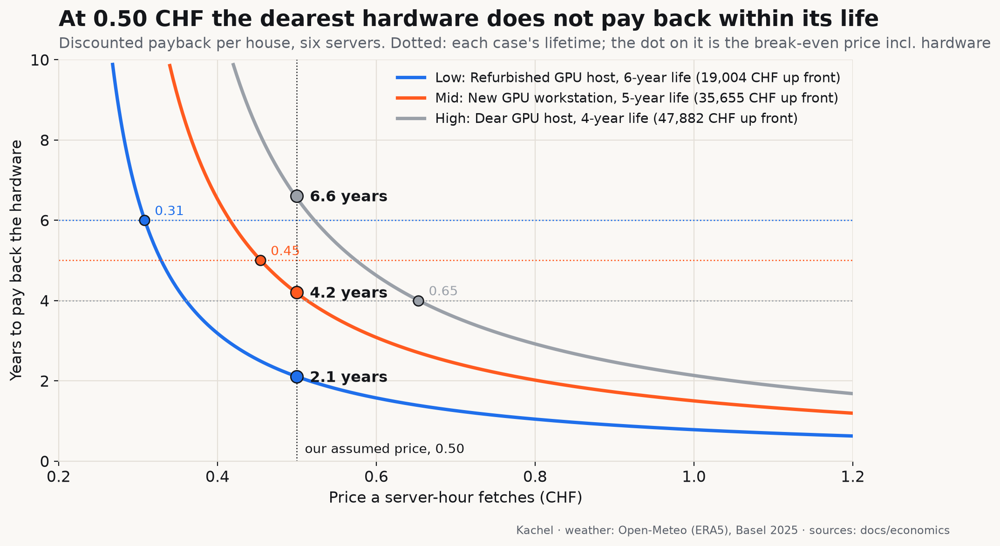

# The numbers behind Kachel

One reference house in Basel with six 1 kW servers in the basement. The servers run AI jobs
only when the house can use their heat. This page shows what that means for heat, money and
risk. It lists where every input comes from and which questions are still open.

The charts use real Basel weather for 2025. The README figures still come from the synthetic
preview weather, and the two agree within 1.5 points (heat covered: 79.6% here, 78.1% there).

Rebuild everything on this page with:

```
cd services/scheduler
python economics.py
```

The tables behind each chart are in [`data/`](data/), ready for a spreadsheet.

## Key figures, one house, one year

| Figure                                     | Value      | Comes from |
| ------------------------------------------ | ---------- | ---------- |
| Heat demand (space heat + hot water)       | 31,231 kWh | [1], [2]   |
| Share covered by server heat               | 79.6%      | model      |
| Server utilisation                         | 59.1%      | model      |
| Server-hours sold                          | 31,075     | model      |
| Electricity bought for the servers         | 8,608 CHF  | [3]        |
| Heat credit (what a heat pump would spend) | 2,753 CHF  | [1], [4]   |
| Computing income at 0.50 CHF/server-hour   | 15,538 CHF | assumption |
| Left before hardware                       | 9,683 CHF  | model      |
| Break-even price per server-hour           | 0.188 CHF  | model      |
| Hardware per year, mid case                | 8,268 CHF  | [9]–[18]   |
| Left after hardware, mid case              | 1,415 CHF  | model      |
| Payback, mid case                          | 4.2 years  | model      |
| Break-even price including hardware, mid   | 0.454 CHF  | model      |

The hardware figures are for the mid case. The low and high cases are in chart 7 and in
[`data/hardware.csv`](data/hardware.csv).

## Charts

### 1. When the house needs heat


Space heating follows the brief's formula: on days with a mean below 12 °C, each hour needs
10 × (20 − outdoor °C) ÷ 25.6 kWh. This is the 20/12 heating-degree rule used in Swiss
practice [2]. Hot water is a flat 12 kWh a day [1].

### 2. Month by month


Servers run almost all of December to February and about 10% of the summer hours. The
business is seasonal unless summer work can find another heat sink.

### 3. How many servers per house


Each extra server covers less new heat and runs fewer hours. The model stops at the sixth,
the last one that still runs at least 40% of the year. That 40% cut-off is our rule, not a
market figure.

### 4. Break-even price


A server-hour costs 1 kWh of electricity. If 80% of it replaces heat a heat pump would have
made, the house saves 0.8 ÷ COP kWh. Break-even is then price × (1 − 0.8 ÷ COP). With the
2026 median price [3] and the brief's COP of 2.5 that is 0.188 CHF. A better heat pump makes
server heat worth less, so break-even rises. Field-test COPs are 3.4 on average and 4.9 at
best [4].

### 5. Room for hardware


This is the yearly amount each server has left to pay for itself, its upkeep and the
installation. The dashed lines are what the hardware costs each year in the three cases
below: the price spread over its life at the discount rate (an annuity), plus upkeep. At
0.50 CHF a server-hour the low and mid cases are covered; the high case is not.

### 6. What moves the result


Each input is moved alone, with everything else as in `config.json` and the mid hardware
case. Two things dominate: the price a server-hour fetches, and whether there is always
flexible work waiting. Without that backlog, utilisation falls from 59% to 8%. Next come the
electricity price, the server price and how long a server lasts.

Heat recovery barely matters here, and more of it lowers the result a little. The scheduler
only runs when the heat is needed, so more heat per hour means fewer hours sold. That holds
only while computing pays better than heating.

### 7. Paying back the hardware



Three hardware cases, each for six servers in one house. Prices are without VAT; dollar and
pound prices use the ECB rates of 20 Nov 2026 (1 USD = 0.839 CHF, 1 GBP = 1.10 CHF).

| Input, per server unless per house  | Low                  | Mid                 | High           | Comes from            |
| ----------------------------------- | -------------------- | ------------------- | -------------- | --------------------- |
| Server, about 1 kW                  | 2,518 CHF            | 5,034 CHF           | 6,714 CHF      | [9], [10]             |
| What it is                          | refurbished GPU host | new GPU workstation | dear GPU host  | [9], [10]             |
| Water loop to the tank              | 496 CHF              | 633 CHF             | 771 CHF        | [11], our guess       |
| Fitter, hours per house × rate      | 6 h × 103 CHF        | 10 h × 120 CHF      | 16 h × 148 CHF | our guess, [12]       |
| Electrician, hours per house × rate | 2 h × 151 CHF        | 3 h × 151 CHF       | 4 h × 151 CHF  | our guess, [13]       |
| Upkeep per house and year           | 190 CHF              | 315 CHF             | 630 CHF        | our guess, [12]       |
| Lifetime                            | 6 years              | 5 years             | 4 years        | [14], [15]            |
| Discount rate                       | 3.28%                | 3.75%               | 6%             | [16], [17], our guess |

| Result, per house                         | Low        | Mid        | High        |
| ----------------------------------------- | ---------- | ---------- | ----------- |
| Paid up front                             | 19,004 CHF | 35,655 CHF | 47,882 CHF  |
| Hardware per year (annuity + upkeep)      | 3,731 CHF  | 8,268 CHF  | 14,448 CHF  |
| Left per year after hardware              | 5,952 CHF  | 1,415 CHF  | −4,765 CHF  |
| Payback, discounted                       | 2.1 years  | 4.2 years  | 6.6 years   |
| Net present value over the lifetime       | 31,948 CHF | 6,344 CHF  | −16,512 CHF |
| Break-even per server-hour, with hardware | 0.308 CHF  | 0.454 CHF  | 0.653 CHF   |

With hardware, break-even rises from 0.188 CHF to between 0.31 and 0.65 CHF a server-hour.
At our assumed 0.50 CHF the mid case only just pays, and the high case needs 6.6 years on a
4-year life. Whether a 1 kW unit really costs this little, and whether it lasts, is now as
important as the compute price.

## Sources

1. DigitalHeat case brief, reference house: 35 kWh tank, 12 kWh hot water a day, 1 kW server,
   80% heat recovery, COP 2.5, heating formula. In `services/scheduler/config.json`.
2. Heating degree days 20/12 (20 °C inside, 12 °C heating limit), the Swiss standard SIA
   381/3. Summary: <https://www.energiesparhaus.at/fachbegriffe/hgt.htm>. Basel-Stadt uses
   SIA 381/3 with station Basel-Binningen:
   <https://www.gesetzessammlung.bs.ch/frontend/annex_document_dictionaries/190>.
3. ElCom, "Leicht sinkende Strompreise 2026", 9 Sep 2025: H4 median 27.7 Rp/kWh
   <https://www.admin.ch/de/newnsb/8nuE_fvwnfqCu8OHNOwKu>. ElCom, "Leicht sinkende
   Strompreise 2027", 8 Sep 2026: H4 median 26.5 Rp/kWh
   <https://www.admin.ch/de/newnsb/1miE201yRzoA>. The range across municipalities
   (10.6 to 45.9 Rp) is as reported by Blick:
   <https://www.blick.ch/politik/medienkonferenz-um-11-uhr-das-zahlst-du-2027-fuer-den-strom-id22242708.html>.
   Tariffs per municipality, including Basel (IWB): <https://www.strompreis.elcom.admin.ch>.
   For Basel, ElCom lists IWB's 2027 H4 total tariff at 33.42 Rp/kWh, checked 21 Nov 2026:
   <https://www.strompreis.elcom.admin.ch/municipality/2701?period=2027&priceComponent=total&category=H4&product=standard>.
4. Fraunhofer ISE, "WP-QS im Bestand", press release 3 Nov 2025: 61 air/water heat pumps in
   existing houses, seasonal COP 3.4 on average, 2.6 to 4.9
   <https://www.ise.fraunhofer.de/de/presse-und-medien/presseinformationen/2025/waermepumpen-heizen-auch-im-altbau-klimafreundlich-forschungsprojekt-des-fraunhofer-ise-abgeschlossen.html>.
5. Weather: Zippenfenig, P. (2023). Open-Meteo.com Weather API. Zenodo.
   <https://doi.org/10.5281/ZENODO.7970649>. Based on Hersbach, H. et al. (2023). ERA5 hourly
   data on single levels from 1940 to present. ECMWF. <https://doi.org/10.24381/cds.adbb2d47>.
   Data licence CC BY 4.0.
6. Heat recovery up to 95% is Qarnot's own claim for its water-cooled boilers, not a measured
   average:
   <https://techcrunch.com/2023/01/09/qarnot-creates-green-data-centers-by-putting-servers-in-central-heating-boilers/>.
7. Context: data centres used about 415 TWh in 2024, about 1.5% of world electricity, and the
   IEA expects about 945 TWh by 2030. IEA, Energy and AI (2025):
   <https://www.iea.org/reports/energy-and-ai/executive-summary>.
8. Context: Basel-Stadt voted on 27 Nov 2022 for net zero by 2037:
   <https://www.srf.ch/news/abstimmungen-27-november/abstimmungen-basel-stadt-bis-2037-klimaneutral-basel-macht-vorwaerts-beim-klimaschutz>.
9. PCSP, "How much does a server cost in 2026?", 21 Aug 2026: a refurbished single-GPU
   inference host costs about USD 3,000 to 8,000 (low and high case):
   <https://pcserverandparts.com/news/how-much-does-a-server-cost-2026/>.
10. VRLA Tech, "How much does a custom AI workstation cost in 2026?", 30 Jun 2026: a
    single-GPU workstation with an RTX PRO 6000 Blackwell (up to 600 W) from USD 5,999 (mid
    case): <https://vrlatech.com/how-much-does-a-custom-ai-workstation-cost/>.
11. Watercooling UK, "How much does it cost to water cool a PC?", 29 Jul 2026: a CPU and GPU
    loop costs GBP 450 to 700; the mid case is the midpoint:
    <https://www.watercoolinguk.co.uk/how-much-does-it-cost-to-water-cool-a-pc/>.
12. WBAG, Regietarif Sanitär/Heizung 2025, without VAT: B-Monteur 103, A-Monteur 120,
    Chefmonteur 148, service fitter with van 125 CHF an hour, call-out 65 CHF:
    <https://www.wbag.ch/app/uploads/2024/12/Regietarife_Pauschalangebote-2025.pdf>.
13. EIT.nordwest (Basel), recommended hourly rates 2026, without VAT: Elektroinstallateur EFZ
    151 CHF:
    <https://www.eitnordwest.swiss/fileadmin/sections/eitbasel/documents/Loehne/Stundenansaetze_Personalkategorien_2026_als_Empfehlung_Rev.1.pdf>.
14. SiliconANGLE, "Resetting GPU depreciation", 22 Nov 2025: Amazon moved servers from three to
    four years in 2020, and the three largest clouds used six years by 2023:
    <https://siliconangle.com/2025/11/22/resetting-gpu-depreciation-ai-factories-bend-dont-break-useful-life-assumptions/>.
15. Amazon, Form 10-K for 2025: part of its servers moved from six to five years from 1 Jan
    2025: <https://www.sec.gov/Archives/edgar/data/1018724/000101872426000004/amzn-20251231.htm>.
16. UVEK, "UVEK legt WACC für Stromnetze für das Tarifjahr 2027 fest", 2 Mar 2026: 3.28%
    <https://www.admin.ch/de/newnsb/ZNjc_Y1WGHBjMrFROHcoK>.
17. pv magazine, 2 Mar 2026: WACC for PV investment contributions in 2026 is 3.75%
    <https://www.pv-magazine.de/2026/03/02/schweiz-legt-neue-kapitalkostensaetze-fuer-erneuerbare-und-stromnetze-fest/>.
18. ECB euro reference rates, 20 Nov 2026, used for USD and GBP to CHF:
    <https://www.ecb.europa.eu/stats/policy_and_exchange_rates/euro_reference_exchange_rates/html/index.en.html>.

Our own assumptions, with no outside source yet:

- Compute sells at 0.50 CHF per server-hour.
- There is always a backlog of flexible work.
- A paused server draws nothing.
- Each house has one 4-hour evening session and 8 server-hours of batch work a day.
- Each server in the three hardware cases draws about 1 kW.
- A plate heat exchanger to the tank costs about what the water loop's radiator does.
- Fitting six servers takes 6, 10 or 16 fitter hours and 2, 3 or 4 electrician hours.
- Upkeep is one or two service visits a year.
- A 6% discount rate for the high case: a young business with no track record should pay
  more for its money than a power grid (3.28%) or a solar roof (3.75%).

## Research topics for the report

Each one replaces an assumption above with evidence.

1. **What a server-hour sells for.** Compare cloud and GPU prices per kWh drawn, for jobs that
   can pause. This sets the break-even margin in chart 5.
2. **Is there always flexible work?** Find out who buys interruptible compute (rendering,
   embeddings, scientific batch jobs) and how much exists. Chart 6 shows this decides the
   case.
3. **Hardware and lifetime.** Chart 7 now uses cited prices and lifetimes. What is still
   missing: a real quote for fitting servers to a tank, a measured draw for each unit, and
   how long a server lasts when it runs about 60% of the year in a basement.
4. **The real Basel tariff.** Use the IWB H4 tariff and a time-of-use tariff, not the Swiss
   median. Check whether cheap night power changes when servers should run.
5. **Who gets the money.** Split income between homeowner, operator and compute buyer, and
   work out what heat price per kWh a homeowner would accept.
6. **Summer.** Look at district heating, pools or neighbours as summer heat sinks, and what
   they add to utilisation.
7. **Solar and storage** (issue #27). Find what own PV does to the electricity price the
   servers pay.
8. **Carbon.** Count avoided heat-pump electricity and avoided data-centre cooling. Swiss
   consumer-mix factors differ by method, from 128 g CO₂e/kWh (BAFU, 2018 data) to about
   59 g (VSE, 2024). Pick one and say why:
   <https://www.bafu.admin.ch/dam/bafu/de/dokumente/klima/fachinfo-daten/Umweltbilanz-Strommix-Schweiz-2018-v2.01.pdf>,
   <https://www.strom.ch/de/dokument/co2-gehalt-des-strommix-schweiz-bis-2050-2026>.
9. **Regulation.** Check whether a home server farm counts as a heat source under Basel's
   energy law, and what that means for subsidies.
