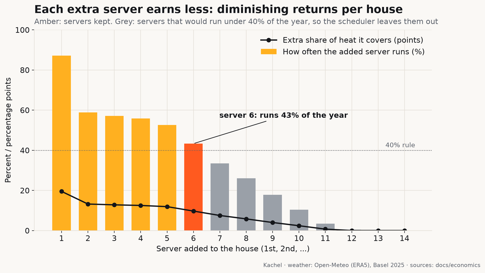
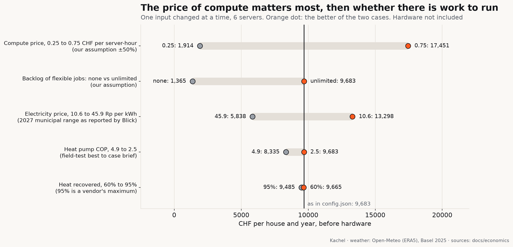

# The numbers behind Kachel

One reference house in Basel with six 1 kW servers in the basement. The servers run AI jobs
only when the house can use their heat. This page shows what that means for heat, money and
risk. It lists where every input comes from and which questions are still open.

The charts use real Basel weather for 2025. The README figures still come from the synthetic
preview weather, and the two agree within 1.5 points (heat covered: 79.6% here, 78.1% there).

Rebuild everything on this page with:

```
cd services/scheduler
python economics.py
```

The tables behind each chart are in [`data/`](data/), ready for a spreadsheet.

## Key figures, one house, one year

| Figure                                     | Value      | Comes from |
| ------------------------------------------ | ---------- | ---------- |
| Heat demand (space heat + hot water)       | 31,231 kWh | [1], [2]   |
| Share covered by server heat               | 79.6%      | model      |
| Server utilisation                         | 59.1%      | model      |
| Server-hours sold                          | 31,075     | model      |
| Electricity bought for the servers         | 8,608 CHF  | [3]        |
| Heat credit (what a heat pump would spend) | 2,753 CHF  | [1], [4]   |
| Computing income at 0.50 CHF/server-hour   | 15,538 CHF | assumption |
| Left before hardware                       | 9,683 CHF  | model      |
| Break-even price per server-hour           | 0.188 CHF  | model      |

## Charts

### 1. When the house needs heat


Space heating follows the brief's formula: on days with a mean below 12 °C, each hour needs
10 × (20 − outdoor °C) ÷ 25.6 kWh. This is the 20/12 heating-degree rule used in Swiss
practice [2]. Hot water is a flat 12 kWh a day [1].

### 2. Month by month


Servers run almost all of December to February and about 10% of the summer hours. The
business is seasonal unless summer work can find another heat sink.

### 3. How many servers per house



Each extra server covers less new heat and runs fewer hours. The model stops at the sixth,
the last one that still runs at least 40% of the year. That 40% cut-off is our rule, not a
market figure.

### 4. Break-even price


A server-hour costs 1 kWh of electricity. If 80% of it replaces heat a heat pump would have
made, the house saves 0.8 ÷ COP kWh. Break-even is then price × (1 − 0.8 ÷ COP). With the
2026 median price [3] and the brief's COP of 2.5 that is 0.188 CHF. A better heat pump makes
server heat worth less, so break-even rises. Field-test COPs are 3.4 on average and 4.9 at
best [4].

### 5. Room for hardware


This is the yearly amount each server has left to pay for itself, its upkeep and the
installation. Hardware is not in the model yet, so set this line against a real price and
lifetime.

### 6. What moves the result



Each input is moved alone, with everything else as in `config.json`. Two things dominate: the
price a server-hour fetches, and whether there is always flexible work waiting. Without that
backlog, utilisation falls from 59% to 8%.

Heat recovery barely matters here, and more of it lowers the result a little. The scheduler
only runs when the heat is needed, so more heat per hour means fewer hours sold. That holds
only while computing pays better than heating.

## Sources

1. DigitalHeat case brief, reference house: 35 kWh tank, 12 kWh hot water a day, 1 kW server,
   80% heat recovery, COP 2.5, heating formula. In `services/scheduler/config.json`.
2. Heating degree days 20/12 (20 °C inside, 12 °C heating limit), the Swiss standard SIA
   381/3. Summary: <https://www.energiesparhaus.at/fachbegriffe/hgt.htm>. Basel-Stadt uses
   SIA 381/3 with station Basel-Binningen:
   <https://www.gesetzessammlung.bs.ch/frontend/annex_document_dictionaries/190>.
3. ElCom, "Leicht sinkende Strompreise 2026", 9 Sep 2025: H4 median 27.7 Rp/kWh
   <https://www.admin.ch/de/newnsb/8nuE_fvwnfqCu8OHNOwKu>.
   ElCom, Stromtarife: H4 median IWB in 2027: 33.42 Rp/kWh
   <https://www.strompreis.elcom.admin.ch/municipality/2701?period=2027&priceComponent=total&category=H4&product=standard#main-content>
   ElCom, "Leicht sinkende
   Strompreise 2027", 8 Sep 2026: H4 median 26.5 Rp/kWh
   <https://www.admin.ch/de/newnsb/1miE201yRzoA>. The range across municipalities
   (10.6 to 45.9 Rp) is as reported by Blick:
   <https://www.blick.ch/politik/medienkonferenz-um-11-uhr-das-zahlst-du-2027-fuer-den-strom-id22242708.html>.
   Tariffs per municipality, including Basel (IWB): <https://www.strompreis.elcom.admin.ch>.
5. Fraunhofer ISE, "WP-QS im Bestand", press release 3 Nov 2025: 61 air/water heat pumps in
   existing houses, seasonal COP 3.4 on average, 2.6 to 4.9
   <https://www.ise.fraunhofer.de/de/presse-und-medien/presseinformationen/2025/waermepumpen-heizen-auch-im-altbau-klimafreundlich-forschungsprojekt-des-fraunhofer-ise-abgeschlossen.html>.
6. Weather: Zippenfenig, P. (2023). Open-Meteo.com Weather API. Zenodo.
   <https://doi.org/10.5281/ZENODO.7970649>. Based on Hersbach, H. et al. (2023). ERA5 hourly
   data on single levels from 1940 to present. ECMWF. <https://doi.org/10.24381/cds.adbb2d47>.
   Data licence CC BY 4.0.
7. Heat recovery up to 95% is Qarnot's own claim for its water-cooled boilers, not a measured
   average:
   <https://techcrunch.com/2023/01/09/qarnot-creates-green-data-centers-by-putting-servers-in-central-heating-boilers/>.
8. Context: data centres used about 415 TWh in 2024, about 1.5% of world electricity, and the
   IEA expects about 945 TWh by 2030. IEA, Energy and AI (2025):
   <https://www.iea.org/reports/energy-and-ai/executive-summary>.
9. Context: Basel-Stadt voted on 27 Nov 2022 for net zero by 2037:
   <https://www.srf.ch/news/abstimmungen-27-november/abstimmungen-basel-stadt-bis-2037-klimaneutral-basel-macht-vorwaerts-beim-klimaschutz>.

Our own assumptions, with no outside source yet:

- Compute sells at 0.50 CHF per server-hour.
- There is always a backlog of flexible work.
- A paused server draws nothing.
- Each house has one 4-hour evening session and 8 server-hours of batch work a day.
- Hardware costs nothing.

## Research topics for the report

Each one replaces an assumption above with evidence.

1. **What a server-hour sells for.** Compare cloud and GPU prices per kWh drawn, for jobs that
   can pause. This sets the break-even margin in chart 5.
2. **Is there always flexible work?** Find out who buys interruptible compute (rendering,
   embeddings, scientific batch jobs) and how much exists. Chart 6 shows this decides the
   case.
3. **Hardware and lifetime.** Find the price, lifetime and upkeep of a 1 kW home server, and
   the cost of fitting it to a tank. Then turn chart 5 into a payback period and an NPV.
4. **The real Basel tariff.** Use the IWB H4 tariff and a time-of-use tariff, not the Swiss
   median. Check whether cheap night power changes when servers should run.
5. **Who gets the money.** Split income between homeowner, operator and compute buyer, and
   work out what heat price per kWh a homeowner would accept.
6. **Summer.** Look at district heating, pools or neighbours as summer heat sinks, and what
   they add to utilisation.
7. **Solar and storage** (issue #27). Find what own PV does to the electricity price the
   servers pay.
8. **Carbon.** Count avoided heat-pump electricity and avoided data-centre cooling. Swiss
   consumer-mix factors differ by method, from 128 g CO₂e/kWh (BAFU, 2018 data) to about
   59 g (VSE, 2024). Pick one and say why:
   <https://www.bafu.admin.ch/dam/bafu/de/dokumente/klima/fachinfo-daten/Umweltbilanz-Strommix-Schweiz-2018-v2.01.pdf>,
   <https://www.strom.ch/de/dokument/co2-gehalt-des-strommix-schweiz-bis-2050-2026>.
9. **Regulation.** Check whether a home server farm counts as a heat source under Basel's
   energy law, and what that means for subsidies.
