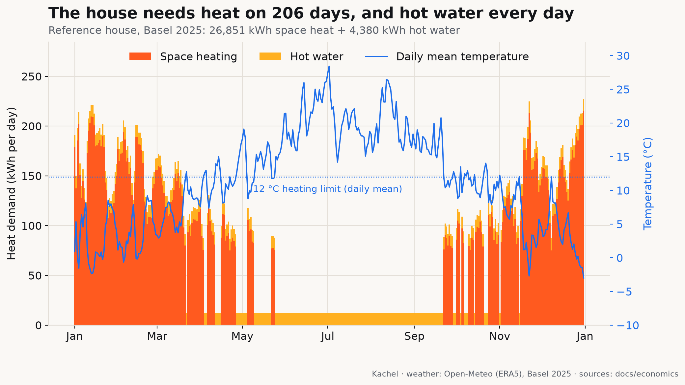
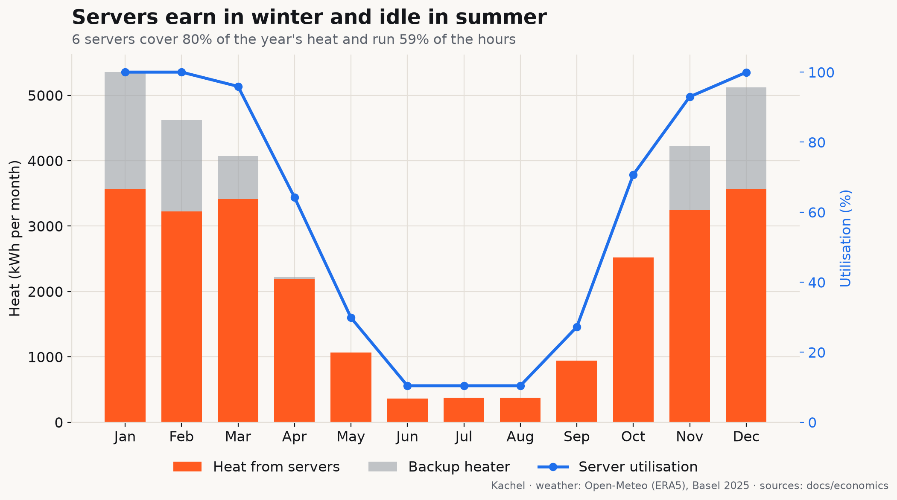
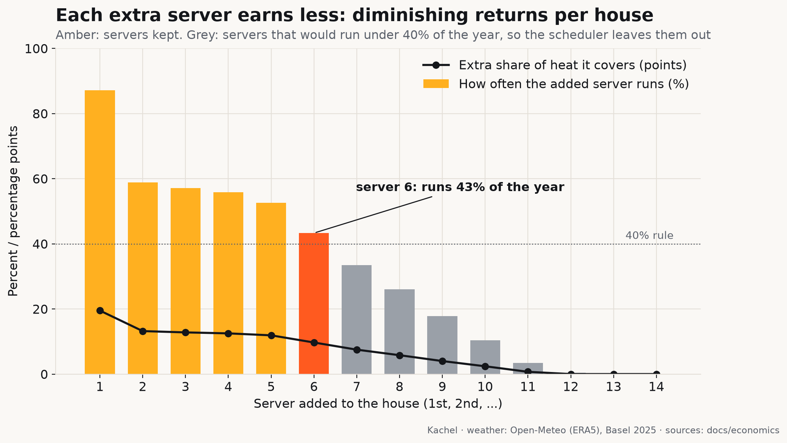
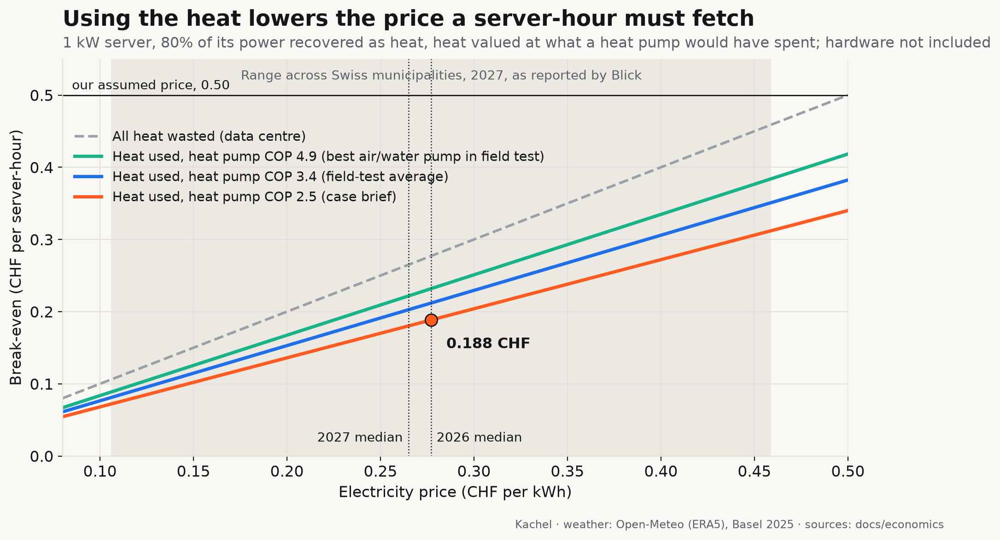
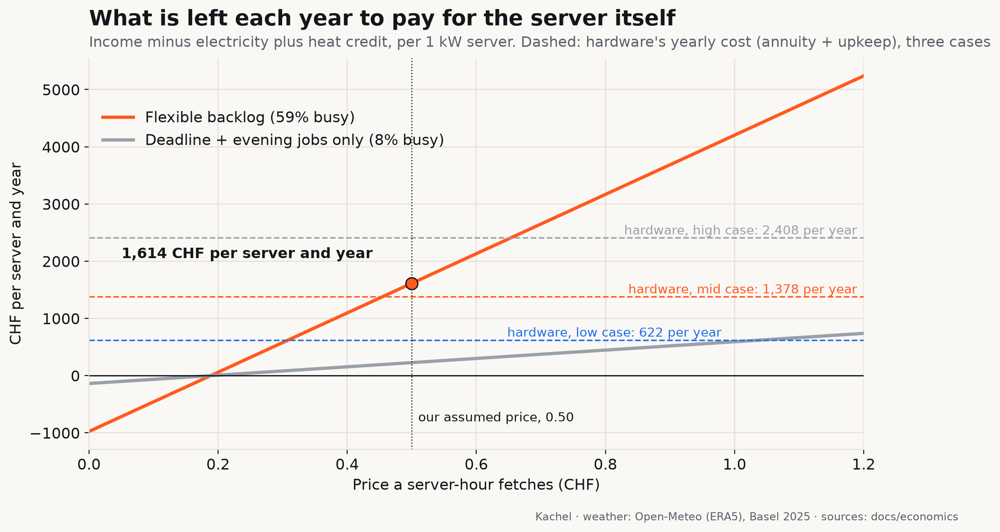
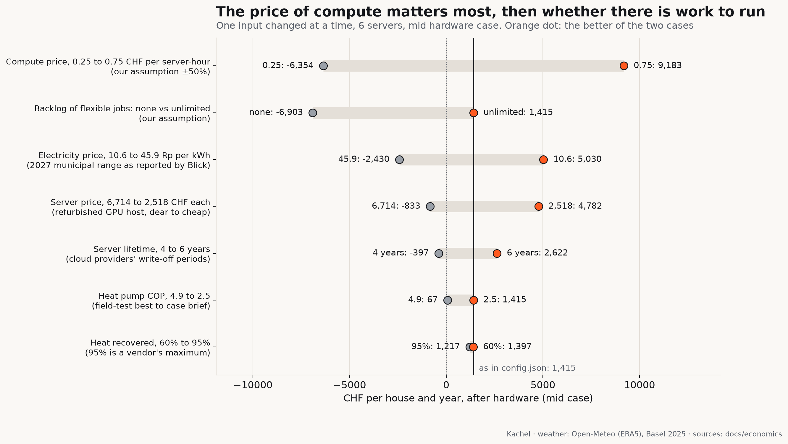
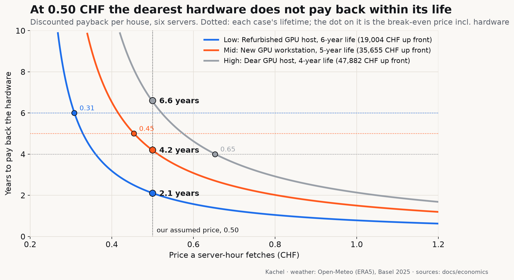

# Kachel: the numbers, for Nikolas

Hi Nikolas. This page walks through the two files that hold Kachel's numbers: what goes in,
and what comes out. Everything here is also on the
[economics page](https://github.com/CPD9/kachel/blob/main/docs/economics/README.md), with
the full list of sources. This is the short way in, in case it's handy.

The setup in one line: a reference house in Basel with six 1 kW servers in the basement. The
servers run AI jobs only when the house can use their heat, and the heat goes into the hot
water tank.

## What a JSON file is

A JSON file is a plain text list of names and values, much like a two-column spreadsheet. It
opens in any browser or text editor. You can read both files below without installing
anything.

## The inputs: `services/scheduler/config.json`

[Open config.json](https://github.com/CPD9/kachel/blob/main/services/scheduler/config.json).
These are our assumptions. Change a value here and every result and chart changes with it.

| Input                        | Value                    | What it means                                                                                                                 | Where it comes from                                                                                     |
| ---------------------------- | ------------------------ | ----------------------------------------------------------------------------------------------------------------------------- | ------------------------------------------------------------------------------------------------------- |
| Tank size                    | 35 kWh                   | How much heat the hot water tank can store.                                                                                   | Case brief (DigitalHeat reference house)                                                                |
| Hot water use                | 12 kWh a day             | Heat the household draws as hot water each day, spread evenly over the day.                                                   | Case brief. Spreading it evenly is our guess                                                            |
| Server power                 | 1 kW per server          | Electricity one server draws while it runs. One server-hour = 1 kWh.                                                          | Case brief                                                                                              |
| Heat recovery                | 0.8 (80%)                | Share of the server's electricity that ends up as useful heat in the tank.                                                    | Case brief                                                                                              |
| Idle power                   | 0 kW                     | What a paused server draws. We assume nothing.                                                                                | Our guess                                                                                               |
| Electricity price            | 0.277 CHF per kWh        | What the house pays for the servers' power.                                                                                   | ElCom 2026 Swiss median for household type H4 (27.7 Rp). A stand-in until we use the Basel (IWB) tariff |
| Heat pump COP                | 2.5                      | The heat pump the servers replace makes 2.5 kWh of heat per kWh of power. This sets what server heat is worth.                | Case brief. Field tests show 3.4 on average (Fraunhofer ISE)                                            |
| Compute price                | 0.50 CHF per server-hour | What one hour of one server's work sells for.                                                                                 | Our guess. Break-even is 0.188 CHF before hardware (see the outputs below)                              |
| Job type 1: evening          | 4 server-hours a day     | Live sessions (local AI chat, game streaming) from 18:00 to 22:00. They cannot wait, so they run even if heat is not needed.  | Our scenario                                                                                            |
| Job type 2: deadline batch   | 8 server-hours a day     | Batch work such as transcription, arriving at 06:00 and due 24 hours later. It can pause and wait for the house to need heat. | Our scenario. Job size from our own measurements                                                        |
| Job type 3: flexible backlog | unlimited                | Work with no deadline (for example embeddings) that fills any hour the house wants heat.                                      | Our guess, and the most optimistic one in the model                                                     |

## The outputs: `services/scheduler/out/kpis.json`

[Open kpis.json](https://github.com/CPD9/kachel/blob/main/services/scheduler/out/kpis.json).
These are the results for one house over one year.

One caveat: the numbers in this file come from synthetic preview weather, so the model can
run offline. The results with real Basel weather for 2025 are on the
[economics page](https://github.com/CPD9/kachel/blob/main/docs/economics/README.md). The two
agree within about 1.5 points (heat covered: 78.1% here, 79.6% with real weather).

| Output                               | Value      | What it means                                                                                                               |
| ------------------------------------ | ---------- | --------------------------------------------------------------------------------------------------------------------------- |
| `servers_per_house`                  | 6          | How many servers the model puts in the house. It stops adding once the last one would run under 40% of the year (our rule). |
| `heat_demand_kwh`                    | 31,296 kWh | Heat the house needs in the year: space heating plus hot water.                                                             |
| `share_of_heat_covered_pct`          | 78.1%      | Share of that demand met by server heat.                                                                                    |
| `heat_dumped_kwh`                    | 11.3 kWh   | Server heat the house could not use and had to get rid of (from evening sessions that cannot wait).                         |
| `backup_heat_kwh`                    | 6,864 kWh  | Heat the backup heater still has to make.                                                                                   |
| `utilisation_pct`                    | 58.1%      | Share of all hours in the year that the servers run.                                                                        |
| `server_hours_sold`                  | 30,554     | Server-hours of work done and sold in the year.                                                                             |
| `missed_deadlines_pct_of_jobs`       | 0%         | Share of jobs that finished late.                                                                                           |
| `moved_offsite_pct_of_deadline_jobs` | 0%         | Share of jobs sent to an ordinary data centre because the house had no use for the heat in time.                            |
| `electricity_cost_chf`               | 8,463 CHF  | Electricity bought for the servers.                                                                                         |
| `value_of_heat_used_chf`             | 2,707 CHF  | Heat credit: what the heat pump would have spent on electricity to make the same heat.                                      |
| `computing_income_chf`               | 15,277 CHF | Server-hours sold times the compute price.                                                                                  |
| `break_even_chf_per_server_hour`     | 0.188 CHF  | Lowest price per server-hour at which income covers electricity minus the heat credit. Hardware not included.               |
| `pays_off_at_assumed_compute_price`  | true       | Whether the assumed 0.50 CHF is above that break-even.                                                                      |
| `profile_source`                     | synthetic  | Which weather the run used.                                                                                                 |
| `heating_days`                       | 202        | Days in the year with a mean temperature below 12 °C, when space heating is on.                                             |

Income minus electricity plus the heat credit leaves about 9,700 CHF per house and year
with real weather, before anyone pays for the servers themselves.

## Hardware: three cases

The `hardware` block in `config.json` adds what the servers cost. There are three cases, low,
mid and high, and the results use the mid one. Prices are without VAT; dollar and pound
prices are converted at the ECB rates of 20 Nov 2026. Each source is listed on the
[economics page](https://github.com/CPD9/kachel/blob/main/docs/economics/README.md#7-paying-back-the-hardware).

| Input                              | Low           | Mid            | High           | Where it comes from                                                                                                                          |
| ---------------------------------- | ------------- | -------------- | -------------- | -------------------------------------------------------------------------------------------------------------------------------------------- |
| Server, about 1 kW                 | 2,518 CHF     | 5,034 CHF      | 6,714 CHF      | Low and high: refurbished GPU host (PCSP, Aug 2026). Mid: new GPU workstation (VRLA Tech, Jun 2026). That each draws about 1 kW is our guess |
| Water loop to the tank, per server | 496 CHF       | 633 CHF        | 771 CHF        | Water loop price (Watercooling UK, Jul 2026). The heat exchanger costing about the same as a radiator is our guess                           |
| Fitter, per house                  | 6 h × 103 CHF | 10 h × 120 CHF | 16 h × 148 CHF | Rates from a Swiss heating firm's 2025 price list. Hours are our guess                                                                       |
| Electrician, per house             | 2 h × 151 CHF | 3 h × 151 CHF  | 4 h × 151 CHF  | Rate from EIT.nordwest (Basel) 2026. Hours are our guess                                                                                     |
| Upkeep, per house and year         | 190 CHF       | 315 CHF        | 630 CHF        | Service rate and call-out from the same firm. Number of visits is our guess                                                                  |
| Lifetime                           | 6 years       | 5 years        | 4 years        | Write-off periods used by large cloud providers (Amazon 10-K, SiliconANGLE)                                                                  |
| Discount rate                      | 3.28%         | 3.75%          | 6%             | Swiss grid WACC 2027 (UVEK); PV WACC 2026; 6% is our guess                                                                                   |

| Result, per house                         | Low        | Mid        | High        | What it means                                                                              |
| ----------------------------------------- | ---------- | ---------- | ----------- | ------------------------------------------------------------------------------------------ |
| Paid up front                             | 19,004 CHF | 35,655 CHF | 47,882 CHF  | Six servers, six water loops, fitter and electrician.                                      |
| Hardware per year                         | 3,731 CHF  | 8,268 CHF  | 14,448 CHF  | The up-front cost spread over the lifetime at the discount rate (an annuity), plus upkeep. |
| Left per year after hardware              | 5,952 CHF  | 1,415 CHF  | −4,765 CHF  | The 9,683 CHF above, minus hardware per year.                                              |
| Payback                                   | 2.1 years  | 4.2 years  | 6.6 years   | Years until the discounted yearly cash has repaid the up-front cost.                       |
| Net present value                         | 31,948 CHF | 6,344 CHF  | −16,512 CHF | Over the lifetime, at the discount rate.                                                   |
| Break-even per server-hour, with hardware | 0.308 CHF  | 0.454 CHF  | 0.653 CHF   | Lowest price per server-hour that also pays for the hardware.                              |

In short: at 0.50 CHF a server-hour the mid case only just pays, and the high case does not
pay back within its four-year life. These figures are also in
[hardware.csv](https://github.com/CPD9/kachel/blob/main/docs/economics/data/hardware.csv).

## The charts

These are the same seven charts as on the economics page. Chart 6 now shows the result after
hardware (mid case), so its numbers are lower than the 9,700 CHF above.

## The tables behind the charts

Each opens in Excel or Google Sheets (use Download, then open the file).

- [daily.csv](https://github.com/CPD9/kachel/blob/main/docs/economics/data/daily.csv): heat
  demand and mean temperature for each day
- [monthly.csv](https://github.com/CPD9/kachel/blob/main/docs/economics/data/monthly.csv):
  heat from servers, backup heat and utilisation for each month
- [servers_per_house.csv](https://github.com/CPD9/kachel/blob/main/docs/economics/data/servers_per_house.csv):
  every result for 1 to 14 servers per house
- [sensitivity.csv](https://github.com/CPD9/kachel/blob/main/docs/economics/data/sensitivity.csv):
  the yearly result after hardware when one input moves at a time
- [hardware.csv](https://github.com/CPD9/kachel/blob/main/docs/economics/data/hardware.csv):
  up-front cost, payback, NPV and break-even for each hardware case
- [payback.csv](https://github.com/CPD9/kachel/blob/main/docs/economics/data/payback.csv):
  payback years against the compute price, for each hardware case
- [weather_basel_2025.csv](https://github.com/CPD9/kachel/blob/main/docs/economics/data/weather_basel_2025.csv):
  hourly Basel temperature and sunshine for 2025

Also worth a look: the [pitch script](https://github.com/CPD9/kachel/blob/main/docs/pitch.md)
and [issue #27](https://github.com/CPD9/kachel/issues/27) on solar and storage.

## Where you could help most

These are the questions we are least sure of, and where your background counts most.

1. **Compute price.** What does an hour of pausable 1 kW compute really sell for? We use
   0.50 CHF. Break-even is 0.188 CHF before hardware and 0.31 to 0.65 CHF with it.
2. **Hardware payback.** Are our three hardware cases sensible? The fitting hours, the
   upkeep and the 6% rate for the high case are still our guesses. Which discount rate
   would you use, and should a home server be written off over 4, 5 or 6 years?
3. **Tariffs.** Which Basel tariff should the servers pay: the IWB household tariff, a
   time-of-use tariff, or a business tariff? Does cheap night power change when they should
   run?
4. **Who gets the money.** How should income be split between homeowner, operator and the
   buyer of compute, and what heat price would a homeowner accept?
5. **Carbon factor.** Swiss consumer-mix factors range from about 59 to 128 g CO₂e per kWh
   depending on method. Which one should we use, and why?
