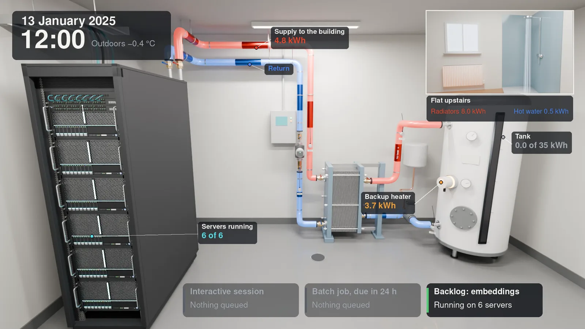
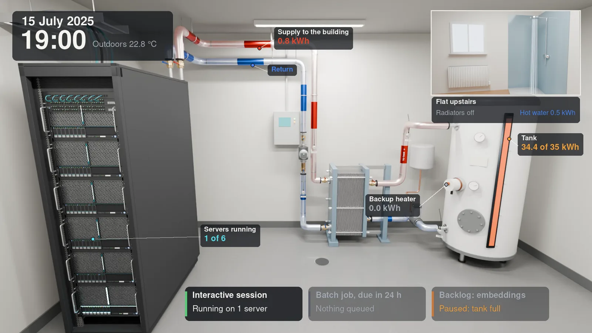
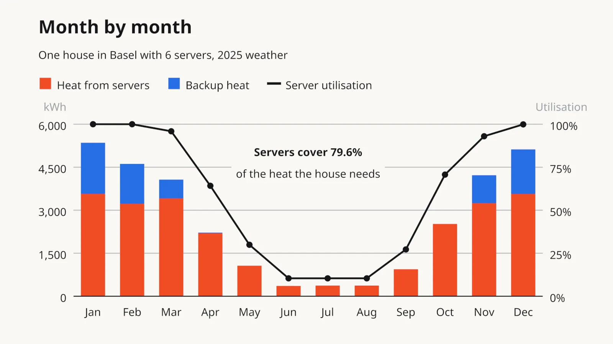
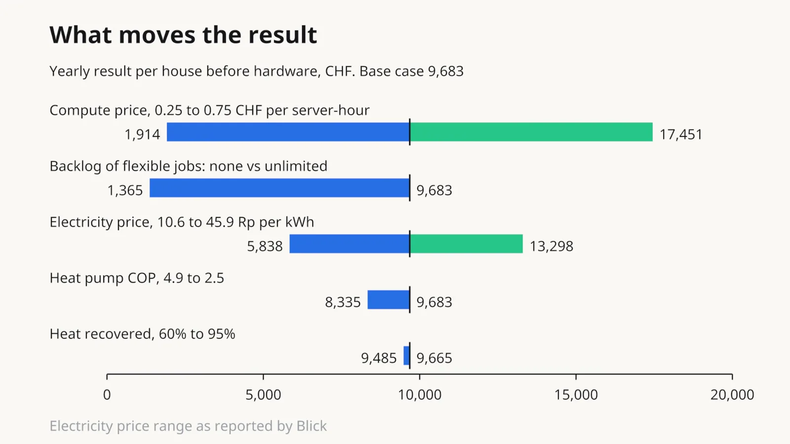
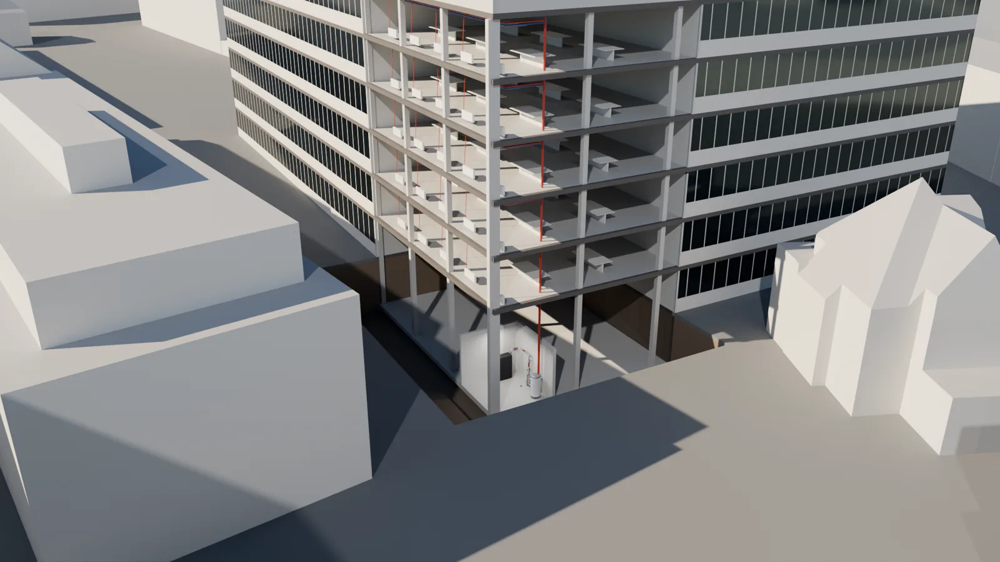
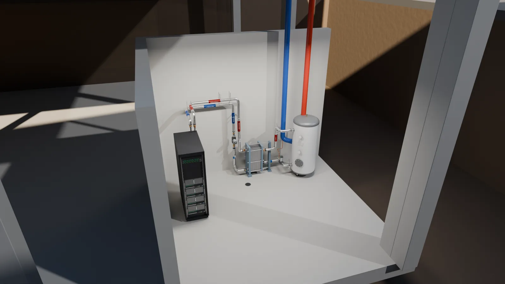
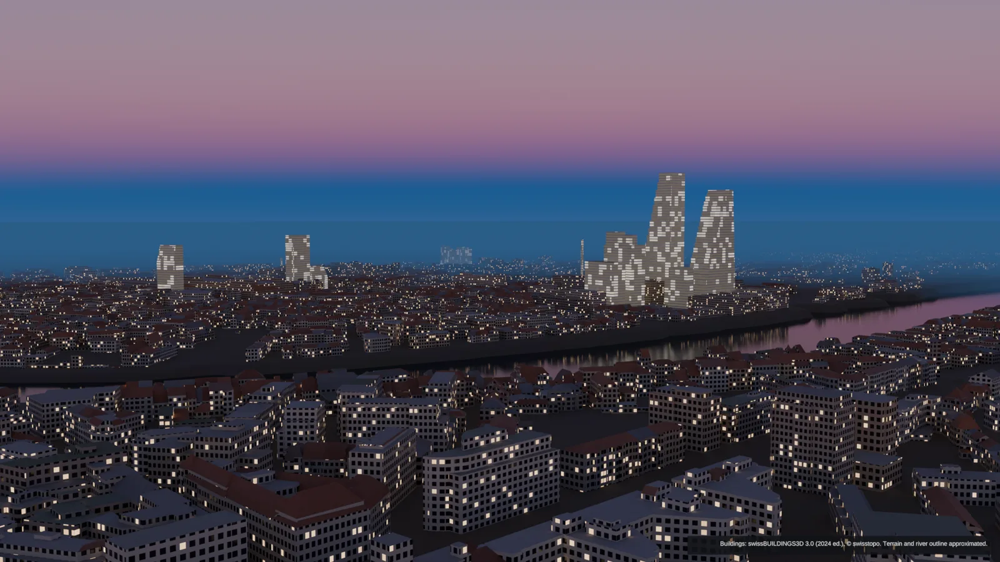

# Media

Renders for the pitch video, made in Blender. Every figure on screen is read from the
scheduler's output or from [docs/economics/data](../economics/data) at render time, never
typed by hand. The videos are in the [media-v1 release](https://github.com/CPD9/kachel/releases/tag/media-v1).

## In the basement

How a server goes into a basement: rack, supply and return, pump, plate heat exchanger,
tank and backup heater. [Video, 20 s](https://github.com/CPD9/kachel/releases/download/media-v1/setup.mp4)

The scheduler on a cold January day and a warm July day in Basel, 2025. Jobs run when the
house can use their heat, and the backlog pauses when the tank is full.
[Video, 25 s](https://github.com/CPD9/kachel/releases/download/media-v1/scheduler.mp4)

## Live demo

The host app on the local stack. The agent follows a real embedding job on Server 4. When its
signal file says pause, it stops the process and writes the change to Supabase, and the pill
turns Paused under a second later; on run it turns back.
[Video, 27 s](https://github.com/CPD9/kachel/releases/download/media-v1/live-demo.mp4)

## The numbers

Videos: [month by month](https://github.com/CPD9/kachel/releases/download/media-v1/chart-month.mp4), [break-even](https://github.com/CPD9/kachel/releases/download/media-v1/chart-breakeven.mp4),
[what moves the result](https://github.com/CPD9/kachel/releases/download/media-v1/chart-sensitivity.mp4). Sources for every input are on the
[economics page](../economics/README.md).

## Scaling up

The campus is too new for swisstopo's 2024 data, so it is a block model from its published
floor area. Its shape and orientation are our assumptions.

The loop to the neighbours is a concept, not an existing system. Buildings © swisstopo
(swissBUILDINGS3D 3.0, 2024 edition). Heat demand per hectare: SFOE, data status 2013.
