# Media

Renders for the pitch video, made in Blender. Every figure on screen is read from the
scheduler's output or from [docs/economics/data](../economics/data) at render time, never
typed by hand. The videos are in the [media-v1 release](https://github.com/CPD9/kachel/releases/tag/media-v1).

## The two-minute film

January day-night, setup, scheduler, break-even and payback, the live demo, and the July
evening to close, in the order of the [talk track](../pitch.md).
[1080p](https://github.com/CPD9/kachel/releases/download/media-v1/kachel-film-2min.mp4) or
[720p](https://github.com/CPD9/kachel/releases/download/media-v1/kachel-film-2min-720p.mp4).

## One day in Basel

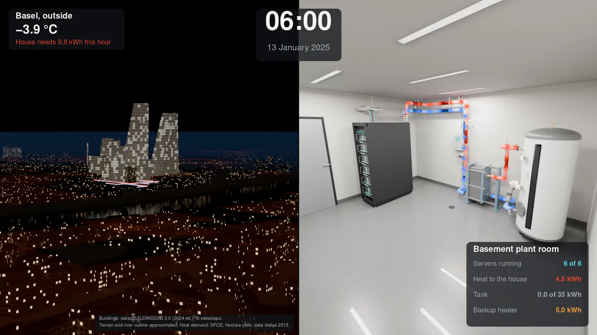

One January day, outside and inside on the same clock. Sun, temperature, heat demand, servers and backup heater all come from the scheduler's output for 13 January 2025.
[Video, 36 s](https://github.com/CPD9/kachel/releases/download/media-v1/daynight-january.mp4)

## Two cities, one model

Basel and Bern are two separate use cases. Each film runs the same reference house on that
city's own 2025 weather, and says so under the clock. Snow depth comes from the Open-Meteo
archive ([services/scheduler/data](../../services/scheduler/data/README.md)); no snow fell on
4 January, so none falls in the films.

Basel: [13 January](https://github.com/CPD9/kachel/releases/download/media-v1/daynight-january.mp4), [15 July](https://github.com/CPD9/kachel/releases/download/media-v1/daynight-july.mp4) and
[4 January, with the 2 cm of snow lying that day](https://github.com/CPD9/kachel/releases/download/media-v1/daynight-snow.mp4).

## Bern

Bern is colder than Basel, so the model gives its house 7 servers instead of 6. Figures come
from `make bern-days` (services/scheduler/out/bern).

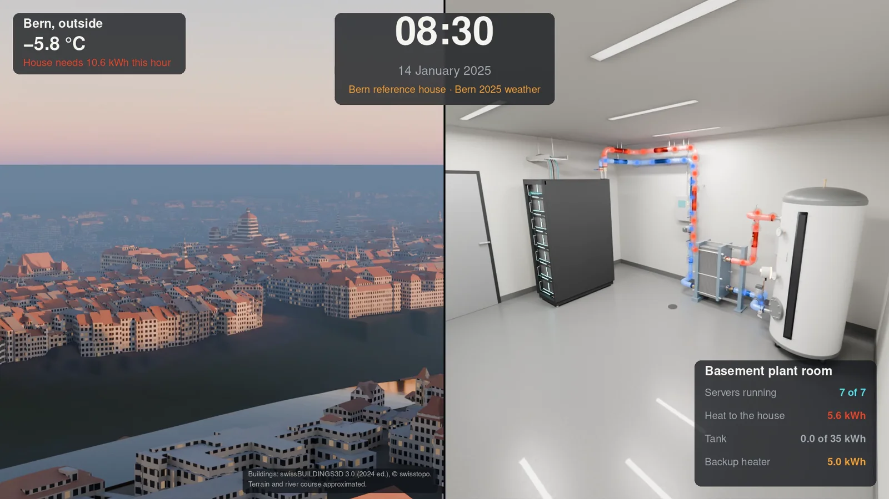

14 January: every server runs and the backup heater fills the gap.
[Video, 36 s](https://github.com/CPD9/kachel/releases/download/media-v1/daynight-bern-january.mp4)

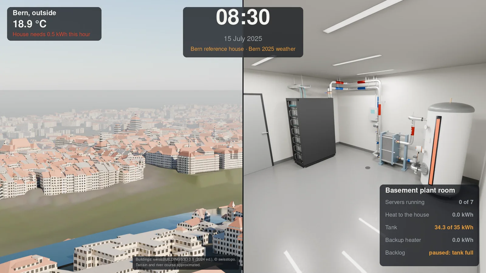

15 July: the tank is full by morning and the backlog waits.
[Video, 36 s](https://github.com/CPD9/kachel/releases/download/media-v1/daynight-bern-july.mp4)

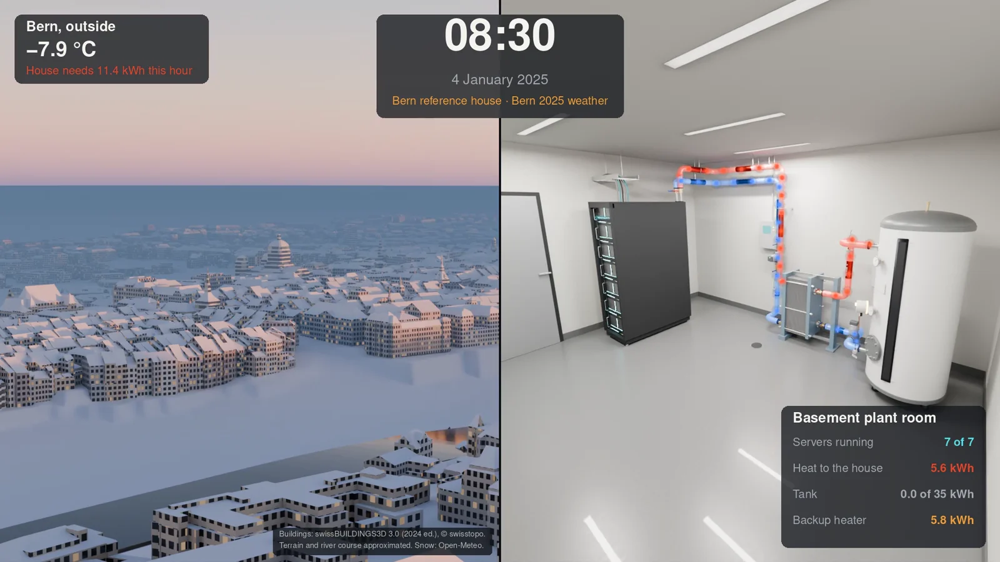

4 January, under the 10 cm of snow lying that day.
[Video, 36 s](https://github.com/CPD9/kachel/releases/download/media-v1/daynight-bern-snow.mp4)

## In the basement

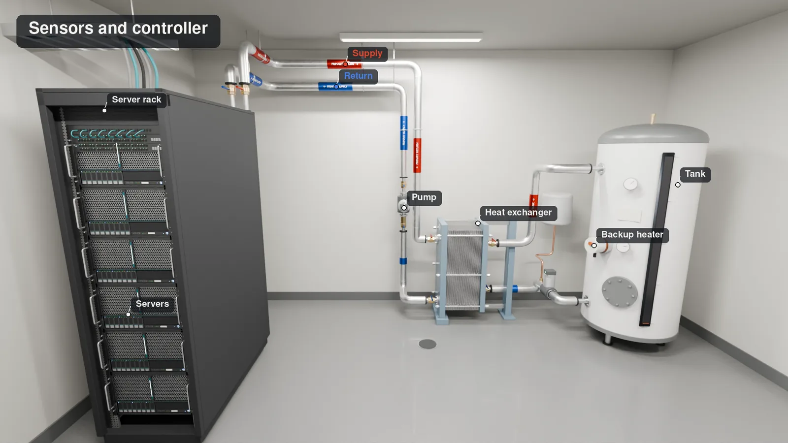

How a server goes into a basement: rack, supply and return, pump, plate heat exchanger,
tank and backup heater. [Video, 20 s](https://github.com/CPD9/kachel/releases/download/media-v1/setup.mp4)

The scheduler on a cold January day and a warm July day in Basel, 2025. Jobs run when the
house can use their heat, and the backlog pauses when the tank is full.
[Video, 25 s](https://github.com/CPD9/kachel/releases/download/media-v1/scheduler.mp4)

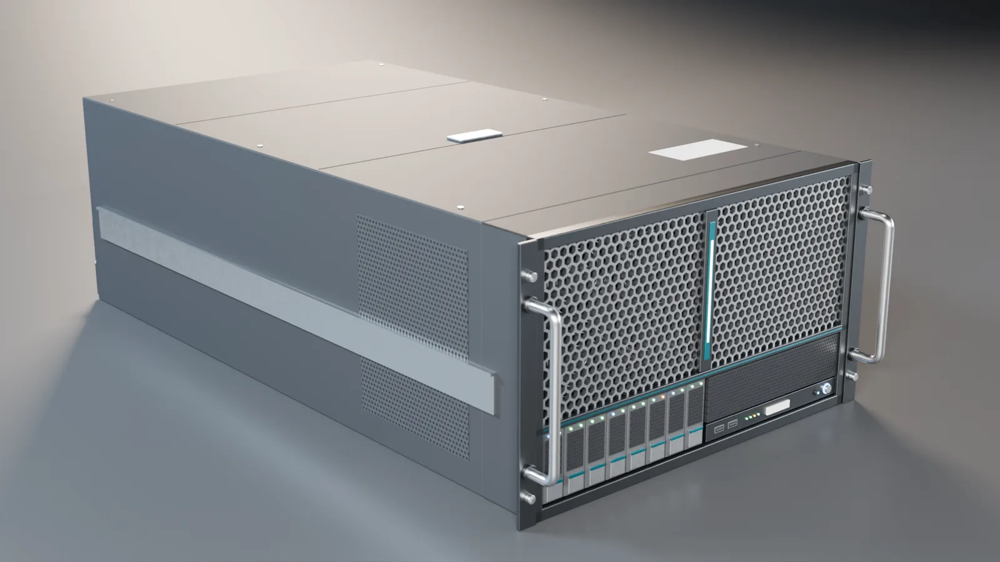

## Live demo

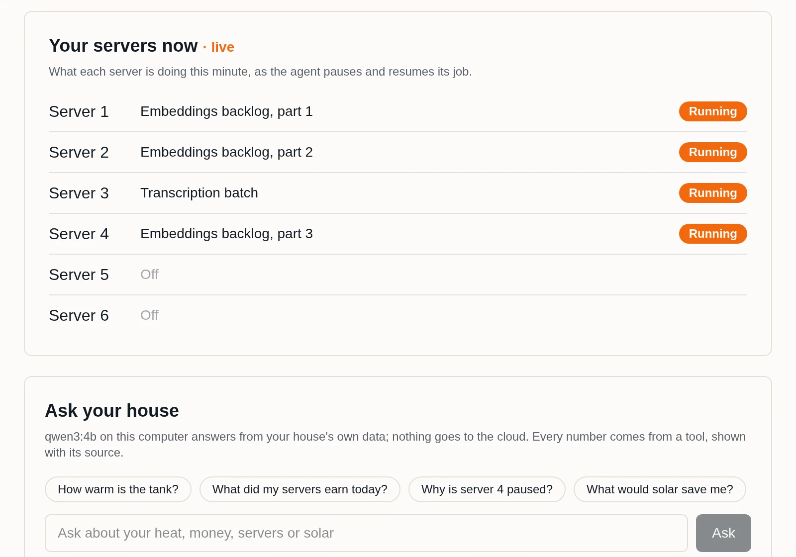

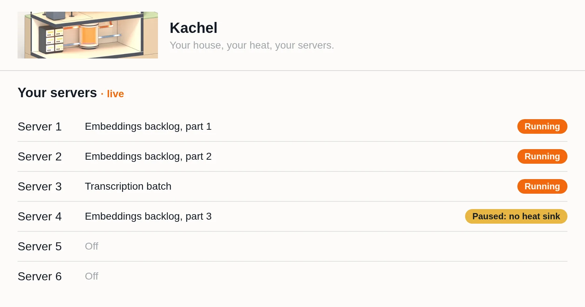

The host app on the local stack. The agent follows a real embedding job on Server 4. When its
signal file says pause, it stops the process and writes the change to Supabase, and the pill
turns Paused under a second later (agent run with `--tick 0.2`; the default is 1 s). On run it
turns back.
[Video, 30 s](https://github.com/CPD9/kachel/releases/download/media-v1/live-demo.mp4)

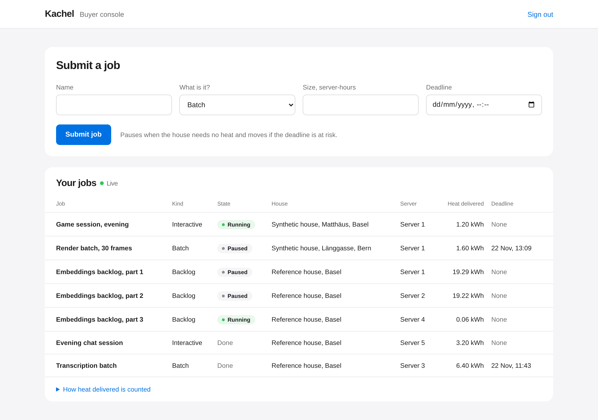

The console, where a buyer submits jobs and sees where each one runs and the heat it has
given. Both app screenshots come from `pnpm screenshots` (scripts/screenshots.mjs).

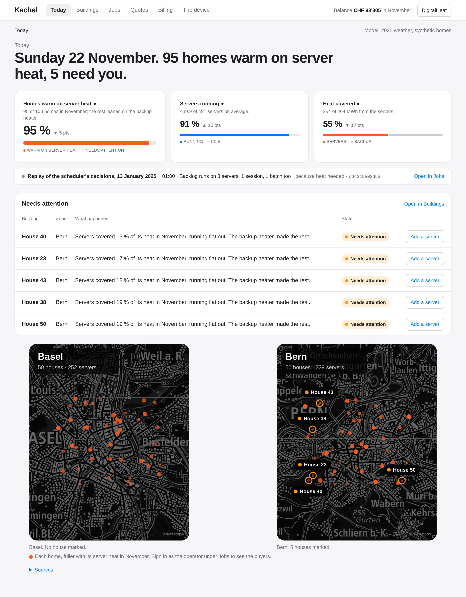

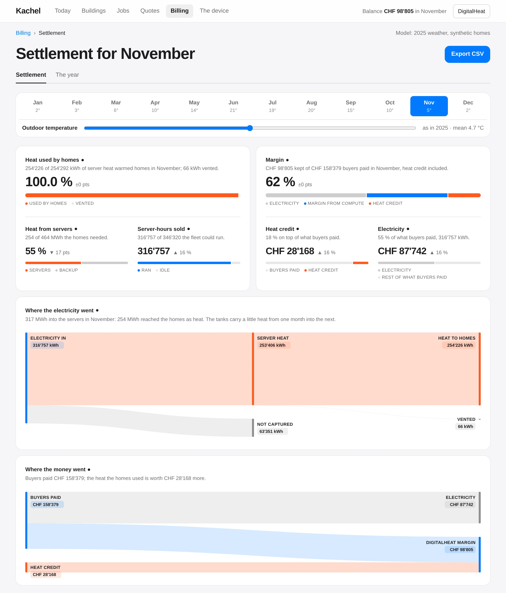

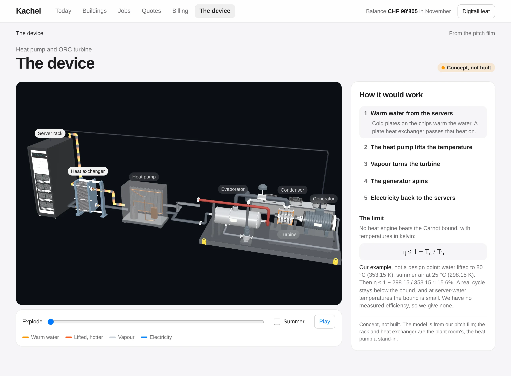

The DigitalHeat operator console at 1280 px, 2x, en-GB, from the model with no sign-in: Today,
Billing → Settlement and the device. Map © swisstopo.

The host screen with the house, its day and its money, live from `heat_state`, `kpis` and `assumptions`. Until the scheduler writes today's hours it replays a stored day at the clock's hour and says so; hover any number for its source.

## The numbers

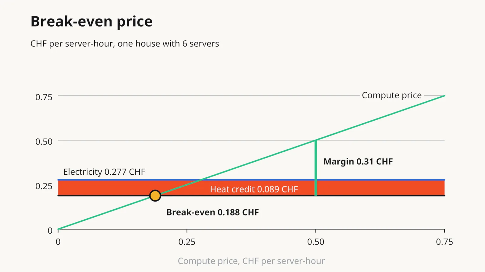

Videos: [month by month](https://github.com/CPD9/kachel/releases/download/media-v1/chart-month.mp4), [break-even](https://github.com/CPD9/kachel/releases/download/media-v1/chart-breakeven.mp4),
[what moves the result](https://github.com/CPD9/kachel/releases/download/media-v1/chart-sensitivity.mp4). Sources for every input are on the
[economics page](../economics/README.md).

## Scaling up

The campus is too new for swisstopo's 2024 data, so it is a block model from its published
floor area. Its shape and orientation are our assumptions.

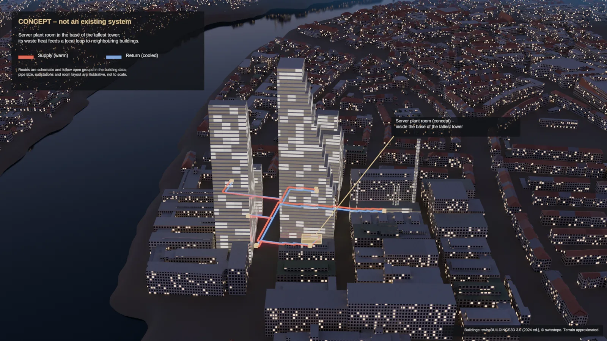
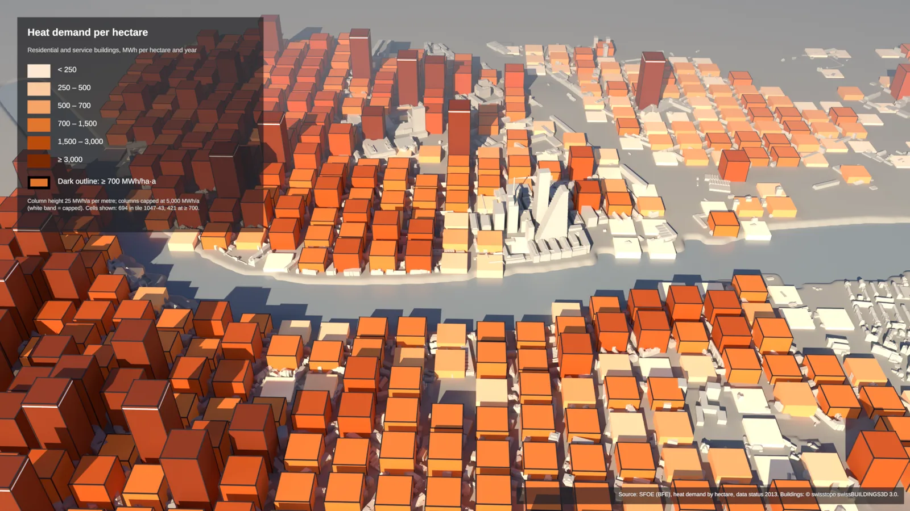

The loop to the neighbours is a concept, not an existing system. Buildings © swisstopo
(swissBUILDINGS3D 3.0, 2024 edition). Heat demand per hectare: SFOE, data status 2013.
