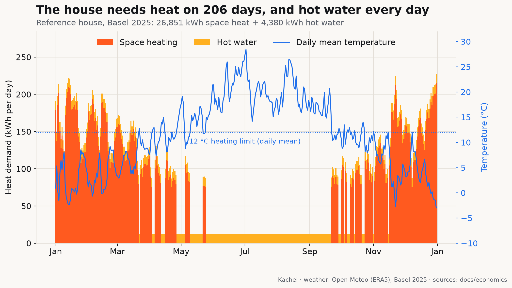
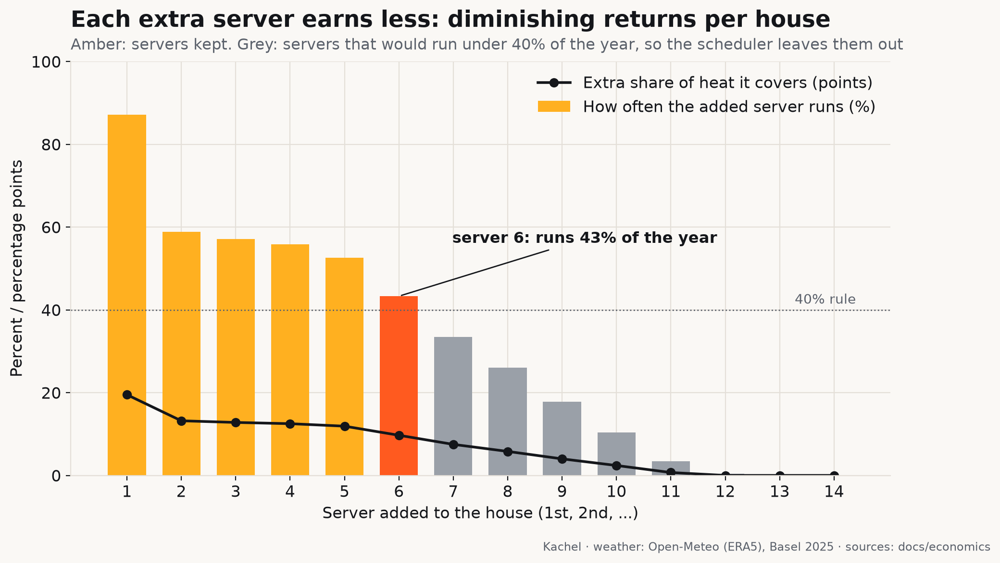
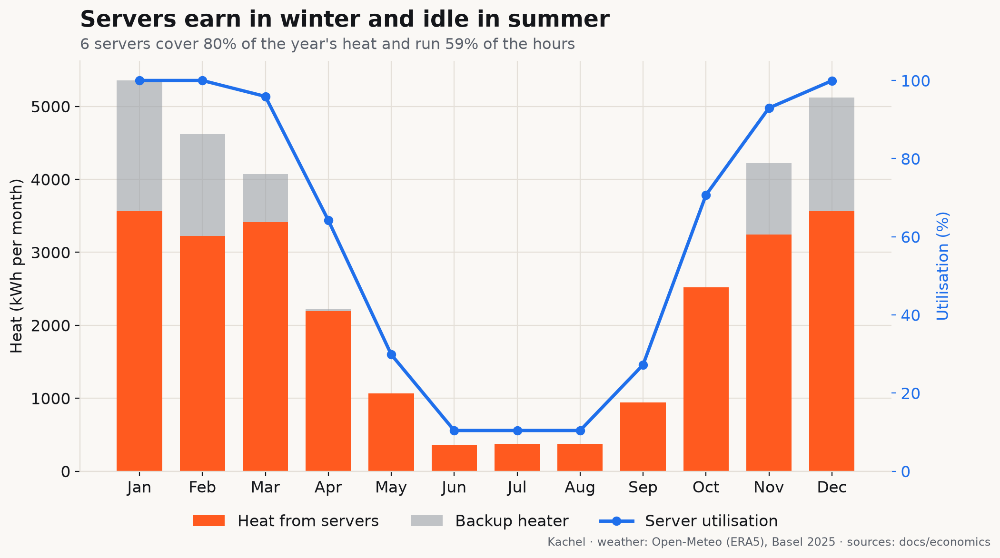
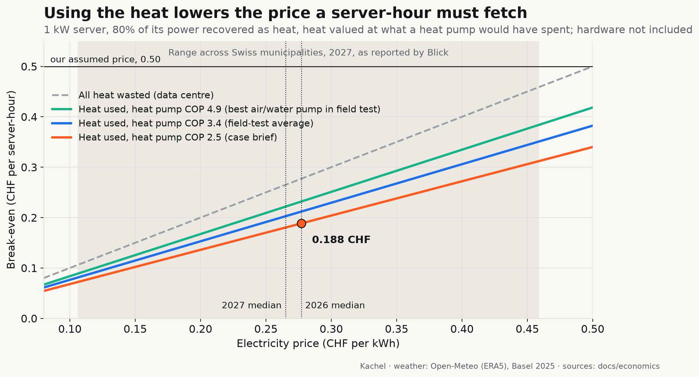
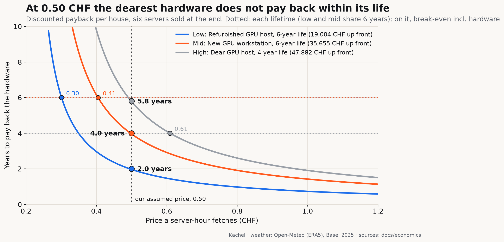
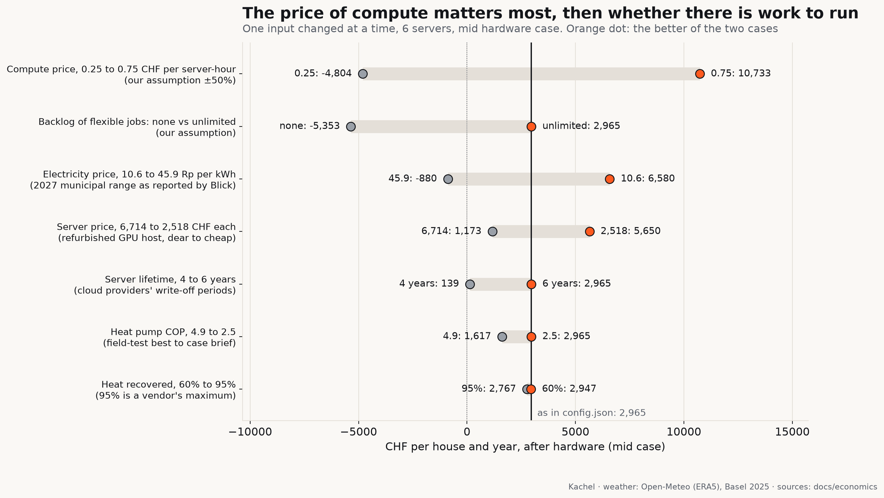
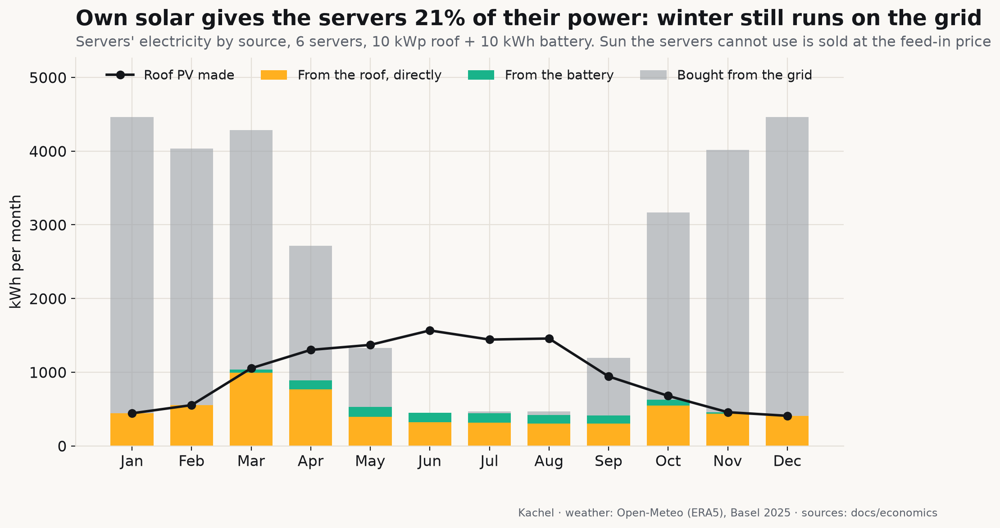

<header class="title-block">

# Heat-led scheduling of AI compute in home basements: the Kachel model, its results and its economics

{authors}

Kachel team, Basel

</header>

<section class="abstract">

**Abstract.** Kachel places small servers in the basements of homes, runs AI jobs on them and feeds their heat into space heating and hot water. A scheduler runs a job only when its heat is useful. This paper documents the model we run, step by step, so that each figure can be checked against the code and the data it comes from. A reference house in Basel is driven hour by hour by real weather ({basel_source}) through the heating formula of the case brief; the house needs {basel_demand_kwh} kWh of heat on {basel_heating_days} heating days. The scheduler is one pure function with four rules in priority order: interactive sessions run at once, deadline batch runs as early as its heat is useful, a deadline-free backlog fills the remaining useful heat room after a head-room reserve taken from a persistence forecast, and nothing else runs. Keeping each added server only while it still runs at least {theta} of the year gives {n_basel} servers. They cover {basel_cover} of the heat demand, run {basel_util} of the hours and dump {basel_dumped} kWh of heat in the year; in Bern, {n_bern} servers cover {bern_cover}. Heat valued at what a heat pump would have spent lowers the price a server-hour must fetch to {basel_be}. With hardware paid for, the {hw_case} case leaves {mid_net_after} per house and year at our assumed compute price, with a net present value of {mid_npv}; the dearest hardware case does not pay back within its life. The result rests most on the compute price and on an unlimited backlog of flexible work, our most optimistic assumption; without that backlog the servers run {nb_util} of the hours.

</section>

## 1. Introduction

A computer turns nearly all of the electricity it draws into heat. In a data centre that heat is a cost; in a house that needs heat it is worth what the heating system would otherwise have spent. Kachel puts servers where the heat is wanted and lets the heat decide when they run: a job runs when the house or its hot-water tank can take the heat, and waits, moves or pauses otherwise.

The model has five parts, each a module in `services/scheduler`: an hourly heat profile for a reference house (`heatsched/profile.py`, Section 2), a plant model of servers, tank and backup heater (`heatsched/sim.py`, Section 3), the scheduler (`heatsched/scheduler.py`, Section 4), indicators and sizing (Sections 5 and 6), and the economics (`economics.py`, Section 7). A fleet model (`heatsched/fleet.py`, Section 8) places jobs across many houses. Section 9 gives the results, Section 10 the limitations and Section 11 a concept we have not modelled. Every value the model assumes is in `services/scheduler/config.json`, with its source; every figure in this paper is read from the model's output files by `scripts/paper/build.py`.

## 2. Reference house and weather

### 2.1 Weather

Hourly air temperature and global horizontal irradiance come from the Open-Meteo historical archive, which serves the ERA5 reanalysis [@econ5]. The saved files cover the whole of the weather year for Basel and for Bern, one row per hour, local time. The Basel file is the one the case brief's check and every chart use; Bern runs the same house on its own weather.

### 2.2 Space heating

The case brief gives the space-heating formula for the reference house [@econ1]. It follows heating degree days with a twenty-degree inside temperature and a twelve-degree heating limit, the Swiss standard SIA 381/3 [@econ2]. A day is a heating day when its mean temperature is below the limit, and on a heating day the demand of hour *t* is

Qsh(t) = 𝟙[ T̄day(t) &lt; 12 °C ] · max(0, 10 · (20 °C − T(t)) / 25.6) &nbsp;kWh(1)

where T(t) is the hourly temperature and T̄day the mean of the day's hours. On the Basel weather ({basel_source}) this gives {basel_space_kwh} kWh of space heat on {basel_heating_days} heating days. The case brief puts the reference house at about {brief_kwh} kWh; our profile differs from that by {brief_dev_pct}, and the test suite holds it within {brief_tol_pct} (`tests/test_sim.py`). The coldest day by daily mean is {coldest_day}, at {coldest_day_temp} °C.

### 2.3 Hot water

Hot water is {dhw_kwh_day} kWh a day [@econ1], spread evenly over the hours of each day (Section 10 discusses this shape):

Qdhw(t) = Qdhw,day / Hday(t), &nbsp;&nbsp; D(t) = Qsh(t) + Qdhw(t)(2)

with Hday the number of hours in that day, which keeps the daily total right on days with a clock change. Over {days} days hot water adds {basel_dhw_kwh} kWh, so the yearly demand D is {basel_demand_kwh} kWh in Basel. In Bern the same house needs {bern_demand_kwh} kWh, of which {bern_space_kwh} kWh is space heat, on {bern_heating_days} heating days.

## 3. Plant model

Each house has N servers of electrical power Ps = {server_kw} kW. A fraction η = {heat_recovery} of that power is recovered as heat into a hot-water tank of capacity C = {tank_kwh} kWh [@econ1], so a server-hour delivers

h = Ps · η = {heat_per_server} kWh(3)

The model steps in hours. With n(t) servers running and s(t) the heat in the tank at the start of the hour, the heat served to the house, the tank after the hour, the heat dumped and the backup heat are

q(t) = min( D(t), n(t)·h + s(t) )(4)

s′ = s(t) + n(t)·h − q(t), &nbsp;&nbsp; d(t) = max(0, s′ − C), &nbsp;&nbsp; s(t+1) = min(s′, C)(5)

b(t) = D(t) − q(t)(6)

The tank is a lossless energy store: it has no standing loss, no temperature and no stratification, so heat put in is heat available later. The backup heater covers whatever the servers and tank cannot, b(t); it is not modelled further except through the heat it would have cost (Section 5). Dumped heat d(t) is heat made when the tank is full and the house needs nothing; the scheduler avoids it, and the only rule that can cause it is the interactive rule. A paused server draws {idle_kw} kW. The tank starts empty.

## 4. The scheduler

The scheduler is one pure function, `decide`, used both by the yearly simulation and the live demo. Each hour it receives a signal: the number of servers N, the heat per server-hour h, this hour's demand D, the tank state s and capacity C, the interactive server-hours due, the batch queue as pairs of hours to deadline and server-hours, and forecasts of demand and interactive load for the next hours. It returns how many servers run each kind of job.

### 4.1 Jobs

Three kinds of job arrive, set in `config.json`. Interactive sessions (local AI chat, game streaming) cannot be paused: {interactive_sh} server-hours a day, one an hour from {interactive_from} to {interactive_to}. Deadline batch is speech-to-text transcription with Whisper large-v3 [@econ19; @econ21], interruptible per recording: {batch_sh} server-hours arrive at {batch_at} each day and are due within {batch_deadline_h} hours, the completion window of a common batch API [@econ22]. The opportunistic backlog is embedding work with no deadline, measured on our own machine [@econ24], and assumed unlimited.

### 4.2 Forecast and head-room

The forecast is `{forecast}`: the demand of a coming hour is taken to equal the demand at the same hour the day before, D̂; interactive arrivals Î are known from the schedule. Over a horizon of {horizon_h} hours the scheduler keeps tank room for interactive heat that will have nowhere else to go:

W = maxk Σj=1..k ( Î(t+j)·h − D̂(t+j) ), &nbsp;&nbsp; W ≥ 0(7)

the largest cumulative surplus of interactive heat over demand in the look-ahead. The useful heat room this hour, after the interactive servers ni and the reserve, is

R = D(t) + C − s(t), &nbsp;&nbsp; U = R − ni·h − W(8)

### 4.3 The four rules

Algorithm 1 gives `decide` as it runs. F counts free servers, the batch queue holds pairs (δk, wk) of hours to deadline and server-hours, earliest deadline first.

<pre class="algo"><b>Algorithm 1</b>  decide(signal) → decision, once per hour
 1  R ← D + (C − s)                                   <i>heat that can be used or stored now</i>
 2  <b>Rule 1, interactive:</b> ni ← min(N, round(I));  missedi ← I − ni
 3  F ← N − ni;  R ← R − ni·h                           <i>its heat is dumped if R &lt; 0</i>
 4  W ← reserve from Eq. (7);  U ← R − W
 5  <b>Rule 2, batch</b>, earliest deadline first:
 6     nb ← max(0, min(F, Σ wk, ⌊U / h⌋))
 7     u ← maxk ( Σm≤k wm − F·max(0, δk − 1) )        <i>work that cannot wait</i>
 8     <b>if</b> u − nb &gt; 0 <b>then</b> by policy: move it to a data centre,
 9        or run it and dump the heat, or count it missed
10     F ← F − nb;  U ← U − nb·h
11  <b>Rule 3, backlog:</b> no ← max(0, min(F, ⌊U / h⌋))       <i>only into useful heat</i>
12  <b>Rule 4:</b> every other server is off
13  <b>return</b> (ni, nb, no, moved, missed, W)</pre>

In equation form the batch and backlog servers are

nb = max(0, min( N − ni, Σk wk, ⌊U / h⌋ )), &nbsp;&nbsp; no = max(0, min( N − ni − nb, ⌊(U − nb·h) / h⌋ ))(9)

and n(t) = ni + nb + no. The batch policy in the runs reported here is *move*: work that reaches its last possible hour with no heat sink goes to an ordinary data centre, its heat is lost and it counts as moved. Because U excludes the reserve and every term is in whole server-hours, the batch and backlog rules never make heat the house cannot use or store; only the interactive rule can dump.

### 4.4 With roof PV

When the house has roof PV (Section 7.4), the forecast also carries the number of servers yesterday's sun could have powered, Ŝ(t+k), and the scheduler keeps extra room so that the tank fills on sunshine rather than on bought power:

Wpv = maxk Σj≤k ( max(Î, Ŝ)(t+j)·h − D̂(t+j) ), &nbsp;&nbsp; e = min( max(0, Wpv − W), max(0, R − W − κ) )(10)

where κ is this hour's unmet demand after the tank and the interactive servers, rounded up to whole server-hours, so the extra room never leaves the house colder now. If any forecast hour needs more heat than all servers make together, e is set to zero. The reserve is then W + e.

## 5. Indicators

Over the T hours of the year, with p the electricity price, COP the coefficient of performance of the heat pump the server heat replaces and c the price a server-hour sells for, `sim.kpis` computes:

share covered = Σ q(t) / Σ D(t), &nbsp;&nbsp; utilisation = Σ n(t) / (N·T)(11)

E = Σ n(t) · Ps · p, &nbsp;&nbsp; V = Σ q(t) · p / COP, &nbsp;&nbsp; I = c · Σ n(t)(12)

c* = (E − V) / Σ n(t)(13)

E is the electricity cost, V the value of the heat used, priced at what a heat pump would have spent on electricity to make it, I the compute income, and c* the break-even price per server-hour before hardware. The case brief gives COP = {cop} [@econ1]; field tests of air-to-water heat pumps in existing houses span a wider range [@econ4]. The electricity price p = CHF {elec_price} per kWh is the Swiss median household tariff [@econ3]. The compute price c = CHF {compute_price} per server-hour is our own assumption, used only against the break-even.

When almost no heat is dumped, Σ q ≈ Σ n·h and Eq. (13) reduces to

c* ≈ p · (1 − η / COP)(14)

which here is {be_identity}: the break-even depends on prices and recovery, not on the house.

## 6. Sizing

`sim.sweep` runs the whole year for N from {sweep_min} to {sweep_max} servers. The marginal utilisation of the N-th server is the share of the year's hours that the server added last runs:

mN = ( SN − SN−1 ) / T, &nbsp;&nbsp; SN = Σt n(t) with N servers, &nbsp; S0 = 0(15)

`sim.recommend` keeps adding servers while the last one added still runs at least θ = {theta} of the year:

N* = max { N : mN ≥ θ }(16)

A rule on the marginal server, rather than on cover, stops before servers are bought only to cover the few coldest hours.

## 7. Economics

`services/scheduler/economics.py` runs the same model on the same Basel weather with N = {n_basel} and turns the indicators into money per house and year. All prices are without VAT.

### 7.1 Hardware and the annuity

Three hardware cases bound the cost (Table 1), each with a server price [@econ9; @econ10], a water-cooling kit [@econ11], fitter and electrician hours at published rates [@econ12; @econ13], service visits at {service_chf_h} an hour plus {callout_chf} a call-out [@econ12], a lifetime from the write-off periods of large cloud providers [@econ14; @econ15], six years in the mid case as the case owner also judged realistic, a resale share of the server price at the end of its life [@econ41; @econ42] and a discount rate [@econ16; @econ17]. Dollar and pound prices are converted at the ECB reference rate [@econ18]. Up front and upkeep per house are

C = N·(Pserver + Pkit) + hfit·wfit + hel·wel, &nbsp;&nbsp; U = v·(hv·wsvc + ccallout)(17)

The servers are sold at the end of their life for R = ρ·N·Pserver, which, discounted to today, comes off the capex:

C′ = C − R·(1 + r)−L(17a)

and the hardware costs C′·a + U a year, with the annuity factor

a = r / (1 − (1 + r)−L)(18)

for discount rate r and lifetime L.

Table 1. Hardware cases, from config.json.

{table_hw_inputs}

### 7.2 Net result, payback and net present value

Before hardware, a house earns A = I − E + V a year (Eq. 12). The yearly cash once upkeep is paid is A − U, and

net after hardware = A − C′·a − U(19)

NPV = −C′ + (A − U) · (1 − (1 + r)−L) / r(20)

τ = −ln(1 − r·C′ / (A − U)) / ln(1 + r), &nbsp;&nbsp; τ = ∞ if A − U ≤ r·C′(21)

c*hw = (E − V + C′·a + U) / Σ n(t)(22)

τ is the discounted payback, the time until the yearly cash, discounted at r, has repaid C less the discounted resale; it is compared with L. c*hw is the break-even price per server-hour once hardware is paid for. The payback curve is evaluated on a grid of compute prices from {payback_grid_min} to {payback_grid_max} in steps of {payback_grid_step}.

### 7.3 Sensitivity design

The sensitivity analysis is one-at-a-time: from the configuration as it stands, {sens_n} inputs are each set to a low and a high value while all others stay put, and the yearly result after hardware (Eq. 19, {hw_case} case) is recomputed. Inputs that change the plant or the prices rerun the whole year; inputs that change only the hardware reuse the base run. The ranges are the compute price at our assumption ±50 %, a backlog of none or unlimited, the Swiss range of municipal electricity tariffs as reported [@econ3], heat recovery up to a vendor's stated maximum [@econ6], the COP from the case brief to the best field result [@econ4], and the server price and lifetime across the hardware cases.

### 7.4 Roof PV and a battery

Roof PV is modelled from the same weather file. The sun's position follows Spencer [@econ26], the split of global light into direct and diffuse follows Erbs, Klein and Duffie [@econ27], and the tilted roof sees an isotropic sky [@econ28]:

Groof = Gb·cos θi / cos θz + Gd·(1 + cos β)/2 + G·ρ·(1 − cos β)/2, &nbsp;&nbsp; PV(t) = K · Groof/1000 · PR(23)

for a roof of K = {roof_kwp} kWp at β = {tilt}° facing south, with the performance ratio PR = {perf_ratio} from PVGIS for Basel [@econ25]. PV and an optional {battery_kwh} kWh battery power the servers only. Each hour PV first meets the server load, the surplus charges the battery with √ηrt lost each way (round trip ηrt = {round_trip}), and the rest is sold at {feed_in} per kWh [@econ31]. The servers' power bill is then grid·p − export·f. Up front is K·(cpv − subsidy), with the federal payment of {subsidy} per kWp [@econ30], plus the battery [@econ29; @econ32]; the yearly cost uses Eq. (18) on each part with its own life. The solar payback uses Eq. (21) with the bill saving less PV upkeep as cash. Four setups are compared: no solar; PV with a scheduler that ignores the sun; PV with the scheduler of Section 4.4; and PV with a battery and that scheduler. Each runs at the median tariff and at the Basel utility's tariff for the coming year, {iwb_2027} per kWh [@econ3].

## 8. Fleet

`heatsched/fleet.py` places one stream of jobs across many houses each hour. Jobs are taken least slack first, slack being the hours a job can still wait and finish in time. A job goes to the house with the most useful heat room left this hour, stays on the house it ran on last hour while that house still has room, and a house takes a job only while one more server's heat still fits. A job with slack left waits; a job with none that no house can take goes to an ordinary data centre, and its heat is lost. Routing to any house is compared with routing each job only to the house it was sent to.

The houses are synthetic: {fleet_per_city} per city in {fleet_cities}, {fleet_houses} in all, each drawn evenly from ranges on its city's real weather: {fleet_srv_range} servers, a {fleet_tank_range} tank, space heating scaled by {fleet_scale_range} from the reference house, and {fleet_dhw_range} of hot water a day. Each house sends {fleet_inter} interactive jobs, {fleet_batch} batch jobs of {fleet_batch_h} due in {fleet_batch_dl}, and {fleet_backlog} backlog jobs of {fleet_backlog_h} due within {fleet_backlog_dl} a day, after {fleet_warmup} warm-up days. Unlike the single-house model, the backlog is finite and has a deadline, so work the houses cannot take shows up as moved.

## 9. Results

### 9.1 The reference house in Basel and Bern

Table 2 gives the yearly balance. In Basel {n_basel} servers cover {basel_cover} of the heat demand and dump {basel_dumped} kWh, {dumped_share} of the heat they make. Missed deadlines come to {basel_missed} and work moved to a data centre to {basel_moved} of the jobs' server-hours. The break-even per server-hour is {basel_be} in both cities, as Section 5 predicts.

Table 2. Yearly balance of the reference house (out/kpis.json and out/bern/kpis.json).

{table_kpis}

### 9.2 Sizing

Table 3 shows the sweep in Basel. Server number {n_basel} still runs {marg_n} of the year and is kept; server number {n_next} would run {marg_next}, below θ = {theta}, and is left out. In Bern the same rule keeps {n_bern} servers.

Table 3. Servers per house, Basel (docs/economics/data/servers_per_house.csv). ◀ marks the recommendation.

{table_sweep}

### 9.3 Seasons

The servers follow the heat (Table 4). Utilisation peaks at {util_max} in {util_max_month} and falls to {util_min} in {util_min_month}, when only hot water takes heat; backup heat is needed in {months_with_backup} months. Without the unlimited backlog, only the interactive and batch jobs run: {nb_sh} server-hours, a utilisation of {nb_util} and {nb_cover} of the heat covered.

Table 4. Month by month, Basel, {n_basel} servers (docs/economics/data/monthly.csv).

{table_monthly}

### 9.4 Money

Before hardware a house earns {net_before} a year at the assumed compute price. Table 5 takes the hardware off. The low case leaves {low_net_after} a year and the {hw_case} case {mid_net_after}; the high case ends at {high_net_after} a year, pays back in {high_payback} against a life of {high_life}, and has a net present value of {high_npv}. Within each case's life, the payback grid first pays back at {low_pb_price} (low), {mid_pb_price} (mid) and {high_pb_price} (high) per server-hour.

Table 5. Hardware cases per house (docs/economics/data/hardware.csv).

{table_hw}

### 9.5 Sensitivity

Table 6 ranks the inputs by how far they swing the result after hardware, from the base of {sens_base}. The {sens_top} moves it most; {sens_negative} of the {sens_n} inputs can turn it negative at one end of their range. Heat recovery acts against intuition: at {rec_lo} the result is {rec_lo_chf}, at {rec_hi} {rec_hi_chf}. With more heat per server-hour, fewer server-hours fill the same demand, so fewer are sold.

Table 6. One-at-a-time sensitivity, CHF per house and year after hardware (docs/economics/data/sensitivity.csv).

{table_sens}

### 9.6 Roof PV and battery

The {roof_kwp} kWp roof makes {pv_kwh} kWh in the year, {pv_yield} kWh per kWp. Its own power gives the servers {own_plain} of their electricity when the scheduler ignores the sun, {own_pref} when it prefers the sun, and {own_batt} with the battery (Table 7). Most server hours fall in winter, when the roof makes least. The battery pays back more slowly than PV alone; in the high case its payback of {batt_payback_high} is longer than the battery's assumed life of {batt_life_high}.

Table 7. Solar setups, {solar_case} solar case, at two tariffs (docs/economics/data/solar.csv). Net after all: after server hardware and solar.

{table_solar}

### 9.7 Fleet

Table 8 gives the fleet of {fleet_houses} synthetic houses with {fleet_servers} servers on a winter day, {jan_date}, and a summer day, {jul_date}. In winter almost every job runs in a house. In summer the houses cannot take all the heat: with fleet routing {jul_moved_fleet} of the jobs are moved to a data centre, against {jul_moved_home} with home-only routing, and the share of compute heat used is {jul_heat_fleet} against {jul_heat_home}.

Table 8. Fleet results (services/scheduler/out/fleet_basel_bern_kpis.json).

{table_fleet}

### 9.8 When it does not pay off

The model says plainly where Kachel loses money for the house:

- **Compute sells below the break-even.** Below {be_rounded} per server-hour the servers lose money before any hardware; with hardware the threshold rises to {low_be_hw}, {mid_be_hw} and {high_be_hw} per server-hour for the low, mid and high cases.
- **Dear hardware with a short life.** The high case ends at {high_net_after} a year at the assumed price and its net present value is {high_npv}.
- **No flexible work.** With no backlog the result after hardware is {bl_none_chf} a year.
- **A low compute price.** At {cp_lo} CHF per server-hour the result is {cp_lo_chf}.
- **Dear electricity.** At {el_hi} Rp per kWh the result is {el_hi_chf}.

## 10. Limitations

- **Hot water has no shape.** Hot-water demand is spread evenly over the day; real draws peak in the morning and evening. The flat shape is our assumption, replaced when the case's own hourly profile is supplied.
- **The tank is lossless.** It has no standing loss and no temperature, so the model cannot say whether the server loop is hot enough for a given hot-water or heating system, and it slightly overstates the heat that reaches the house.
- **Idle power is zero.** A paused server is assumed to draw nothing; a real one draws some power while it waits.
- **The backlog is unlimited.** `config.json` calls this the single most optimistic assumption in the model. Section 9.3 and Table 6 show how much the result depends on it; the fleet model, with a finite backlog, shows work moved away in summer.
- **The compute price is ours.** CHF {compute_price} per server-hour has no outside source yet; it is shown only against the break-even.
- **Old building data.** The heat map of Basel and Switzerland (`apps/map`) shows SFOE heat demand per hectare, built from building and company statistics more than a decade old [@sfoe]. The model in this paper does not use that layer, but anyone reading the map next to it should know its age.
- **One weather year, one tariff at a time.** Every result is for one year of weather, and prices are held constant over each hardware life.

## 11. Concept, not modelled: electricity from hotter sites

*This section describes an idea. Nothing in it is in the model or the results.*

Where servers run hotter, for example in a larger plant room with a higher loop temperature, the heat could drive an organic Rankine cycle (ORC) turbine to make electricity when no building needs the heat. Any heat engine is bounded by the Carnot efficiency,

ηC = 1 − Tc / Th(24)

with Tc and Th the cold and hot temperatures in kelvin. At the modest loop temperatures of water-cooled servers Th is close to Tc, so the bound, and any real cycle below it, is small. We have no source in our references for the efficiency of a real ORC at these temperatures, so we give no figure; it would be the first number to establish before this concept is taken further.

## 12. Reproducibility

Each table is regenerated from the repository: `make year` writes the Basel balance, `make bern-days` the Bern balance, `uv run python economics.py` in `services/scheduler` the economics data and charts, and `make fleet` the fleet. `make paper` fills this paper from those files and renders the PDF; `make check` fails if the paper no longer matches its data.

## References

<!-- references -->
