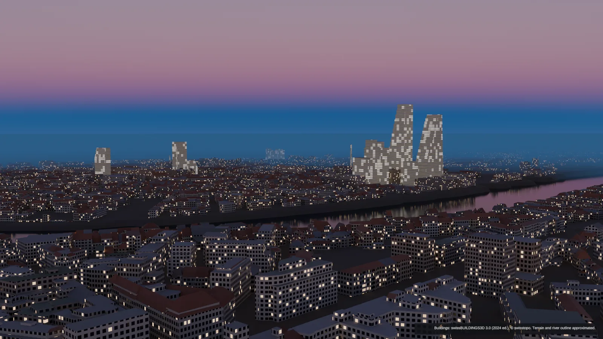
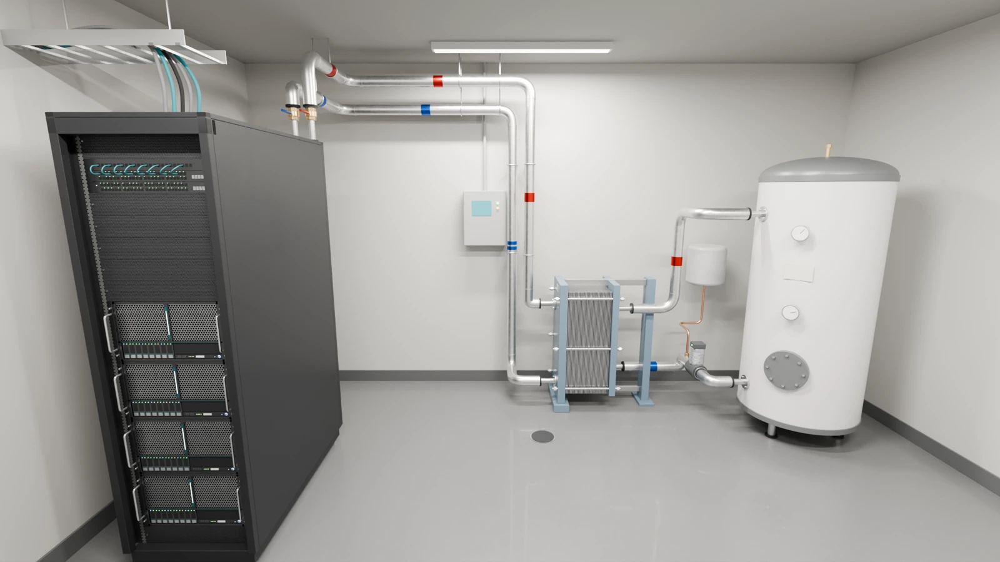

<!-- _class: title -->

# Kachel

Your AI heats your home.

Basel at dusk. Buildings © swisstopo (swissBUILDINGS3D 3.0, 2024 edition)

---

## The problem

- Basel-Stadt voted for **net zero by 2037**. [8]
- Data centres used **415 TWh** in 2024, about **1.5%** of world electricity. Their heat is cooled away. [7]
- Homes still burn oil and gas for heat.

## The idea

Servers in the basement run AI jobs **only when the house can use their heat**: space heating and hot water.

The plant room: rack, heat exchanger, tank.

[7] IEA, Energy and AI (2025). [8] SRF, 27 Nov 2022. Both listed in docs/economics/README.md.

---

## One Basel house, six 1 kW servers, one year

<b>79.6%</b>of the heat demand covered<i>kpis.json</i>

<b>31,075</b>server-hours sold<i>kpis.json</i>

<b>0.188 CHF</b>break-even per server-hour<i>kpis.json</i>

<b>9,683 CHF</b>left a year before hardware<i>summary.json</i>

<b>1,415 CHF</b>left a year after hardware, mid case<i>summary.json</i>

<b>4.2 years</b>payback, mid case<i>summary.json</i>

**Model:** the buyer pays per server-hour (we assume 0.50 CHF), the home gets the heat.
**Ask:** a Basel building for a pilot, buyers of compute that can pause, and a fitter's quote.

Basel 2025 weather (Open-Meteo). kpis.json: services/scheduler/out. summary.json: docs/economics/data. The 0.50 CHF is our assumption.

