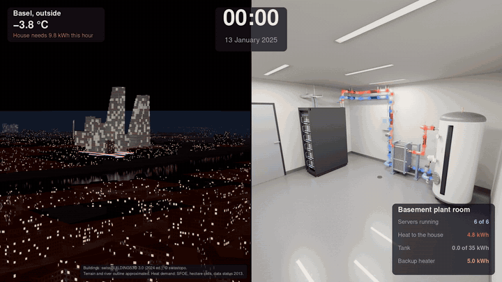
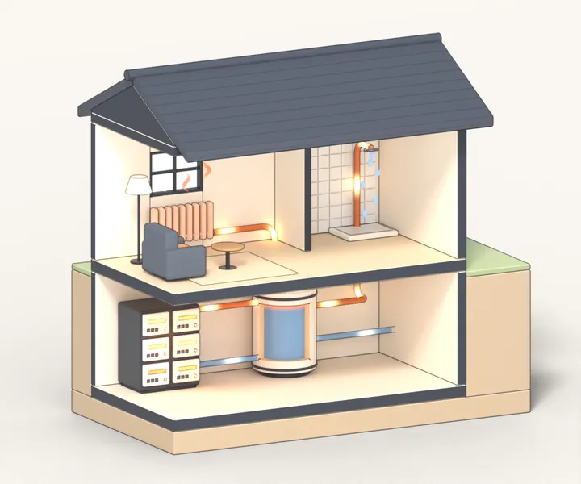

# Kachel

Your AI heats your home.

Small servers in a home's basement run AI jobs, and their heat goes into space heating and hot
water. A job runs only when its heat is useful. When the house needs no heat, a job that can
wait pauses. A job that runs out of time moves to a home that can use its heat, or to an
ordinary data centre. The buyer pays for the compute; the home gets the heat.

Kachel was built in 36 hours at the DigitalHeat hackathon at FHNW Campus Dreispitz, Basel, on
Basel's goal of net zero by 2037.

## Who it is for

- **Homeowners and building operators** who want cheaper heat from a box in the basement.
- **Buyers of compute** with work that can pause: batch jobs, embeddings, transcription.
- **Basel**, which still heats many homes with oil and gas, and wants net zero by 2037.

## What is in the repo

- A **scheduler** that decides every hour which jobs run in a house, and a **fleet** model that
  sends each job to the house where its heat is most useful.
- An **agent** that pauses and resumes a real running job on the server box.
- A **host app** for the homeowner, a **console** for the compute buyer and a **3D heat map**
  of Basel.
- The **numbers**: one Basel house over a real 2025 year, with hardware, solar and four
  buildings, every input with its source.

## Where to go next

| If you want to…                          | Read                                 |
| ---------------------------------------- | ------------------------------------ |
| See how the parts fit together           | [How it works](How-it-works)         |
| See the three apps                       | [The product](The-product)           |
| Know whether it pays, and why            | [The numbers](The-numbers)           |
| Check where a number or a map comes from | [Data and sources](Data-and-sources) |
| Run it on your laptop                    | [Run it yourself](Run-it-yourself)   |
| Contribute code                          | [Engineering](Engineering)           |
| Look up a word                           | [Glossary](Glossary)                 |
| Read the honest limits                   | [FAQ](FAQ)                           |
| Meet the team and see what comes next    | [Team](Team)                         |

The code is at [github.com/CPD9/kachel](https://github.com/CPD9/kachel), under the MIT licence.
