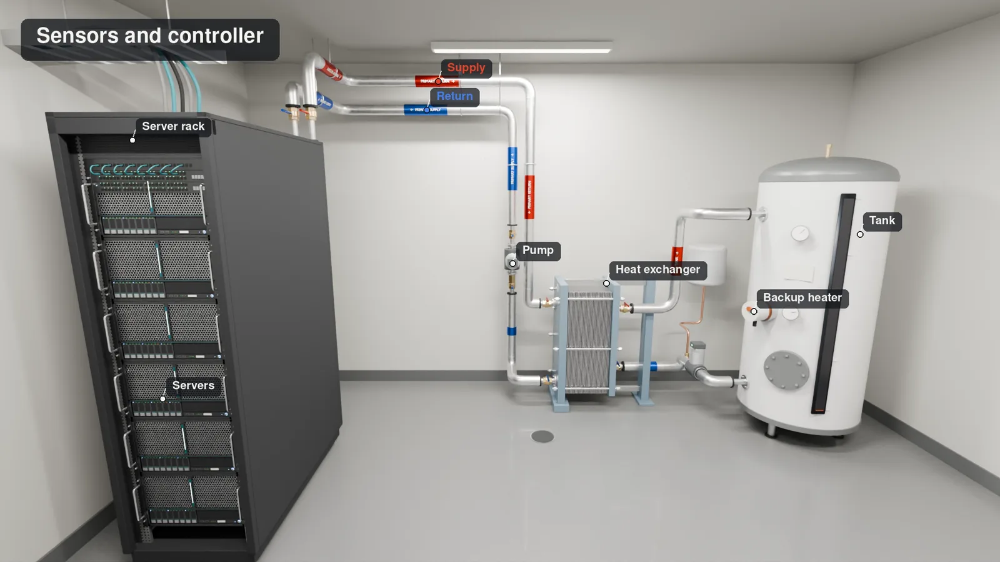
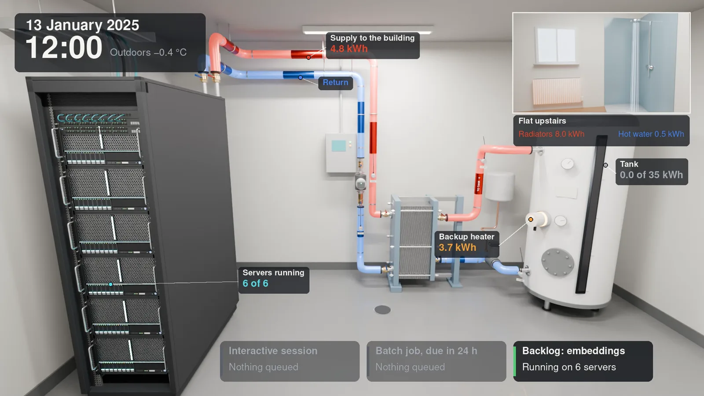
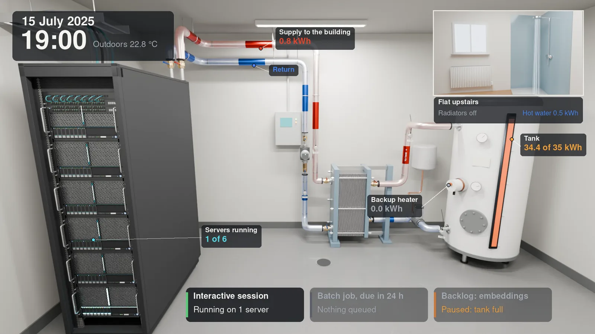
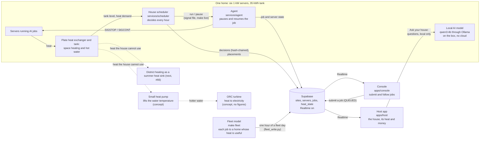

# How it works

Each home has servers and a hot-water tank in the basement. A server runs AI jobs only when the
house can use the heat. Five parts make that happen: the heat loop, the house scheduler, the
fleet, the agent and the database that feeds the apps.

## The heat loop

1. **Servers.** Six water-cooled servers of about 1 kW each sit in a rack. Running a job, each
   turns 1 kWh of electricity an hour into compute, and 80% of it comes back as heat (case
   brief, `services/scheduler/config.json: server`).
2. **Plate heat exchanger.** Supply and return pipes and a pump carry the servers' warm water to
   a plate heat exchanger, which passes the heat across to the tank.
3. **Tank.** The heat goes into a 35 kWh hot-water tank (`config.json: house`). The tank feeds
   space heating and hot water, and lets heat made now be used a few hours later.
4. **Backup heater.** When the servers and the tank cannot cover the demand, a backup heater
   tops up. The model values server heat at what a heat pump would have spent to make it.

A 20-second film of the plant room is in the
[media-v1 release](https://github.com/CPD9/kachel/releases/download/media-v1/setup.mp4).

## The scheduler's decision, every hour

One function, `decide` in
[`heatsched/scheduler.py`](https://github.com/CPD9/kachel/blob/main/services/scheduler/heatsched/scheduler.py),
plans one house for one hour. It looks at the heat the house needs, the room left in the tank and
the jobs waiting, and goes through four rules in order:

1. **Interactive sessions run now.** A live session cannot wait. If its heat has nowhere to go,
   it is dumped.
2. **Batch jobs with a deadline run as early as their heat is useful.** If a job reaches its last
   possible hour and the house still cannot use the heat, it moves to another site.
3. **The backlog fills what heat room is left.** It keeps some tank room free for interactive
   heat the forecast says is coming. With roof solar, it also waits for the sun when the tank can
   carry the house until then. It never leaves the house colder to wait.
4. **Nothing else runs.** A server whose heat is not needed is off.

The same function drives the yearly balance (`make year`) and the live demo, so the numbers and
the demo follow the same rules.

## The fleet: each job to where its heat is useful

One house alone has to pause or move work when it is warm. Many houses together can pass it
on. The fleet model,
[`heatsched/fleet.py`](https://github.com/CPD9/kachel/blob/main/services/scheduler/heatsched/fleet.py),
places every waiting job each hour:

1. Jobs go least slack first: the job that can wait least is placed first.
2. A job goes to the house with the most useful heat room left this hour. A job that ran last
   hour stays on its house while that house still has room.
3. A house takes a job only while one more server's heat still fits. Heat is never made where it
   has nowhere to go.
4. A job that can still wait, waits. A job that cannot, and that no house can take, goes to an
   ordinary data centre.

`make fleet` runs this on 50 made-up houses in Basel, 50 in Bern and the 100 together, on a cold
January day and a July day. The results are on [The numbers](The-numbers#the-fleet).

## The agent: pausing a real job

The agent,
[`services/agent`](https://github.com/CPD9/kachel/tree/main/services/agent), runs on the server
box. Every tick (1 second by default) it reads a signal file whose first line says `run` or
`pause`:

- On `pause` it stops the job's process with `SIGSTOP`. The process keeps its memory and waits.
- On `run` it sends `SIGCONT`, and the job carries on where it stopped. Nothing is lost.
- On each change it writes the job's and the server's state to Supabase.

## The live loop: the scheduler drives the agent

`make live` ([`services/scheduler/live.py`](https://github.com/CPD9/kachel/blob/main/services/scheduler/live.py))
runs the same `decide()` as the yearly balance on the house in Supabase, tick by tick. Each tick
it reads the house's servers and jobs and the heat of the hour (a replayed day on the saved Basel
weather, or `heat_state` for the clock's hour), decides, and carries it out: the agent's signal
file, with the reason and the decision's hash on the lines after `run` or `pause`; the state of
the other jobs and servers; and a server for each job queued in the console, through the fleet's
`place_hour`. No person writes the signal file any more. `make live-demo` starts a real job, its
agent and the loop in one command, and replays 13 January and 15 July at about a minute a day.

## Every decision, verifiable

Each decision is appended to `out/decisions.jsonl` and the `decisions` table. An entry holds the
inputs (time, outdoor temperature, heat demand, tank, servers, jobs), the Signal, the decision,
the jobs it ran, when it was made, and a SHA-256 hash over all of it and the previous entry's
hash. The table is append-only: not even the service role can change or delete a row.
`make verify-live` checks every link and hash and replays each entry's inputs through
`decide()`; a decision that does not follow from its inputs is reported and the command fails.
The host app and the operator view show the newest decisions and their hashes under "Why this
decision".

## The AI stays in the house

The AI that runs a house runs in the house, not in a cloud. The scheduler decides on the box,
the agent pauses and resumes jobs on the box, and "Ask your house" in the host app asks a local
model, qwen3:4b through [Ollama](https://ollama.com), on the same computer. The chat talks only
to a model on that machine (`isLocalUrl` in
[`apps/host/src/chat/model.ts`](https://github.com/CPD9/kachel/blob/main/apps/host/src/chat/model.ts));
if none is running, the chat is off and the rest of the page still works. A household's
questions, and the house data the model reads to answer them, stay in the house.

## Heat to power: a concept

When no building needs the heat, it could make electricity with an ORC (organic Rankine cycle)
turbine. Server water is too cool for that to work well, so a small heat pump would first lift
its temperature, and the turbine would then run on the hotter water. This is a concept only:
it has no figures and is in none of our numbers.

## Realtime to the apps

Supabase holds the houses (`sites`), `servers`, `jobs`, `job_runs`, `heat_state` (one row per
house and hour), `kpis` and `assumptions`. Realtime is on for `servers`, `jobs`,
`heat_state` and `decisions`, so when the agent or the loop writes a change, the host app and the console show it without a
reload, in under a second in the demo. Row level security shows each person only their own
rows.

## The whole picture

Boxes marked "next" are not built yet. The diagram follows
[docs/architecture.md](https://github.com/CPD9/kachel/blob/main/docs/architecture.md), updated
for what has been built since.

| Part                    | Where                                                   | State                                                                              |
| ----------------------- | ------------------------------------------------------- | ---------------------------------------------------------------------------------- |
| House scheduler         | `services/scheduler/heatsched/scheduler.py`             | Built. Runs the yearly balance and the live demo                                   |
| Fleet model             | `services/scheduler/heatsched/fleet.py`                 | Built as a model on synthetic houses; `fleet_write.py` puts one hour into Supabase |
| Agent                   | `services/agent`                                        | Built. Follows a run/pause signal file and writes to Supabase                      |
| Supabase and Realtime   | `supabase/migrations`, `packages/db`                    | Built. Realtime on `servers`, `jobs` and `heat_state`; row level security on all   |
| Host app, console, map  | `apps/host`, `apps/console`, `apps/map`                 | Built. See [The product](The-product)                                              |
| Scheduler writes signal | `services/scheduler/live.py`, `services/agent`          | Built (#191). `make live` writes the agent's signal from `decide()` each tick      |
| Live routing            | `services/scheduler/heatsched/live.py`                  | Built (#191). A queued console job gets a server through the fleet's `place_hour`  |
| Decision log            | `heatsched/ledger.py`, `decisions` table                | Built (#191). SHA-256 chained, append-only; `make verify-live` replays it          |
| District heating        | issue [#66](https://github.com/CPD9/kachel/issues/66)   | Next. A summer heat sink for heat the houses cannot use                            |
| Local AI model          | `apps/host/src/chat`, Ollama                            | Built. qwen3:4b on the same computer answers "Ask your house"; no cloud model      |
| ORC with a heat pump    | issue [#159](https://github.com/CPD9/kachel/issues/159) | Concept, no figures. A small heat pump lifts the temperature, then the turbine     |
