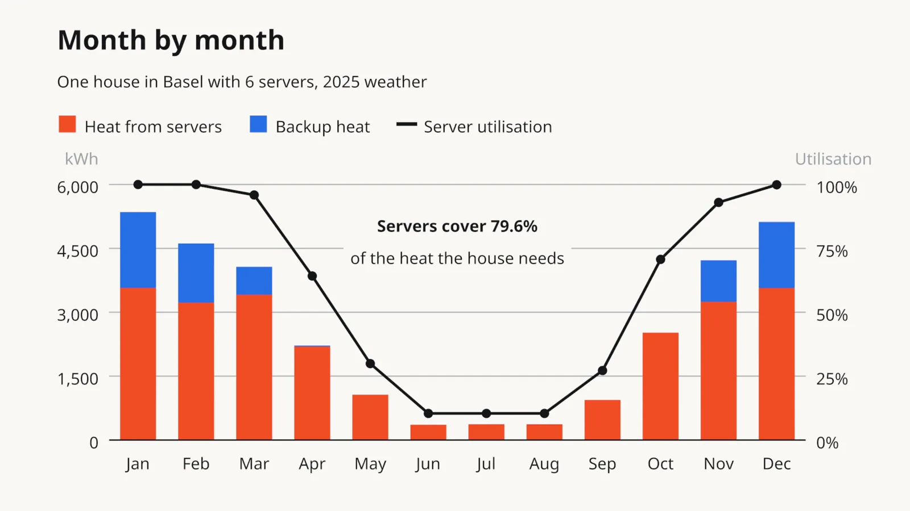
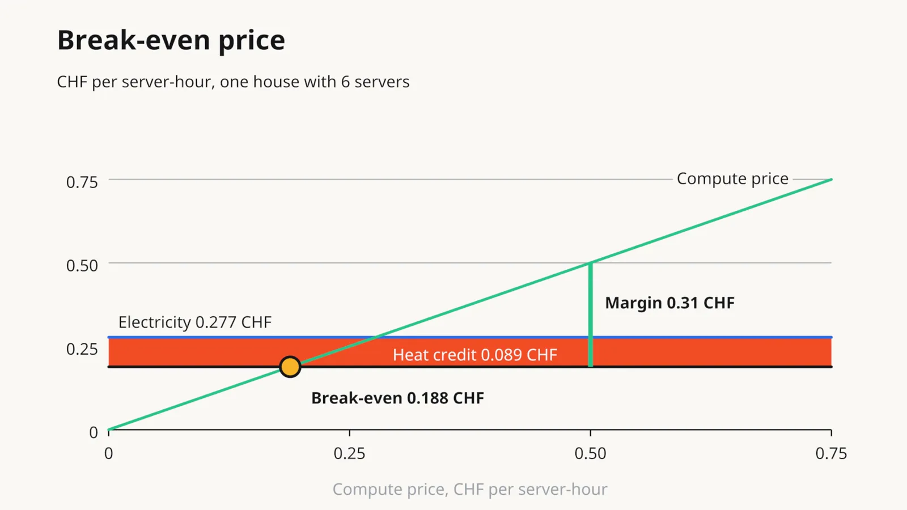
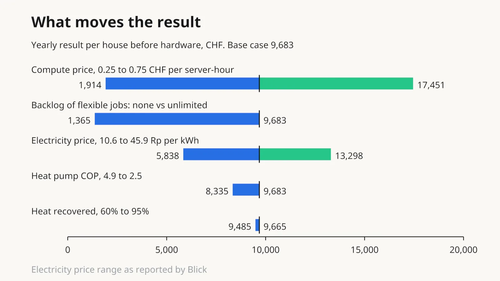

# The numbers

Does it pay, and how much heat does it really give? This page sums up the model in plain words.
Every figure is read from a file in the repo, named next to it. The full story, with all eleven
charts and every source, is on the
[economics page](https://github.com/CPD9/kachel/blob/main/docs/economics/README.md). Every input
the model uses, with its unit and source, is on the
[assumptions page](https://github.com/CPD9/kachel/blob/main/docs/assumptions.md).

These are model results on real 2025 Basel weather, not measurements from a house. Values
marked "our guess" in the assumptions have no outside source yet.

## One house, one year

The reference house from the DigitalHeat case brief: six 1 kW servers in the basement, a 35 kWh
tank, 12 kWh of hot water a day, on Open-Meteo's hourly weather for Basel in 2025. Source:
[`services/scheduler/out/kpis.json`](https://github.com/CPD9/kachel/blob/main/services/scheduler/out/kpis.json).

| What                                            | Value      |
| ----------------------------------------------- | ---------- |
| Heat the house needs (space heating, hot water) | 31,231 kWh |
| Share of it covered by server heat              | 79.6%      |
| Heat the backup heater still makes              | 6,380 kWh  |
| Server heat the house could not use (dumped)    | 9.1 kWh    |
| Share of the year the servers run (utilisation) | 59.1%      |
| Server-hours sold                               | 31,075     |
| Jobs that missed their deadline                 | 0%         |
| Days with space heating on                      | 206        |

The servers run almost all of December to February and about 10% of the hours in June, July and
August ([`docs/economics/data/monthly.csv`](https://github.com/CPD9/kachel/blob/main/docs/economics/data/monthly.csv)).
Summer is the hard part: the house only needs hot water then.

## The money, before hardware

Same file, at the assumed compute price of 0.50 CHF a server-hour (our guess) and the 2026
Swiss median electricity price of 27.7 Rp per kWh (ElCom).

| What                                                    | CHF a year |
| ------------------------------------------------------- | ---------- |
| Earned from computing                                   | 15,538     |
| Electricity for the servers                             | 8,608      |
| Heat credit: what a heat pump would have spent on power | 2,753      |
| Left before hardware                                    | 9,683      |

**Break-even is 0.188 CHF a server-hour.** A server-hour uses 1 kWh of power. If 80% of it
replaces heat a heat pump with a COP of 2.5 would have made, the house saves 0.8 ÷ 2.5 kWh of
power. Break-even is then the electricity price × (1 − 0.8 ÷ 2.5) = 0.277 × 0.68 = 0.188 CHF.
Below that, every server-hour loses money, before anyone pays for the servers.

## Hardware and payback

Three cited cases for six servers, their water loops, a fitter and an electrician. Source:
[`docs/economics/data/summary.json`](https://github.com/CPD9/kachel/blob/main/docs/economics/data/summary.json)
and [hardware.csv](https://github.com/CPD9/kachel/blob/main/docs/economics/data/hardware.csv).

| Per house                                 | Low                  | Mid                 | High          |
| ----------------------------------------- | -------------------- | ------------------- | ------------- |
| What the server is                        | Refurbished GPU host | New GPU workstation | Dear GPU host |
| Server price, each                        | 2,518 CHF            | 5,034 CHF           | 6,714 CHF     |
| Lifetime                                  | 6 years              | 6 years             | 4 years       |
| Resale at the end, share of the server    | 10%                  | 7.5%                | 15%           |
| Paid up front                             | 19,004 CHF           | 35,655 CHF          | 47,882 CHF    |
| Hardware per year (annuity and upkeep)    | 3,499 CHF            | 6,718 CHF           | 13,067 CHF    |
| Left per year after hardware              | 6,184 CHF            | 2,965 CHF           | −3,384 CHF    |
| Payback, discounted                       | 2.0 years            | 4.0 years           | 5.8 years     |
| Net present value over the lifetime       | 33,192 CHF           | 15,672 CHF          | −11,726 CHF   |
| Break-even per server-hour, with hardware | 0.301 CHF            | 0.405 CHF           | 0.609 CHF     |

In plain words: at 0.50 CHF a server-hour the mid case keeps 2,965 CHF a year over a six-year life
with the servers sold at the end, and the high case does not pay back within its four-year life.
Whether a 1 kW unit really costs this little, and whether it lasts, matters as much as the
compute price.

## What moves the result

Each input moved alone, with everything else as in `config.json` and the mid hardware case.
Result after hardware, CHF a year. Source:
[sensitivity.csv](https://github.com/CPD9/kachel/blob/main/docs/economics/data/sensitivity.csv).

| Input                                       | Low end | High end |
| ------------------------------------------- | ------- | -------- |
| Compute price, 0.25 to 0.75 CHF             | −4,804  | 10,733   |
| Backlog of flexible jobs, none or unlimited | −5,353  | 2,965    |
| Electricity price, 45.9 to 10.6 Rp          | −880    | 6,580    |
| Server price, 6,714 to 2,518 CHF            | 1,173   | 5,650    |
| Server lifetime, 4 to 6 years               | 139     | 2,965    |

Two things decide it: the price a server-hour fetches, and whether there is always flexible work
waiting. Without that backlog, utilisation falls from 59.1% to 8.3% (`summary.json:
no_backlog_case`). The unlimited backlog is the single most optimistic assumption in the model.

## Solar and a battery

A 10 kWp roof facing south at 30° (our guess), and as an option a 10 kWh battery. They power
only the servers. The scheduler learns one more rule: in summer it lets the tank carry the house
until the sun is up, then runs the backlog on sunshine. Source: `summary.json: solar` and
[solar.csv](https://github.com/CPD9/kachel/blob/main/docs/economics/data/solar.csv).

| One year, mid prices                 | No solar   | Roof PV    | Roof PV and battery |
| ------------------------------------ | ---------- | ---------- | ------------------- |
| Server power from own PV             | 0%         | 18.6%      | 21.4%               |
| Servers' electricity at 27.7 Rp      | 8,608 CHF  | 6,174 CHF  | 6,069 CHF           |
| Servers' electricity at 33.42 Rp     | 10,385 CHF | 7,619 CHF  | 7,464 CHF           |
| Paid up front, after federal payment | none       | 15,510 CHF | 21,952 CHF          |
| Payback at 27.7 Rp, mid              | none       | 8.2 years  | 11.7 years          |
| Left per year after servers and PV   | 2,965 CHF  | 4,322 CHF  | 3,750 CHF           |

The roof pays back in about 8 years and adds about 1,350 CHF a year. The battery does not pay.
Six servers use about 31,000 kWh a year, nearly three times the roof's 11,671 kWh, and mostly in
winter, so solar trims the bill but does not remove it.

## Four buildings, five tariffs

The Basel house next to three bigger buildings, each scaled to its own heat demand. The number
of servers follows one rule: add servers while the last one still runs at least 40% of the year
(our rule). Source:
[buildings.csv](https://github.com/CPD9/kachel/blob/main/docs/economics/data/buildings.csv) and
[`services/scheduler/buildings.json`](https://github.com/CPD9/kachel/blob/main/services/scheduler/buildings.json).

| Building                         | Heat a year | Servers | Heat covered | After hardware, 27.7 Rp | After hardware, its own tariff |
| -------------------------------- | ----------- | ------- | ------------ | ----------------------- | ------------------------------ |
| Reference house, Basel           | 31 MWh      | 6       | 79.6%        | 2,965 CHF               | 1,757 CHF (IWB H4, 33.42 Rp)   |
| Flat block, Bern (1970s)         | 140 MWh     | 26      | 78.2%        | 13,540 CHF              | 14,656 CHF (median, 26.5 Rp)   |
| Office building, Basel           | 144 MWh     | 27      | 76.6%        | 12,713 CHF              | 8,125 CHF (IWB C3, 32.6 Rp)    |
| FHNW Campus Dreispitz, HGK tower | 221 MWh     | 39      | 82.6%        | 27,422 CHF              | 19,826 CHF (IWB C3, 32.6 Rp)   |

Servers grow with heat demand, about one per 5.2 MWh a year. The tariff matters more than the
building: at IWB's 2027 household tariff the Basel house keeps 1,757 CHF a year after hardware
instead of 2,965. The Bern block's and the office's areas and heat per m² are our guesses; the
FHNW tower's are published.

## The fleet

`make fleet` runs made-up houses on the real 2025 weather of their city, on the coldest January
day and on 15 July, 1,000 jobs a day per city. Each day also runs with every job kept at the
house it was sent to, for comparison. Source:
[`services/scheduler/out/fleet_*kpis.json`](https://github.com/CPD9/kachel/tree/main/services/scheduler/out)
and the [scheduler README](https://github.com/CPD9/kachel/blob/main/services/scheduler/README.md#the-fleet-many-houses-one-stream-of-jobs).

| Fleet, day                 | Houses, servers | Compute heat used | House heat covered | Sent to a data centre: fleet | Kept at its house |
| -------------------------- | --------------- | ----------------- | ------------------ | ---------------------------- | ----------------- |
| Basel, 13 January          | 50, 252         | 100%              | 19.1%              | 0                            | 1                 |
| Basel, 15 July             | 50, 252         | 55.3%             | 100%               | 331                          | 489               |
| Bern, 14 January           | 50, 229         | 100%              | 15.6%              | 0                            | 0                 |
| Bern, 15 July              | 50, 229         | 55.8%             | 100%               | 338                          | 472               |
| Basel and Bern, 13 January | 100, 481        | 100%              | 17.4%              | 0                            | 5                 |
| Basel and Bern, 15 July    | 100, 481        | 56.3%             | 100%               | 636                          | 949               |

No deadline was missed in any run. In January the houses could take far more work than
arrives. In July they can only take what hot water and the tanks absorb, so routing cannot raise
the heat used much; it sends about a third fewer jobs to a data centre by putting each where
there is room.

## What is ours, and what is open

Our own assumptions, with no outside source yet, are listed at the end of the
[economics page](https://github.com/CPD9/kachel/blob/main/docs/economics/README.md#sources).
The biggest: compute sells at 0.50 CHF a server-hour, there is always a backlog of flexible work,
and a paused server draws nothing. The research topics that would replace them with evidence
are listed there too, and in plain words on
[the page for Nikolas](https://github.com/CPD9/kachel/blob/main/docs/economics/for-nikolas.md).
