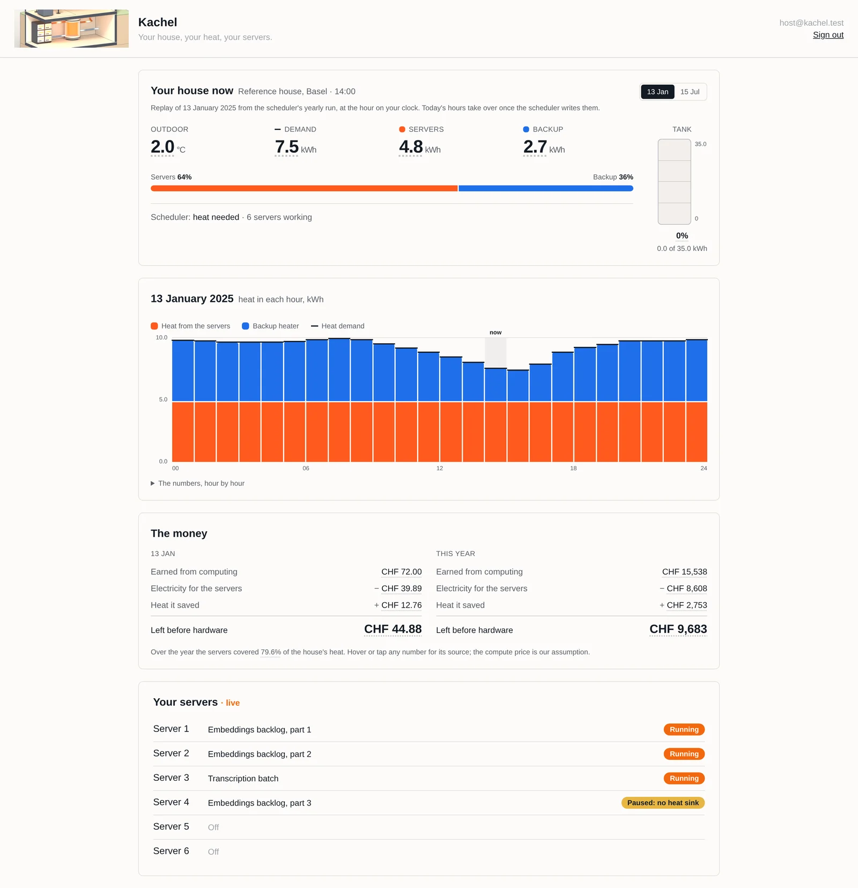
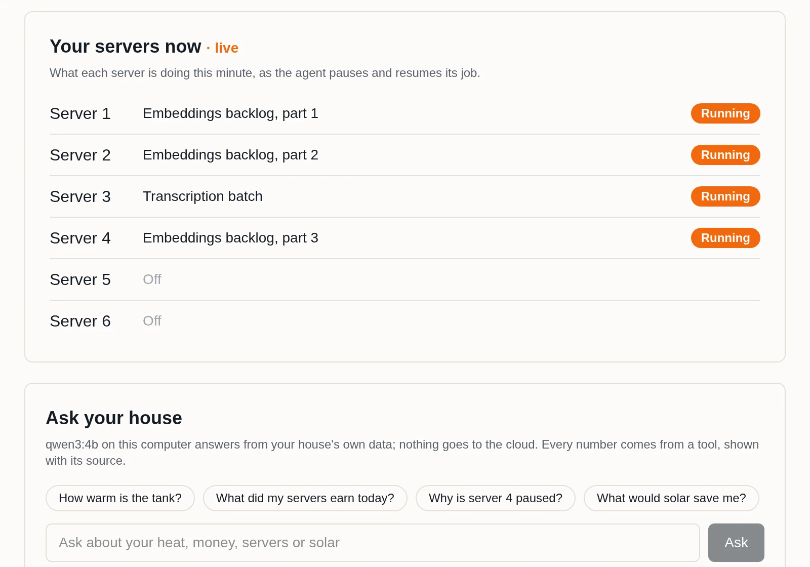
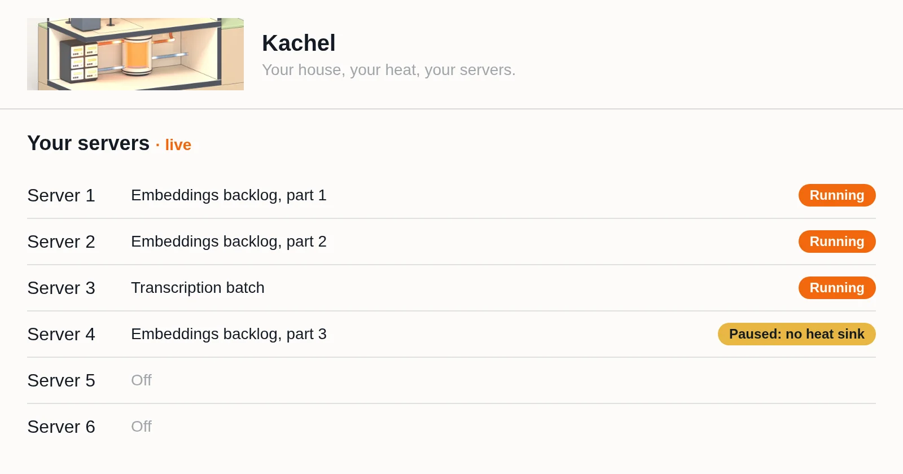
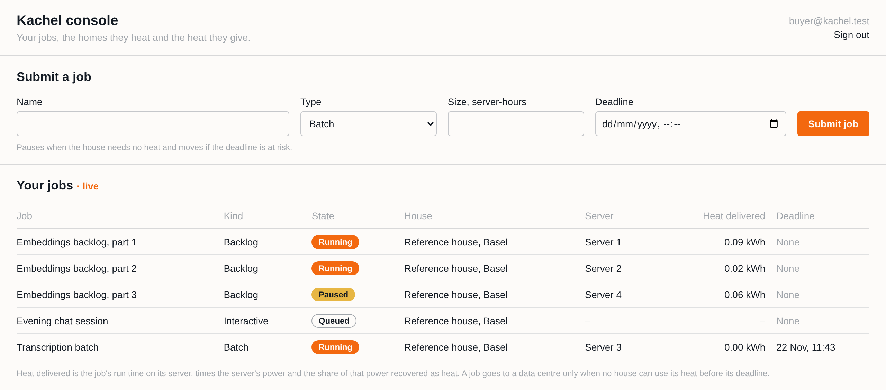
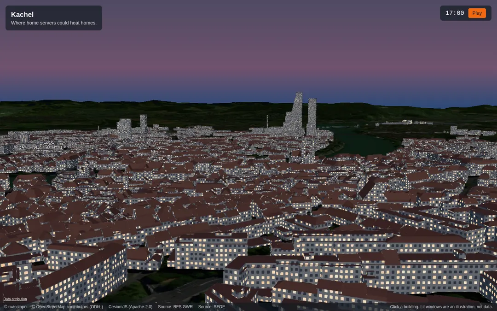
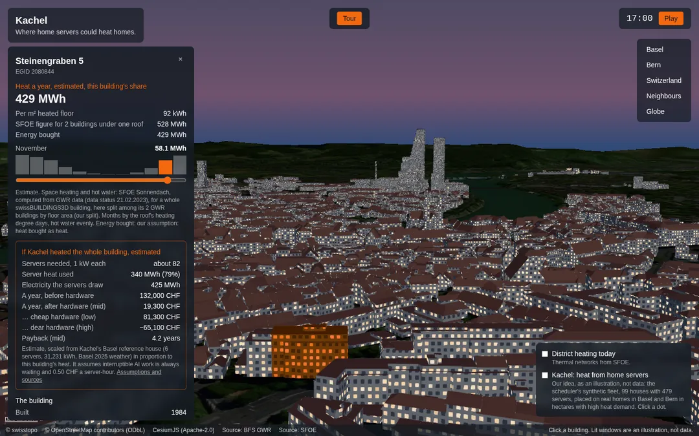

# The product

Three apps, one for each person who meets Kachel: the **host app** for the homeowner, the
**console** for the buyer of compute, and the **heat map** for anyone asking where home servers
could heat homes. All three run on your laptop today; none is deployed.

## The host app: your house, your heat, your servers

`apps/host`, on http://localhost:5173 in development.

- **Sign-in.** Row level security shows a host only their own house, so the app asks them to
  sign in first. On the local stack it offers the demo host account.
- **Your house now.** The outdoor temperature, the heat the house needs this hour, the heat from
  the servers and from the backup heater, how this hour's heat splits between them, and how
  full the tank is. A line from the scheduler says why it decided what it did, for example
  "heat needed".
- **Today.** The heat in each hour of the day as a chart: demand, server heat and backup.
- **Money.** For the day and for the year: earned from computing, electricity for the servers,
  heat it saved, and what is left before hardware.
- **Your servers now.** Each server and the job on it, with a pill that turns from Running to
  Paused as the agent pauses the job, live over Realtime.
- **Every number has its source.** Hover or tap a number to see which column and which
  assumption it comes from.

Until the scheduler writes today's hours into the database, the house replays a stored day from
the yearly run at your clock's hour, and says so with a "Replay" label. The servers list below it
is always live.

**Talking to the house.** `services/scheduler/chat.py` is a command-line chat with a small local
model (through Ollama) that can read the house's figures and rerun the year. It is not in the
host app yet: that is issue [#26](https://github.com/CPD9/kachel/issues/26).

## The console: jobs and where they ran

`apps/console`, on http://localhost:5174 in development.

- **Sign-in.** A buyer sees only their own jobs. On the local stack it offers the demo buyer.
- **Submit a job.** A name, a type, a size in server-hours and, for a batch job, a deadline. The
  form checks each field: a deadline must be in the future and late enough for six servers to
  finish the job by then. The job is written as Queued and shows at once.
  - _Interactive_ runs at once and cannot be paused; its heat is used or dumped.
  - _Batch_ pauses when the house needs no heat and moves if the deadline is at risk.
  - _Backlog_ runs only when the house needs heat, with no deadline.
- **Live jobs.** Every job with its kind, its state (Queued, Running, Paused, Done), the house
  and server it runs on, the heat it has delivered and its deadline. A job the fleet sent away
  shows "Data centre: no house could use its heat in time". On a phone the table becomes cards.

What is not built yet: nothing places a newly submitted job on a house live. It waits as Queued.
The jobs that show a house come from the seed or from one hour of a fleet run
(`fleet_write.py`).

## The heat map: Basel in 3D through the day

`apps/map`, on http://localhost:5175 in development.

- **The city.** Every building in Basel, streamed from swisstopo, lit by the real sun at the
  clock's time. The map opens 20 minutes before today's sunset in Basel and a day passes in
  about five minutes. Pause and play are top right.
- **A building card.** Click a building for its estimated heat and energy use a year, built
  year, heated floor area, storeys, dwellings and how it is heated. Each figure says where it
  comes from: the federal building register (GWR) and SFOE's estimates.
- **Honest pictures.** The lit windows are an illustration, not data, and the map says so in
  its footer. The credits are on screen at all times.
- `?at=2026-11-21T16:15:00Z` opens the map paused at that moment, for screenshots and the demo.

Next on the map: a month slider on the card ([#64](https://github.com/CPD9/kachel/issues/64)),
what Kachel servers would cover in a building
([#67](https://github.com/CPD9/kachel/issues/67)) and district heating networks
([#66](https://github.com/CPD9/kachel/issues/66)).

## The films

The pitch films are rendered in Blender, and every figure on screen is read from the
scheduler's output at render time. They are on the
[media page](https://github.com/CPD9/kachel/blob/main/docs/media/README.md) and in the
[media-v1 release](https://github.com/CPD9/kachel/releases/tag/media-v1).
